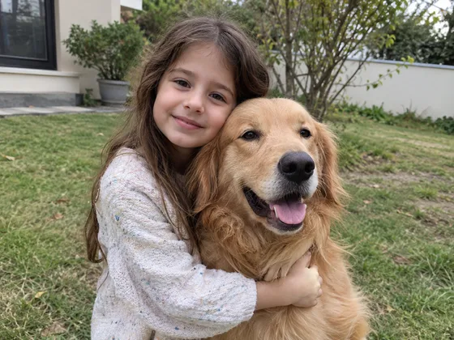
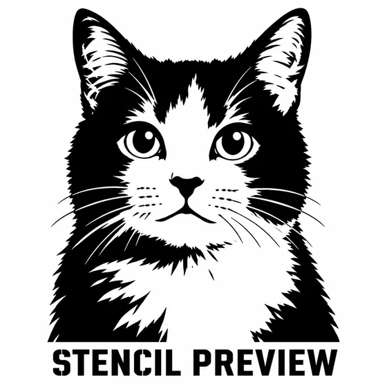

# POD और वैयक्तिकृत उत्पाद

[中文](../../../README.md) · [English](../../../README.en.md) · [Português](../../../README.pt.md) · [Español](../../../README.es.md) · [Français](../../../README.fr.md) · [Deutsch](../../../README.de.md) · [عربي](../../../README.ar.md) · [русский](../../../README.ru.md) · [日本語](../../../README.ja.md) · [हिंदी](../../../README.hi.md)

फ़ीचर्ड कैटलॉग के बाहर 6 मामले। यहां शीघ्र शब्दों का खुलासा नहीं किया गया है, केवल मौजूदा संदर्भ सामग्री, परिणाम निर्देश और न्यूनतम सामग्री आवश्यकताएं प्रदर्शित की गई हैं।

[अधिक केस कैटलॉग पर लौटें](./index.md) · [वेयरहाउस होमपेज पर लौटें](../../../README.hi.md)

> संदर्भ सामग्री और परिणाम छवियां केवल दृश्य मार्गदर्शन के लिए हैं; इस बात की कोई गारंटी नहीं है कि समान सामग्रियों का उपयोग करके समान प्रभाव को पुन: उत्पन्न किया जा सकता है।

## I264 · लोगो या चित्रण को कढ़ाई मशीन सिलाई फ़ाइल में बदलें

<table>
<thead><tr><th width="50%">संदर्भ सामग्री</th><th width="50%">परिणामों का उदाहरण</th></tr></thead>
<tbody><tr><td valign="top">
<strong>कढ़ाई के लिए पारदर्शी लोगो या चित्रण को डिजिटाइज़ किया जाएगा</strong> 
</td><td valign="top"></td></tr></tbody>
</table>

- **इनपुट प्रकार:** इसमें संदर्भ सामग्री पूर्वावलोकन और परिणाम उदाहरण शामिल हैं
- **सामग्री संबंधी आवश्यकताएँ:** कढ़ाई के लिए डिजिटलीकरण के लिए आवश्यक पारदर्शी लोगो या चित्रण (1) + आवश्यक कढ़ाई उत्पादन विशिष्टताएँ (1 प्रति)
- **विवरण:** इस बार एकल दृश्य पूर्वावलोकन तैयार किया गया है। डेटा गणना, सटीक टाइपसेटिंग, वेक्टर या उत्पादन फ़ाइलों को अभी भी संबंधित टूल द्वारा सत्यापित करने की आवश्यकता है।

[ dearsketch में विशिष्ट आवश्यकताओं की जाँच करें और ](https://dearsketch.com/hi/intent/i264-convert-a-logo-or-illustration-into-an-embroidery-stitch-file.html?utm_source=github&utm_medium=gallery&utm_campaign=dearsketch-public-cases&utm_content=i264_cta) बनाएं

---

## I268 · चित्रों या पाठ को लेजर उत्कीर्णन और वेक्टर फ़ाइलों को काटने में व्यवस्थित करें

<table>
<thead><tr><th width="50%">संदर्भ सामग्री</th><th width="50%">परिणामों का उदाहरण</th></tr></thead>
<tbody><tr><td valign="top">
<strong>उकेरा/काटा जाने वाला चित्र या लोगो</strong> 
</td><td valign="top"></td></tr></tbody>
</table>

- **इनपुट प्रकार:** इसमें संदर्भ सामग्री पूर्वावलोकन और परिणाम उदाहरण शामिल हैं
- **सामग्री संबंधी आवश्यकताएँ:** उत्कीर्ण/काटने के लिए वैकल्पिक चित्र या लोगो (0 या 1) + आवश्यक प्रसंस्करण विधियाँ, सामग्री और मशीन की बाधाएँ (1 प्रति) + पाठ और ग्लिफ़ के प्रसंस्करण की आवश्यकता वाली स्थितियाँ (1 प्रति)
- **विवरण:** इस बार एकल दृश्य पूर्वावलोकन तैयार किया गया है। डेटा गणना, सटीक टाइपसेटिंग, वेक्टर या उत्पादन फ़ाइलों को अभी भी संबंधित टूल द्वारा सत्यापित करने की आवश्यकता है।

[ dearsketch में विशिष्ट आवश्यकताओं की जाँच करें और ](https://dearsketch.com/hi/intent/i268-prepare-an-image-or-text-as-a-vector-file-for-laser-engraving-or-cutting.html?utm_source=github&utm_medium=gallery&utm_campaign=dearsketch-public-cases&utm_content=i268_cta) बनाएं

---

## I271 · फ़ोटो को डिजिटल ऑयल पेंटिंग चित्रों में परिवर्तित करें

<table>
<thead><tr><th width="50%">संदर्भ सामग्री</th><th width="50%">परिणामों का उदाहरण</th></tr></thead>
<tbody><tr><td valign="top">
<strong>परिवर्तित की जाने वाली डिजिटल ऑयल पेंटिंग के मुख्य भाग का फोटो</strong> 
</td><td valign="top"></td></tr></tbody>
</table>

- **इनपुट प्रकार:** इसमें संदर्भ सामग्री पूर्वावलोकन और परिणाम उदाहरण शामिल हैं
- **सामग्री संबंधी आवश्यकताएं:** स्थानांतरित की जाने वाली डिजिटल ऑयल पेंटिंग की आवश्यक मुख्य बॉडी फोटो (1 फोटो) + तैयार उत्पाद की आवश्यक रेंज और पेंट रंगों की संख्या (1 सेट)
- **विवरण:** इस बार एकल दृश्य पूर्वावलोकन तैयार किया गया है। डेटा गणना, सटीक टाइपसेटिंग, वेक्टर या उत्पादन फ़ाइलों को अभी भी संबंधित टूल द्वारा सत्यापित करने की आवश्यकता है।

[ dearsketch में विशिष्ट आवश्यकताओं की जाँच करें और ](https://dearsketch.com/hi/intent/i271-turn-a-photo-into-a-paint-by-numbers-pattern.html?utm_source=github&utm_medium=gallery&utm_campaign=dearsketch-public-cases&utm_content=i271_cta) बनाएं

---

## I273 · फ़ोटो को ऐसे टेम्प्लेट में परिवर्तित करें जिन्हें काटा या स्प्रे-पेंट किया जा सकता है

<table>
<thead><tr><th width="50%">संदर्भ सामग्री</th><th width="50%">परिणामों का उदाहरण</th></tr></thead>
<tbody><tr><td valign="top">
<strong>परिवर्तित किए जाने वाले टेम्पलेट का उच्च-कंट्रास्ट फ़ोटो या लोगो</strong> 
</td><td valign="top"></td></tr></tbody>
</table>

- **इनपुट प्रकार:** इसमें संदर्भ सामग्री पूर्वावलोकन और परिणाम उदाहरण शामिल हैं
- **सामग्री संबंधी आवश्यकताएँ:** स्थानांतरित किए जाने वाले टेम्पलेट का आवश्यक उच्च-कंट्रास्ट फोटो या लोगो (1 फोटो) + आवश्यक टेम्पलेट उद्देश्य, सामग्री और न्यूनतम कनेक्शन (1 प्रति)
- **विवरण:** इस बार एकल दृश्य पूर्वावलोकन तैयार किया गया है। डेटा गणना, सटीक टाइपसेटिंग, वेक्टर या उत्पादन फ़ाइलों को अभी भी संबंधित टूल द्वारा सत्यापित करने की आवश्यकता है।

[ dearsketch में विशिष्ट आवश्यकताओं की जाँच करें और ](https://dearsketch.com/hi/intent/i273-turn-a-photo-into-a-cuttable-or-paintable-stencil.html?utm_source=github&utm_medium=gallery&utm_campaign=dearsketch-public-cases&utm_content=i273_cta) बनाएं

---

## I284 · लोगों की तस्वीरों और बोल्ड टेक्स्ट के साथ एक समर्थन प्रशंसक या नाम बोर्ड बनाएं

<table>
<thead><tr><th width="50%">संदर्भ सामग्री</th><th width="50%">परिणामों का उदाहरण</th></tr></thead>
<tbody><tr><td valign="top">
<strong>उपयोग की अनुमति वाले लोगों की तस्वीरें</strong> 
</td><td valign="top"></td></tr></tbody>
</table>

- **इनपुट प्रकार:** इसमें संदर्भ सामग्री पूर्वावलोकन और परिणाम उदाहरण शामिल हैं
- **सामग्री संबंधी आवश्यकताएँ:** लोगों की तस्वीरें (1 फोटो) + आवश्यक नाम या जयकार वाक्यांश (1 सेट) + आवश्यक तैयार उत्पाद प्रकार और प्रतिनिधि रंग (1 सेट) का उपयोग करने का अधिकार होना चाहिए।
- **विवरण:** एक समय में केवल एक ही चित्र उत्पन्न होता है।

[ dearsketch में विशिष्ट आवश्यकताओं की जाँच करें और ](https://dearsketch.com/hi/intent/i284-create-a-fan-support-uchiwa-or-name-board-from-a-portrait.html?utm_source=github&utm_medium=gallery&utm_campaign=dearsketch-public-cases&utm_content=i284_cta) बनाएं

---

## I287 · चार-फ्रेम फोटो स्ट्रिप्स और थीम बॉर्डर में एकाधिक सेल्फी बनाएं

<table>
<thead><tr><th width="50%">संदर्भ सामग्री</th><th width="50%">परिणामों का उदाहरण</th></tr></thead>
<tbody><tr><td valign="top">
<strong>ऐतिहासिक संदर्भ/पूर्व-परिवर्तन इनपुट</strong> 

<strong>ऐतिहासिक संदर्भ/पूर्व-परिवर्तन इनपुट</strong> 

<strong>ऐतिहासिक संदर्भ/पूर्व-परिवर्तन इनपुट</strong> 

<strong>ऐतिहासिक संदर्भ/पूर्व-परिवर्तन इनपुट</strong> 
</td><td valign="top"></td></tr></tbody>
</table>

- **इनपुट प्रकार:** इसमें संदर्भ सामग्री पूर्वावलोकन और परिणाम उदाहरण शामिल हैं
- **सामग्री संबंधी आवश्यकताएँ:** आवश्यक निरंतर शूटिंग/सेल्फी फोटो (2 से 4 फोटो) + फोटो स्ट्रिप्स का आवश्यक ऊपरी और निचला फ्रेम क्रम (1 प्रति) + वैकल्पिक तिथि, लघु वाक्य, लोगो और थीम रंग (0 या 1 समूह)
- **विवरण:** एक समय में केवल एक ही चित्र उत्पन्न होता है।

[ dearsketch में विशिष्ट आवश्यकताओं की जाँच करें और ](https://dearsketch.com/hi/intent/i287-turn-selfies-into-a-four-cut-photo-strip-with-a-themed-frame.html?utm_source=github&utm_medium=gallery&utm_campaign=dearsketch-public-cases&utm_content=i287_cta) बनाएं
