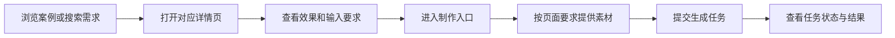
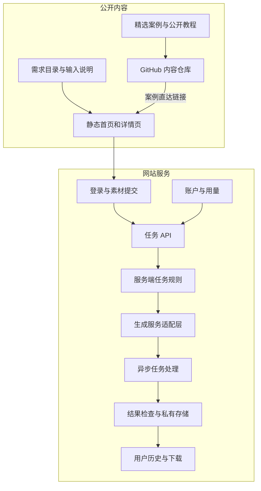

# dearsketch 製品アーキテクチャ

[中文](../../README.md) · [English](../../README.en.md) · [Português](../../README.pt.md) · [Español](../../README.es.md) · [Français](../../README.fr.md) · [Deutsch](../../README.de.md) · [عربي](../../README.ar.md) · [русский](../../README.ru.md) · [日本語](../../README.ja.md) · [हिंदी](../../README.hi.md)


dearsketch は、「どのような写真を完成させたいか」を要件の閲覧可能なディレクトリに整理します。各要件には、目的、必要な材料、結果の要件を説明する独立したページがあります。ユーザーは対応するページから生産プロセスに入ります。

この説明では、モジュールの役割とデータ フローについて説明します。パブリック コンテンツ ライブラリ、Web サイト サービス、および生成されたモデルは、それぞれ異なるタスクを実行します。この倉庫では、公開ケース、新しく編集された 50 個のテンプレート、Agent Skill が提供され、Web サイト上でオンライン制作が行われます。

## ユーザーパス



課題によっては、写真、指定されたデザイン原稿、正確なコピーライティング、または複数のキャラクター アセットが必要になる場合があります。シリーズ図面と複数の計画は、単一のベースで個別に作成されます。正確なテキスト、ベクター、または制作ファイルが必要な場合は、ビジュアル プレビュー後に対応するツールが必要です。

## コンテンツと世代の階層化



静的コンテンツ ページは、検出、解釈、検索の包含を担当します。タスク API は、ユーザー入力の検証とタスクの作成を担当します。サーバー側のルールと世代適応層は、選択された要件の実行を担当します。履歴およびストレージ層は、対応するユーザーに結果を返す責任があります。

図内のモジュールは、現在のソース コードにおける責任の分担を反映しており、すべてのオンライン機能、支払いステータス、サービス レベルを保証するものではありません。それらを使用する場合は、Web サイトで提供される実際の入り口と指示が優先されます。

## モジュールの責任

| モジュール | 問題は解決しました |
| --- | --- |
| 要件カタログ | 目的、入力、出力、シナリオに基づいて画像タスクを整理する |
| ページ構成 | ニーズに合わせて安定したアドレス、ページ コンテンツ、検索メタデータを生成します |
| 契約書を入力する | どのマテリアルが必須で、どれがオプションであり、マテリアル間の関係は何であるかを説明します。 |
| アカウントとタスク API | ID、入力の整合性を確認し、複製をリクエストします |
| サーバータスクのルール | ニーズと現在のインプットに基づいて実行内容を整理する |
| アダプテーション層の生成 | 外部ビルドサービスに接続し、非同期タスクを処理します。 |
| 実績と経緯 | 結果を確認し、リソースを保存し、適切なユーザーにアクセスを提供します |
| アカウントと使用方法 | 利用資格、ポイント、注文関連ステータスの管理 |

## 実施方法

| 層 | 現在のソースコードのメソッド |
| --- | --- |
| コンテンツ構築 | Node.js スクリプトは HTML、詳細ページを生成し、構造化された要件からメタデータを検索します |
| ブラウザのインタラクション | JavaScript はフィルタリング、マテリアルの入力、およびタスクのステータスを処理します。一部のインタラクションは React を使用し、Vite によってパッケージ化されています |
| サーバ | Node.js モジュールは認証、アップロード、ビルドタスク、履歴、使用法を処理します。 |
| データ | リレーショナル データベースには、アカウント、リソースの所有権、タスクのステータスが記録されます。 |
| 書類 | ビジネスデータから分離されたプライベートオブジェクトストレージは、制御されたアドレスを通じてアクセスされます。 |
| 生成する | サーバーは外部で生成されたサービスに適応し、非同期タスクと結果を処理します。 |

これらの技術的な選択により、運用アカウント番号、プロジェクト ID、バケット名、環境変数値を公開することなく、システムがどのように作業を分割するかを説明できます。

## 公開データの例

```json
{
  "id": "I026",
  "title": "宠物定制肖像",
  "input": "1张宠物照片",
  "output": "宠物肖像图片",
  "roles": [
    { "kind": "image", "label": "宠物照片", "requirement": "required", "quantity": "1张" }
  ]
}
```

これらのフィールドはユーザー タスクを説明するものであり、サーバー側の完全な生成手順は含まれていません。選択したケース データについては [cases.json](../../data/cases.json) を参照、その他の結果例については [gallery.json](../../data/gallery.json) を参照、新しいパブリック テンプレートについては [public-prompts.json](../../data/public-prompts.json) を参照してください。パブリック スキルは、入力リストとプロンプト ワードの準備のみを担当し、内部生成ルールにはアクセスできません。

## アクセスとコンテンツの境界

公開されている症例写真とユーザーがアップロードしたリソースの 2 種類のコンテンツがあります。ケースは視覚的な方向を説明するために使用されます。元のユーザー画像、タスク結果、およびアカウントレコードは、公開ケースライブラリに属しません。生成サービスはマテリアルのタイプ、サイズ、所有権を検証する必要があり、ユーザー入力によってサーバーの実行制約をオーバーライドすることはできません。

モジュール図、責任、抽象データ構造、入力仕様、および一般的な信頼性原則を公開できます。サーバー側実装の一部または一連のデータベース構造を公開することは、独立して決定できるオープンソースの領域です。サーバー側にあるからといって自動的に秘密になるわけではありません。

このウェアハウスの範囲は、ケース、基本的なチュートリアル、製品アーキテクチャの説明であり、実稼働サービスのソース コード、内部の完全なスキル、展開リソースは含まれません。認証情報、セッション、実際のユーザー レコード、およびプライベート リソース アドレスは公開コンテンツではありません。

## GitHub を Web サイトに接続する方法

各注目の画像と「同じものを作る」リンクは、対応するデマンド ページにつながります。リンクはソース パラメータを使用して、README、ケースの詳細、チュートリアルのエントリを区別します。これらのパラメータはソースを表すだけであり、統計システムが導入されていることを単独で証明することはできません。

この Web サイトには、訪問者向けの単語入力ボックスはありません。ユーザーが選択したツールを試すことができるように、基本的なチュートリアルが公開されています。ウェブサイトは、選択されたニーズに基づいて、対応するマテリアルの入り口を提供します。
