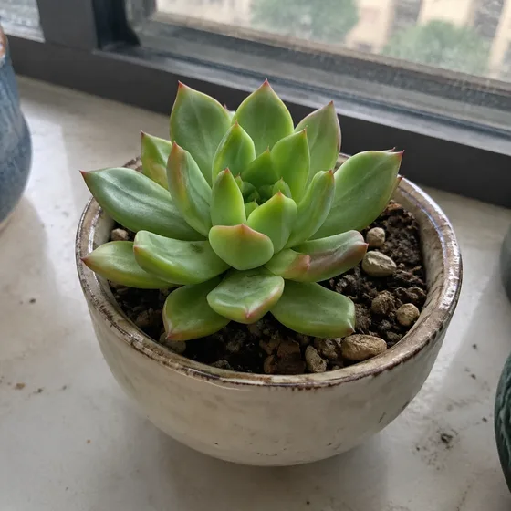
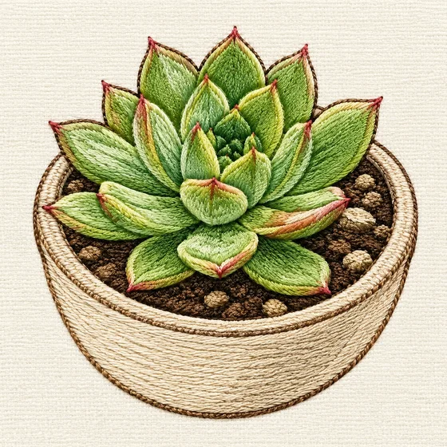

# 刺繍モチーフコンセプト・刺繍スタイルパターンコンセプト

[中文](../../../README.md) · [English](../../../README.en.md) · [Português](../../../README.pt.md) · [Español](../../../README.es.md) · [Français](../../../README.fr.md) · [Deutsch](../../../README.de.md) · [عربي](../../../README.ar.md) · [русский](../../../README.ru.md) · [日本語](../../../README.ja.md) · [हिंदी](../../../README.hi.md)


テキストのみから、指定された概要の刺繍デザインコンセプトを 1 つ作成します。

文字や画像を刺繍模様の方向に変換します。衣類、バッジ、手工芸品に使用されます。

[プロンプトをコピー](#public-prompt) · [ は dearsketch によって作成されています / オンラインで試してください](https://dearsketch.com/ja/intent/i160-turn-text-or-an-image-into-an-embroidery-design-direction.html?utm_source=github&utm_medium=case&utm_campaign=dearsketch-public-cases&utm_content=i160_cta) · [トピックに戻る / コレクション](../guides/text-only.md)

## 参考資料と結果の方向性

<table>
<thead><tr><th width="50%">参考資料</th><th width="50%">結果の例</th></tr></thead>
<tbody><tr><td valign="top"><p><strong>写真またはオリジナルのロゴ</strong><br></p></td><td valign="top"><a href="https://dearsketch.com/ja/intent/i160-turn-text-or-an-image-into-an-embroidery-design-direction.html?utm_source=github&amp;utm_medium=case&amp;utm_campaign=dearsketch-public-cases&amp;utm_content=i160_image"></a></td></tr></tbody>
</table>

参考資料と結果は、視覚的な方向性を説明するために使用されます。公開テンプレートは、添付画像のオリジナルの生成指示ではなく、同じ結果が再現されることは保証されません。

## 準備するもの・入力内容

| 素材 / Material | 種類・タイプ | 数量・個数 | 条件 / Requirement |
| --- | --- | --- | --- |
| テキスト作成概要: プロンプトワードにテーマ、目的、事実パラメータを入力します。 | 文字 / Text | 1食分 | 必須 / 必須 |

**純粋なテキストの生成 / テキストのみ: 画像、ロゴ、スケッチ、その他の添付ファイルは必要ありません。** 新しいコンセプトを作成するには、以下のテキスト概要のみを使用してください。

一度に生成される画像は 1 つだけなので、画像をアップロードする必要はありません。 Web サイトのテキストのみのテーマ ブランチを選択します。

## 保持および変更 / 編集概要

- **保持 / 保持：** 提供された書面による事実、正確な表現および制約を尊重します。
- **変更/修正：** [THREAD COLORS]、幅広の閉じた形状、および [FINISHED SIZE AND PLACEMENT] に適した [LINE WEIGHT] を使用します。グラデーション、小さな島、過度に重なり合うディテールは避けてください。

## Public prompt

**新しくコンパイルされたパブリック テンプレート · 新しく作成されました · 生成テストされていません。** 角括弧パラメータを置き換えるだけで、参照画像をアップロードする必要はありません。このテンプレートは、このページの例の生成には使用されませんでした。

```text
Create one embroidery-design concept of [TEXT-DESCRIBED MOTIF] from the following written brief only. No reference image or other attachment is needed.
Use [THREAD COLORS], broad closed shapes and [LINE WEIGHT] suited to [FINISHED SIZE AND PLACEMENT]. Avoid gradients, tiny islands and excessive overlapping detail.
This is a visual motif, not digitized stitch instructions; stitch count, density and machine files need separate work.
Use an original design. Do not imply fidelity to any existing person, product, property or artwork that has not been supplied.
Return one finished image only. Replace every bracketed field with your own details before generating.
```

[独自の資料を使用してオンラインで作成する / オンラインで作成する](https://dearsketch.com/ja/intent/i160-turn-text-or-an-image-into-an-embroidery-design-direction.html?utm_source=github&utm_medium=case&utm_campaign=dearsketch-public-cases&utm_content=i160_after-prompt) · [エージェントに整理を手伝ってもらう / スキルを使用する](../quickstart.md#agent-skill)

## 要点確認・復習

これは視覚的なモチーフであり、デジタル化されたステッチ指示ではありません。ステッチ数、密度、マシンファイルは別個の作業が必要です。

これは視覚的なモチーフであり、デジタル化されたステッチ指示ではありません。ステッチ数、密度、マシンファイルは別個の作業が必要です。

結果は以下の方向に進みます: 刺繍デザイン。正確なテキスト、透明ファイル、ベクター、または印刷配信が必要な場合は、実際のファイルを確認してください。利用可能な機能と料金はウェブサイトの説明に準じます。

## 関連事例・関連タスク

- [YouTube またはストリーミング用のプロフィール写真を作成する · テキスト生成されたチャンネル アバター ](./i054-create-a-profile-picture-for-youtube-or-streaming.md#public-prompt)
- [テキストからカスタム絵文字を作成 · カスタム絵文字](./i057-create-a-custom-emoji-from-text.md#public-prompt)
- [衣料品用のシームレスなプリントと生地のパターンを作成する · ](./i100-create-seamless-prints-and-fabric-patterns-for-clothing.md#public-prompt)

## 要件の背景リファレンス

- [カットアウト.pro](https://www.cutout.pro/)
- [ライトXすべてのツール](https://www.lightxeditor.com/all-tools/all-tools/)

これらのリンクは、目的の理解を助けることのみを目的としており、このページ上の画像の出典や許可を証明するものではありません。

写真や素材の使用範囲については、[コンテンツ説明](../content-policy.md)をご覧ください。 [100 個のテンプレートをすべて表示 ](../prompts.md)。
