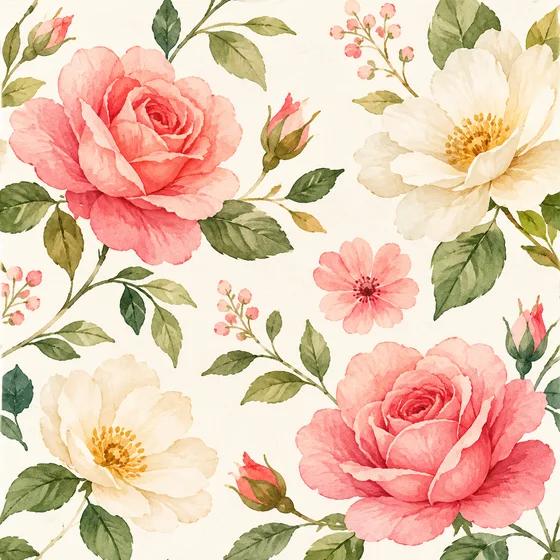

# アクセサリープリントグラフィック・ハンドバッグまたは携帯電話ケースのパターン

[中文](../../../README.md) · [English](../../../README.en.md) · [Português](../../../README.pt.md) · [Español](../../../README.es.md) · [Français](../../../README.fr.md) · [Deutsch](../../../README.de.md) · [عربي](../../../README.ar.md) · [русский](../../../README.ru.md) · [日本語](../../../README.ja.md) · [हिंदी](../../../README.hi.md)


指定した概要に合わせて、テキストだけからオリジナルの印刷グラフィックを 1 つ作成します。

ハンドバッグや電話ケースのパーソナライズされたパターンを生成します。 POD、カスタマイズされたギフトに使用されます。

[プロンプトをコピー](#public-prompt) · [ は dearsketch によって作成されています / オンラインで試してください](https://dearsketch.com/ja/intent/i163-create-personalized-artwork-for-a-tote-bag-or-phone-case.html?utm_source=github&utm_medium=case&utm_campaign=dearsketch-public-cases&utm_content=i163_cta) · [トピックに戻る / コレクション](../guides/text-only.md)

## 参考資料と結果の方向性

<p><strong>結果の例</strong></p>
<p><a href="https://dearsketch.com/ja/intent/i163-create-personalized-artwork-for-a-tote-bag-or-phone-case.html?utm_source=github&amp;utm_medium=case&amp;utm_campaign=dearsketch-public-cases&amp;utm_content=i163_image"></a></p>
<p>この例はテキスト入力であり、画像参照は添付されていません。</p>

参考資料と結果は、視覚的な方向性を説明するために使用されます。公開テンプレートは、添付画像のオリジナルの生成指示ではなく、同じ結果が再現されることは保証されません。

## 準備するもの・入力内容

| 素材 / Material | 種類・タイプ | 数量・個数 | 条件 / Requirement |
| --- | --- | --- | --- |
| テキスト作成概要: プロンプトワードにテーマ、目的、事実パラメータを入力します。 | 文字 / Text | 1食分 | 必須 / 必須 |

**純粋なテキストの生成 / テキストのみ: 画像、ロゴ、スケッチ、その他の添付ファイルは必要ありません。** 新しいコンセプトを作成するには、以下のテキスト概要のみを使用してください。

一度に生成される画像は 1 つだけなので、画像をアップロードする必要はありません。

## 保持および変更 / 編集概要

- **保持 / 保持：** 提供された書面による事実、正確な表現および制約を尊重します。
- **変更/修正：** [MOTIFS]、[PALETTE]、[COMPOSITION] を使用します。付属の [PRINT AREA AND EXCLUSION ZONES] を尊重し、縫い目、ハンドル、カメラの切り欠きなどの重要なディテールを残してください。

## Public prompt

**新しくコンパイルされたパブリック テンプレート · 新しく作成されました · 生成テストされていません。** 角括弧パラメータを置き換えるだけで、参照画像をアップロードする必要はありません。このテンプレートは、このページの例の生成には使用されませんでした。

```text
Create one original print graphic for [TOTE BAG OR PHONE CASE] from the following written brief only. No reference image or other attachment is needed.
Use [MOTIFS], [PALETTE] and [COMPOSITION]. Respect the supplied [PRINT AREA AND EXCLUSION ZONES], leaving critical details clear of seams, handles or camera cutouts.
Deliver artwork, not a product mockup; exact fit requires the manufacturer’s template and a print proof.
Use an original design. Do not imply fidelity to any existing person, product, property or artwork that has not been supplied.
Return one finished image only. Replace every bracketed field with your own details before generating.
```

[独自の資料を使用してオンラインで作成する / オンラインで作成する](https://dearsketch.com/ja/intent/i163-create-personalized-artwork-for-a-tote-bag-or-phone-case.html?utm_source=github&utm_medium=case&utm_campaign=dearsketch-public-cases&utm_content=i163_after-prompt) · [エージェントに整理を手伝ってもらう / スキルを使用する](../quickstart.md#agent-skill)

## 要点確認・復習

製品のモックアップではなく、アートワークを提供します。正確にフィットするには、メーカーのテンプレートと印刷プルーフが必要です。

製品のモックアップではなく、アートワークを提供します。正確にフィットするには、メーカーのテンプレートと印刷プルーフが必要です。

結果の方向性: 製品パターン。正確なテキスト、透明ファイル、ベクター、または印刷配信が必要な場合は、実際のファイルを確認してください。利用可能な機能と料金はウェブサイトの説明に準じます。

## 関連事例・関連タスク

- [YouTube またはストリーミング用のプロフィール写真を作成する · テキスト生成されたチャンネル アバター ](./i054-create-a-profile-picture-for-youtube-or-streaming.md#public-prompt)
- [テキストからカスタム絵文字を作成 · カスタム絵文字](./i057-create-a-custom-emoji-from-text.md#public-prompt)
- [衣料品用のシームレスなプリントと生地のパターンを作成する · ](./i100-create-seamless-prints-and-fabric-patterns-for-clothing.md#public-prompt)

## 要件の背景リファレンス

- [Etsy AI ペットのポートレート](https://www.etsy.com/market/ai_pet_portrait)
- [Etsy AI モックアップ](https://www.etsy.com/market/ai_generated_mockups)

これらのリンクは、目的の理解を助けることのみを目的としており、このページ上の画像の出典や許可を証明するものではありません。

写真や素材の使用範囲については、[コンテンツ説明](../content-policy.md)をご覧ください。 [100 個のテンプレートをすべて表示 ](../prompts.md)。
