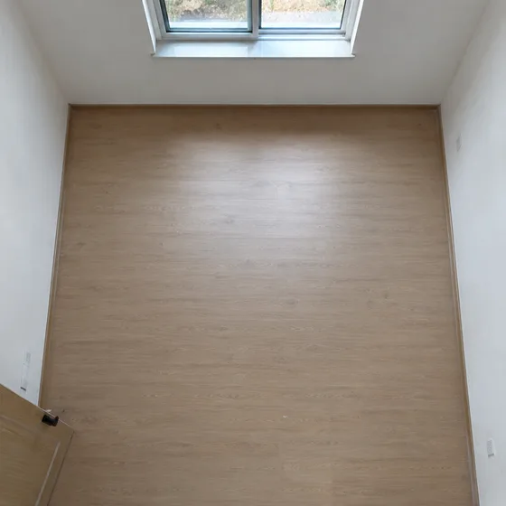
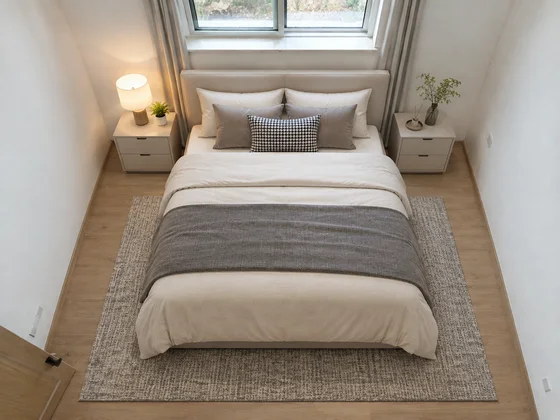

# 空の部屋の仮想ステージング · 空の部屋の仮想ステージング

[中文](../../../README.md) · [English](../../../README.en.md) · [Português](../../../README.pt.md) · [Español](../../../README.es.md) · [Français](../../../README.fr.md) · [Deutsch](../../../README.de.md) · [عربي](../../../README.ar.md) · [русский](../../../README.ru.md) · [日本語](../../../README.ja.md) · [हिंदी](../../../README.hi.md)


空き物件の写真に、本物らしい家具や装飾品を追加します。

空いた物件に家具や室内装飾品を追加します。物件の掲載、販売に使用します。

[プロンプトをコピー](#public-prompt) · [ は dearsketch によって作成されています / オンラインで試してください](https://dearsketch.com/ja/intent/i175-virtually-stage-an-empty-property-with-furniture-and-decor.html?utm_source=github&utm_medium=case&utm_campaign=dearsketch-public-cases&utm_content=i175_cta) · [トピックに戻る / コレクション](../guides/spaces.md)

## 参考資料と結果の方向性

<table>
<thead><tr><th width="50%">参考資料</th><th width="50%">結果の例</th></tr></thead>
<tbody><tr><td valign="top"><p><strong>在庫状況の写真</strong><br></p></td><td valign="top"><a href="https://dearsketch.com/ja/intent/i175-virtually-stage-an-empty-property-with-furniture-and-decor.html?utm_source=github&amp;utm_medium=case&amp;utm_campaign=dearsketch-public-cases&amp;utm_content=i175_image"></a></td></tr></tbody>
</table>

参考資料と結果は、視覚的な方向性を説明するために使用されます。公開テンプレートは、添付画像のオリジナルの生成指示ではなく、同じ結果が再現されることは保証されません。

## 準備するもの・入力内容

| 素材 / Material | 種類・タイプ | 数量・個数 | 条件 / Requirement |
| --- | --- | --- | --- |
| 在庫状況の写真 | 写真/画像 | 1枚。複数のキャラクターまたはパースペクティブを 1 つのマーク付きリファレンス ボードに組み合わせることができます | 必須 / 必須 |

一度に生成される画像は 1 つだけです。

## 保持および変更 / 編集概要

- **保存/保存：** 実際の建築、部屋の状態、窓、ドア、カメラの視界を保存します。
- **変更/修正：** 可動家具、装飾品、ソフトグッズ、照明演出のみ変更します。

## Public prompt

**新しく編集されたパブリック テンプレート · 新しく作成された · 生成テストされていません。** 画像編集をサポートするツールで角括弧パラメータを置き換え、必要な素材を添付します。オプションおよび条件付き入力は、上の表に従って準備されます。このテンプレートは、このページの例の生成には使用されませんでした。

```text
Create one virtually staged property image from [EMPTY ROOM PHOTO].
Preserve the real walls, floor, ceiling, windows, doors, built-ins, fixtures, room proportions, and camera viewpoint.
Furnish the room for [ROOM FUNCTION] in [INTERIOR STYLE].
Add [FURNITURE LIST], restrained decor, and [PALETTE] at believable scale.
Keep perspective, floor contact, shadows, reflections, and circulation realistic.
Do not alter the room layout, hide damage, change views, or add permanent architectural features.
Do not imply that furniture, decor, or upgrades are physically present or included with the property.
Leave the result plausible rather than overfilled or luxury-inflated.
Require a clear virtual-staging disclosure wherever the image is published.
Deliver one staged room image only.
```

[独自の資料を使用してオンラインで作成する / オンラインで作成する](https://dearsketch.com/ja/intent/i175-virtually-stage-an-empty-property-with-furniture-and-decor.html?utm_source=github&utm_medium=case&utm_campaign=dearsketch-public-cases&utm_content=i175_after-prompt) · [エージェントに整理を手伝ってもらう / スキルを使用する](../quickstart.md#agent-skill)

## 要点確認・復習

本物のドア、窓、構造物を保持し、一般に公開する場合は仮想レイアウトを説明し、家具を既存の構成として扱うことは避けてください。

仮想ステージングを公開し、展示されている家具が含まれていることを決して示唆しないでください。

結果の方向性: ハウスマップを仮想的にステージングします。正確なテキスト、透明ファイル、ベクター、または印刷配信が必要な場合は、実際のファイルを確認してください。利用可能な機能と料金はウェブサイトの説明に準じます。

## 関連事例・関連タスク

- [家の写真を水彩画または線画の記念品に変換します · 住宅の水彩画記念絵画 ](./i030-turn-a-house-photo-into-a-watercolor-or-line-art-keepsake.md#public-prompt)
- [部屋の写真でさまざまなインテリア スタイルをプレビュー · 部屋の装飾スタイルのプレビュー](./i169-preview-different-interior-styles-in-a-room-photo.md#public-prompt)
- [庭の写真から景観改造コンセプトを作成 · 庭景観改修 ](./i178-create-a-landscape-makeover-concept-from-a-yard-photo.md#public-prompt)

## 要件の背景リファレンス

- [インテリア AI](https://interiorai.com/)

これらのリンクは、目的の理解を助けることのみを目的としており、このページ上の画像の出典や許可を証明するものではありません。

写真や素材の使用範囲については、[コンテンツ説明](../content-policy.md)をご覧ください。 [50 個のテンプレートをすべて表示します (](../prompts.md))。
