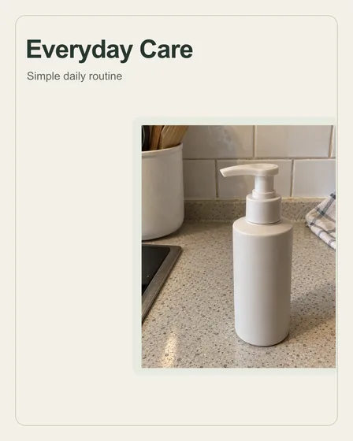
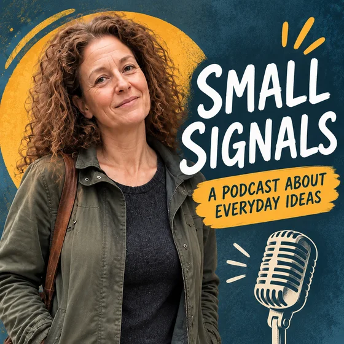

# マーケティング、広告、ソーシャルメディアコンテンツ

[中文](../../../README.md) · [English](../../../README.en.md) · [Português](../../../README.pt.md) · [Español](../../../README.es.md) · [Français](../../../README.fr.md) · [Deutsch](../../../README.de.md) · [عربي](../../../README.ar.md) · [русский](../../../README.ru.md) · [日本語](../../../README.ja.md) · [हिंदी](../../../README.hi.md)

カタログ掲載外の6件。ここではプロンプトの言葉は開示されていません。既存の参考資料、結果の指示、および最小限の材料要件のみが表示されます。

[その他のケース カタログに戻る](./index.md) · [倉庫のホームページに戻る](../../../README.ja.md)

> 参考資料と結果画像は視覚的なガイダンスのみを目的としています。同じ材料を使用して同じ効果が再現できるという保証はありません。

## I110 · 商品画像からパフォーマンス クリエイティブを生成

<table>
<thead><tr><th width="50%">参考資料</th><th width="50%">結果の例</th></tr></thead>
<tbody><tr><td valign="top">
<strong>製品イメージ、セールスポイント、対象ユーザー</strong> 
</td><td valign="top"></td></tr></tbody>
</table>

- **入力タイプ:** 参考資料のプレビューと結果の例が含まれます
- **素材要件:** 製品の写真、セールス ポイントと視聴者 + 製品のセールス ポイント、対象視聴者 → シーン、コピーライティング、ブランド要素の組み合わせ → 現在の 1 つの広告クリエイティブ画像
- **説明:** 一度に生成される画像は 1 つだけです。

[ dearsketch の特定の要件を確認し、](https://dearsketch.com/ja/intent/i110-create-performance-ad-creative-from-a-product-image.html?utm_source=github&utm_medium=gallery&utm_campaign=dearsketch-public-cases&utm_content=i110_cta) を作成します

---

## I125 · 同じ広告ビジュアルを異なる言語および文化バージョンに変更する

<table>
<thead><tr><th width="50%">参考資料</th><th width="50%">結果の例</th></tr></thead>
<tbody><tr><td valign="top">
<strong>完全なオリジナル広告</strong> 
</td><td valign="top"></td></tr></tbody>
</table>

- **入力タイプ:** 参考資料のプレビューと結果の例が含まれます
- **資料要件:** 完全なオリジナル広告 1 つ + 対象国または地域 (指定された言語、文化的嗜好、または改訂された翻訳を追加することができます)
- **説明:** 一度に生成される画像は 1 つだけです。

[ dearsketch の特定の要件を確認し、](https://dearsketch.com/ja/intent/i125-adapt-one-ad-visual-for-different-languages-and-cultures.html?utm_source=github&utm_medium=gallery&utm_campaign=dearsketch-public-cases&utm_content=i125_cta) を作成します

---

## I260 · 衣類コレクションをルックブックやファッション カタログに変えましょう

<table>
<thead><tr><th width="50%">参考資料</th><th width="50%">結果の例</th></tr></thead>
<tbody><tr><td valign="top">
<strong>L02モデル着用画像</strong> 

<strong>L02 正面製品全体写真</strong> 
</td><td valign="top"></td></tr></tbody>
</table>

- **入力タイプ:** 参考資料のプレビューと結果の例が含まれます
- **資料要件:** 必要なモデル写真と製品写真 (シリーズ全体の複数の写真) + 必要なシリーズ テーマ、スタイル番号、順序およびページ数 (1 部)
- **説明:** 今回は、単一の視覚的なプレビューが生成されます。データ計算、正確な組版、ベクターまたは制作ファイルは、対応するツールで検証する必要があります。

[ dearsketch の特定の要件を確認し、](https://dearsketch.com/ja/intent/i260-turn-a-clothing-collection-into-a-lookbook-or-fashion-catalog.html?utm_source=github&utm_medium=gallery&utm_campaign=dearsketch-public-cases&utm_content=i260_cta) を作成します

---

## I261 · ポッドキャストのカバーアートを作成する

<table>
<thead><tr><th width="50%">参考資料</th><th width="50%">結果の例</th></tr></thead>
<tbody><tr><td valign="top">
<strong>主催者のポートレート</strong> 
</td><td valign="top"></td></tr></tbody>
</table>

- **入力タイプ:** 参考資料のプレビューと結果の例が含まれます
- **資料要件:** オプションの主催者のポートレート (0 または 1) + 必須のプログラム名、テーマ、およびターゲット プラットフォーム (1 部) + 必須のプログラム名および必要なサブタイトル (1 セット)
- **説明:** 一度に生成される画像は 1 つだけです。

[ dearsketch の特定の要件を確認し、](https://dearsketch.com/ja/intent/i261-create-podcast-cover-art.html?utm_source=github&utm_medium=gallery&utm_campaign=dearsketch-public-cases&utm_content=i261_cta) を作成します

---

## I262 · 年次報告書のホワイト ペーパーまたはケース スタディ用のイラストを生成します。

<strong>結果の例</strong>

この例には画像参照が含まれておらず、入力プレビューが完了する必要があります。以下の材料要件を参照してください。

- **入力タイプ:** この例は結果の例のみを示しています。画像入力プレビューを追加します
- **資料要件:** オプションのブランド仕様書または既存のレポート イラスト アンカー (0 ～ 複数) + 必須の章リストと各章の概要 (1 部) + 条件検証データ (1 部) + オプションのブランド仕様書 (0 または 1 部)
- **説明:** 一度に生成されるのは、現在選択されているものだけです。シリーズの他の画像は個別に実行されます。

[ dearsketch の特定の要件を確認し、](https://dearsketch.com/ja/intent/i262-create-illustrations-for-an-annual-report-white-paper-or-case-study.html?utm_source=github&utm_medium=gallery&utm_campaign=dearsketch-public-cases&utm_content=i262_cta) を作成します

---

## I263 · ピッチデッキ用の統一されたコンセプトイラストとダイアグラムを生成

<strong>結果の例</strong>

この例には画像参照が含まれておらず、入力プレビューが完了する必要があります。以下の材料要件を参照してください。

- **入力タイプ:** この例は結果の例のみを示しています。画像入力プレビューを追加します
- **資料要件:** オプションのブランドまたはロードショーのビジュアル アンカー (写真 0 または 1 枚) + 必須のページ リストおよび各ページの主要情報 (1 部) + 必須のビジネス モデルまたはユーザー プロセス (1 部) + オプションのブランド仕様 (0 または 1 部)
- **説明:** 一度に生成されるのは、現在選択されているものだけです。シリーズの他の画像は個別に実行されます。

[ dearsketch の特定の要件を確認し、](https://dearsketch.com/ja/intent/i263-create-consistent-illustrations-and-diagrams-for-a-pitch-deck.html?utm_source=github&utm_medium=gallery&utm_campaign=dearsketch-public-cases&utm_content=i263_cta) を作成します
