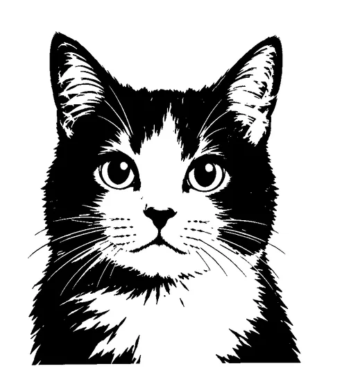

# POD とパーソナライズされた製品

[中文](../../../README.md) · [English](../../../README.en.md) · [Português](../../../README.pt.md) · [Español](../../../README.es.md) · [Français](../../../README.fr.md) · [Deutsch](../../../README.de.md) · [عربي](../../../README.ar.md) · [русский](../../../README.ru.md) · [日本語](../../../README.ja.md) · [हिंदी](../../../README.hi.md)

カタログ掲載外の6件。ここではプロンプトの言葉は開示されていません。既存の参考資料、結果の指示、および最小限の材料要件のみが表示されます。

[その他のケース カタログに戻る](./index.md) · [倉庫のホームページに戻る](../../../README.ja.md)

> 参考資料と結果画像は視覚的なガイダンスのみを目的としています。同じ材料を使用して同じ効果が再現できるという保証はありません。

## I264 ・ロゴやイラストを刺繍ミシンステッチファイルに変換

<table>
<thead><tr><th width="50%">参考資料</th><th width="50%">結果の例</th></tr></thead>
<tbody><tr><td valign="top">
<strong>刺繍用にデジタル化される透明なロゴまたはイラスト</strong> 
</td><td valign="top"></td></tr></tbody>
</table>

- **入力タイプ:** 参考資料のプレビューと結果の例が含まれます
- **必要な材料:** 刺繍用にデジタル化するために必要な透明なロゴまたはイラスト (1 枚) + 必要な刺繍製作仕様書 (1 部)
- **説明:** 今回は、単一の視覚的なプレビューが生成されます。データ計算、正確な組版、ベクターまたは制作ファイルは、対応するツールで検証する必要があります。

[ dearsketch の特定の要件を確認し、](https://dearsketch.com/ja/intent/i264-convert-a-logo-or-illustration-into-an-embroidery-stitch-file.html?utm_source=github&utm_medium=gallery&utm_campaign=dearsketch-public-cases&utm_content=i264_cta) を作成します

---

## I268 · 写真やテキストをレーザー彫刻および切断用のベクター ファイルに整理します

<table>
<thead><tr><th width="50%">参考資料</th><th width="50%">結果の例</th></tr></thead>
<tbody><tr><td valign="top">
<strong>彫刻/カットする絵やロゴ</strong> 
</td><td valign="top"></td></tr></tbody>
</table>

- **入力タイプ:** 参考資料のプレビューと結果の例が含まれます
- **材料要件:** 彫刻/カットするオプションの画像またはロゴ (0 または 1) + 必要な加工方法、材料、および機械の制約 (1 部) + テキストおよびグリフの処理が必要な条件 (1 部)
- **説明:** 今回は、単一の視覚的なプレビューが生成されます。データ計算、正確な組版、ベクターまたは制作ファイルは、対応するツールで検証する必要があります。

[ dearsketch の特定の要件を確認し、](https://dearsketch.com/ja/intent/i268-prepare-an-image-or-text-as-a-vector-file-for-laser-engraving-or-cutting.html?utm_source=github&utm_medium=gallery&utm_campaign=dearsketch-public-cases&utm_content=i268_cta) を作成します

---

## I271 · 写真をデジタル油絵に変換します

<table>
<thead><tr><th width="50%">参考資料</th><th width="50%">結果の例</th></tr></thead>
<tbody><tr><td valign="top">
<strong>変換するデジタル油絵の本体写真</strong> 
</td><td valign="top"></td></tr></tbody>
</table>

- **入力タイプ:** 参考資料のプレビューと結果の例が含まれます
- **必要な材料:** 転写するデジタル油絵の本体写真（1枚）+完成品の必要範囲と塗装色数（1セット）
- **説明:** 今回は、単一の視覚的なプレビューが生成されます。データ計算、正確な組版、ベクターまたは制作ファイルは、対応するツールで検証する必要があります。

[ dearsketch の特定の要件を確認し、](https://dearsketch.com/ja/intent/i271-turn-a-photo-into-a-paint-by-numbers-pattern.html?utm_source=github&utm_medium=gallery&utm_campaign=dearsketch-public-cases&utm_content=i271_cta) を作成します

---

## I273 · 写真をカットまたはスプレーペイントできるテンプレートに変換します

<table>
<thead><tr><th width="50%">参考資料</th><th width="50%">結果の例</th></tr></thead>
<tbody><tr><td valign="top">
<strong>変換するテンプレートのハイコントラストの写真またはロゴ</strong> 
</td><td valign="top"></td></tr></tbody>
</table>

- **入力タイプ:** 参考資料のプレビューと結果の例が含まれます
- **素材の要件:** 転送するテンプレートの必要なハイコントラストの写真またはロゴ (写真 1 枚) + 必要なテンプレートの目的、素材、および最小限の接続 (1 部)
- **説明:** 今回は、単一の視覚的なプレビューが生成されます。データ計算、正確な組版、ベクターまたは制作ファイルは、対応するツールで検証する必要があります。

[ dearsketch の特定の要件を確認し、](https://dearsketch.com/ja/intent/i273-turn-a-photo-into-a-cuttable-or-paintable-stencil.html?utm_source=github&utm_medium=gallery&utm_campaign=dearsketch-public-cases&utm_content=i273_cta) を作成します

---

## I284 · 人々の写真と太字のテキストを使用してサポート ファンまたは名前ボードを作成します

<table>
<thead><tr><th width="50%">参考資料</th><th width="50%">結果の例</th></tr></thead>
<tbody><tr><td valign="top">
<strong>使用許可を得た人物の写真</strong> 
</td><td valign="top"></td></tr></tbody>
</table>

- **入力タイプ:** 参考資料のプレビューと結果の例が含まれます
- **素材要件:** 人物写真（1枚） + 必須の名前または応援フレーズ（1セット） + 必須の完成品の種類と代表色（1セット）の使用権があること
- **説明:** 一度に生成される画像は 1 つだけです。

[ dearsketch の特定の要件を確認し、](https://dearsketch.com/ja/intent/i284-create-a-fan-support-uchiwa-or-name-board-from-a-portrait.html?utm_source=github&utm_medium=gallery&utm_campaign=dearsketch-public-cases&utm_content=i284_cta) を作成します

---

## I287 · 複数のセルフィーを 4 フレームのフォト ストリップとテーマの境界線に作成します

<table>
<thead><tr><th width="50%">参考資料</th><th width="50%">結果の例</th></tr></thead>
<tbody><tr><td valign="top">
<strong>履歴参照/変換前入力</strong> 

<strong>履歴参照/変換前入力</strong> 

<strong>履歴参照/変換前入力</strong> 

<strong>履歴参照/変換前入力</strong> 
</td><td valign="top"></td></tr></tbody>
</table>

- **入力タイプ:** 参考資料のプレビューと結果の例が含まれます
- **素材要件:** 必須連写・自撮り写真（2～4枚） + 必須フォトストリップ上下コマ順（1枚） + 任意の日付、短文、ロゴ、テーマカラー（0または1グループ）
- **説明:** 一度に生成される画像は 1 つだけです。

[ dearsketch の特定の要件を確認し、](https://dearsketch.com/ja/intent/i287-turn-selfies-into-a-four-cut-photo-strip-with-a-themed-frame.html?utm_source=github&utm_medium=gallery&utm_campaign=dearsketch-public-cases&utm_content=i287_cta) を作成します
