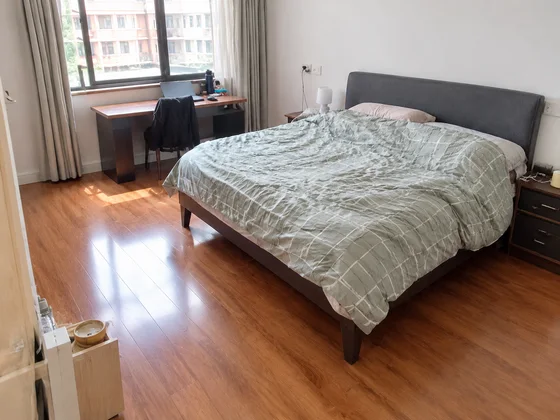
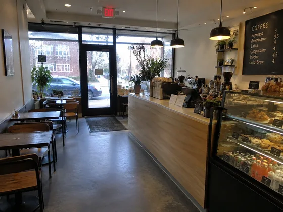
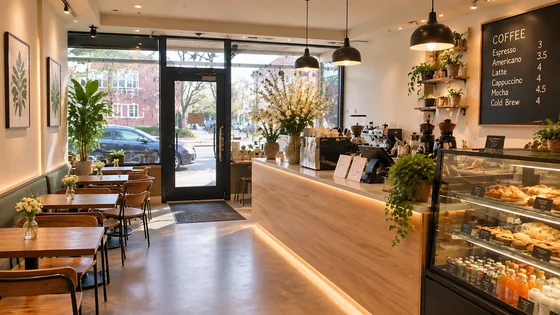
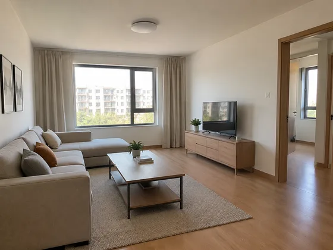
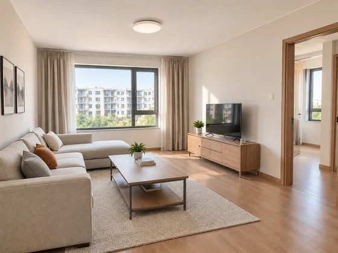

# 宇宙・建築・不動産

[中文](../../../README.md) · [English](../../../README.en.md) · [Português](../../../README.pt.md) · [Español](../../../README.es.md) · [Français](../../../README.fr.md) · [Deutsch](../../../README.de.md) · [عربي](../../../README.ar.md) · [русский](../../../README.ru.md) · [日本語](../../../README.ja.md) · [हिंदी](../../../README.hi.md)

カタログ掲載外の3件。ここではプロンプトの言葉は開示されていません。既存の参考資料、結果の指示、および最小限の材料要件のみが表示されます。

[その他のケース カタログに戻る](./index.md) · [倉庫のホームページに戻る](../../../README.ja.md)

> 参考資料と結果画像は視覚的なガイダンスのみを目的としています。同じ材料を使用して同じ効果が再現できるという保証はありません。

## I170 · さまざまな家具の配置や組み合わせを試してください

<table>
<thead><tr><th width="50%">参考資料</th><th width="50%">結果の例</th></tr></thead>
<tbody><tr><td valign="top">
<strong>空室または既存の部屋の写真</strong> 
</td><td valign="top"></td></tr></tbody>
</table>

- **入力タイプ:** 参考資料のプレビューと結果の例が含まれます
- **材料要件:** 空室または既存の部屋の写真 → 元の画像内の既存の家の要素の配置のみを調整 → 現在の単一の家具のレイアウトのプレビュー
- **説明:** 一度に生成される画像は 1 つだけです。

[ dearsketch の特定の要件を確認し、](https://dearsketch.com/ja/intent/i170-try-different-furniture-arrangements-and-combinations.html?utm_source=github&utm_medium=gallery&utm_campaign=dearsketch-public-cases&utm_content=i170_cta) を作成します

---

## I173 · レストラン、店舗、ショールームのデザインの方向性を生成する

<table>
<thead><tr><th width="50%">参考資料</th><th width="50%">結果の例</th></tr></thead>
<tbody><tr><td valign="top">
<strong>商業スペースシーンのオリジナル画像</strong> 
</td><td valign="top"></td></tr></tbody>
</table>

- **入力タイプ:** 参考資料のプレビューと結果の例が含まれます
- **マテリアル要件:** 商空間＋業態、ブランドポジショニング、核となる機能、旅客動線のオリジナルの現地イメージ → 業態に合わせたレイアウトや雰囲気づくり → 現状の単一商空間コンセプトマップ
- **説明:** 一度に生成される画像は 1 つだけです。

[ dearsketch の特定の要件を確認し、](https://dearsketch.com/ja/intent/i173-create-design-directions-for-a-restaurant-shop-or-showroom.html?utm_source=github&utm_medium=gallery&utm_campaign=dearsketch-public-cases&utm_content=i173_cta) を作成します

---

## I180 · 同じ空間で複数のマテリアルと光の方向を生成

<table>
<thead><tr><th width="50%">参考資料</th><th width="50%">結果の例</th></tr></thead>
<tbody><tr><td valign="top">
<strong>データム空間マップ</strong> 
</td><td valign="top"></td></tr></tbody>
</table>

- **入力タイプ:** 参考資料のプレビューと結果の例が含まれます
- **マテリアル要件:** ベースライン空間マップ + 現在のマテリアルまたは照明変数 → 代替マテリアル、カラー マッチングおよび照明 → 現在の単一プランの比較表
- **説明:** 一度に生成される画像は 1 つだけです。

[ dearsketch の特定の要件を確認し、](https://dearsketch.com/ja/intent/i180-create-material-and-lighting-variations-for-the-same-space.html?utm_source=github&utm_medium=gallery&utm_campaign=dearsketch-public-cases&utm_content=i180_cta) を作成します
