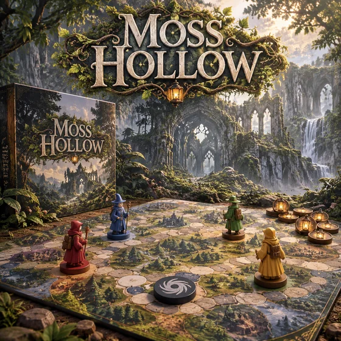

# ゲームと仮想資産

[中文](../../../README.md) · [English](../../../README.en.md) · [Português](../../../README.pt.md) · [Español](../../../README.es.md) · [Français](../../../README.fr.md) · [Deutsch](../../../README.de.md) · [عربي](../../../README.ar.md) · [русский](../../../README.ru.md) · [日本語](../../../README.ja.md) · [हिंदी](../../../README.hi.md)

掲載カタログ外の4件。ここではプロンプトの言葉は開示されていません。既存の参考資料、結果の指示、および最小限の材料要件のみが表示されます。

[その他のケース カタログに戻る](./index.md) · [倉庫のホームページに戻る](../../../README.ja.md)

> 参考資料と結果画像は視覚的なガイダンスのみを目的としています。同じ材料を使用して同じ効果が再現できるという保証はありません。

## I199 · ファンタジーワールドまたは DND バトルマップを生成

<strong>結果の例</strong>

この例には画像参照が含まれておらず、入力プレビューが完了する必要があります。以下の材料要件を参照してください。

- **入力タイプ:** この例は結果の例のみを示しています。画像入力プレビューを追加します
- **マテリアルの要件:** 地形、場所、およびルートのリスト + 地図の視覚的参照 + 現在の地図縮尺 → 地域地図、都市または戦闘シーンを生成 → 現在の単一のファンタジー地図
- **説明:** 今回は、単一の視覚的なプレビューが生成されます。データ計算、正確な組版、ベクターまたは制作ファイルは、対応するツールで検証する必要があります。

[ dearsketch の特定の要件を確認し、](https://dearsketch.com/ja/intent/i199-create-a-fantasy-world-or-d-and-d-battle-map.html?utm_source=github&utm_medium=gallery&utm_campaign=dearsketch-public-cases&utm_content=i199_cta) を作成します

---

## I200 · ゲームのアイコン、ボタン、HUD 要素を生成します

<strong>結果の例</strong>

この例には画像参照が含まれておらず、入力プレビューが完了する必要があります。以下の材料要件を参照してください。

- **入力タイプ:** この例は結果の例のみを示しています。画像入力プレビューを追加します
- **マテリアル要件:** コンポーネントとステータスのリスト + ゲーム UI のビジュアル仕様 → 統一スタイルのインターフェイス アセットの生成 → 現在の単一のゲーム UI アイコン
- **説明:** 今回は、単一の視覚的なプレビューが生成されます。データ計算、正確な組版、ベクターまたは制作ファイルは、対応するツールで検証する必要があります。

[ dearsketch の特定の要件を確認し、](https://dearsketch.com/ja/intent/i200-create-game-icons-buttons-and-hud-elements.html?utm_source=github&utm_medium=gallery&utm_campaign=dearsketch-public-cases&utm_content=i200_cta) を作成します

---

## I204 · ボードゲームのボード、コンポーネント、カバービジュアルを生成

<strong>結果の例</strong>

この例には画像参照が含まれておらず、入力プレビューが完了する必要があります。以下の材料要件を参照してください。

- **入力タイプ:** この例は結果の例のみを示しています。画像入力プレビューを追加します
- **資料要件:** オプションの既存のチェス盤またはコンポーネントのビジュアル リファレンス (0 または 1) + 必須のボード ゲーム ルールおよびコンポーネント リスト (1 部) + 必須の配信タイプおよびテーマ (1 セット)
- **説明:** 今回は、単一の視覚的なプレビューが生成されます。データ計算、正確な組版、ベクターまたは制作ファイルは、対応するツールで検証する必要があります。

[ dearsketch の特定の要件を確認し、](https://dearsketch.com/ja/intent/i204-create-visuals-for-a-board-components-and-box-cover.html?utm_source=github&utm_medium=gallery&utm_campaign=dearsketch-public-cases&utm_content=i204_cta) を作成します

---

## I205 · ゲームストアのカバーとキーアートを生成

<strong>結果の例</strong>

この例には画像参照が含まれておらず、入力プレビューが完了する必要があります。以下の材料要件を参照してください。

- **入力タイプ:** この例は結果の例のみを示しています。画像入力プレビューを追加します
- **マテリアル要件:** オプションの確認済みキャラクター、ロゴ、またはゲーム アート アセット (0 から複数) + 必要なストア リソース スロットおよびゲーム セールス ポイント (1 コピー)
- **説明:** 一度に生成されるのは、現在選択されているものだけです。シリーズの他の画像は個別に実行されます。

[ dearsketch の特定の要件を確認し、](https://dearsketch.com/ja/intent/i205-create-game-store-cover-art-and-key-art.html?utm_source=github&utm_medium=gallery&utm_campaign=dearsketch-public-cases&utm_content=i205_cta) を作成します
