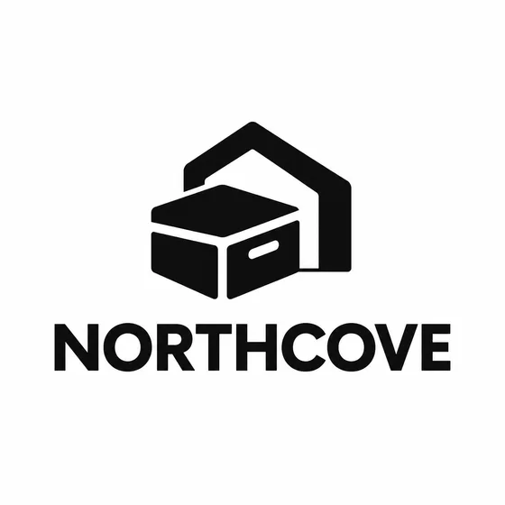

# ポスター、サムネイル、ビジュアル デザインのプロンプト · ポスター、表紙、ビジュアル デザイン

[中文](../../../README.md) · [English](../../../README.en.md) · [Português](../../../README.pt.md) · [Español](../../../README.es.md) · [Français](../../../README.fr.md) · [Deutsch](../../../README.de.md) · [عربي](../../../README.ar.md) · [русский](../../../README.ru.md) · [日本語](../../../README.ja.md) · [हिंदी](../../../README.hi.md)

明確な概要からポスター、サムネイル、メニュー、インフォグラフィック、またはロゴのコンセプトを作成します。一部のタスクは写真から始まります。承認されたコピー、データ、またはデザイン ファイルから開始する場合もあります。画像スタイルを選択する前にタスクを選択してください。

まず正しいタイトル、コピー、情報レベルを指定し、次にレイアウトと画面の方向を指定します。チャートデータはモデルを書き換えることができず、ロゴコンセプトはベクトル配信や商標調査が完了したことを意味しません。

## 適切なタスクを選択してください

目的のサイズまたはアスペクト比、正確なテキストとその優先順位を指定します。実際のスクリーンショット、メニュー項目、グラフ、またはブランド資産を保存する必要がある場合は、元のファイルを指定してください。

| タスク | 保存する | 変化 | プロンプトと入力 |
| --- | --- | --- | --- |
| YouTube サムネイル / YouTube 動画サムネイル | 提供された人物またはオブジェクトの ID と正確に承認されたタイトルを保持します。 | 構図、背景、表現の強調、色、タイトルの扱いを変更します。 | [I106](../cases/i106-create-a-youtube-video-thumbnail.md#public-prompt) |
| プロモーションイベントポスター/テーマプロモーションポスター | 提供された人物、製品、アートワーク、ブランド マーク、イベントの事実を正確に保ちます。 | レイアウト、背景、画像処理、階層、装飾システムを変更します。 | [I107](../cases/i107-create-a-promotional-poster-from-a-topic-and-copy.md#public-prompt) |
| ホリデー セール ポスター / ホリデー セール ポスター | 製品と提供されたすべての価格、割引、日付、状態を正確に保ちます。 | 季節の装飾、構成、パレット、強調点、プロモーションの階層を変更します。 | [I112](../cases/i112-create-a-mother-s-day-black-friday-or-holiday-sale-poster.md#public-prompt) |
| 会議または展示会のポスター / 会議および展示会のポスター | 提供された肖像画や展示品、およびすべての名前、肩書、主催者、事実を正確に保ってください。 | グリッド、視覚的階層、背景、パレット、および画像処理を変更します。 | [I115](../cases/i115-create-a-conference-exhibition-or-speaking-event-poster.md#public-prompt) |
| コンセプトインフォグラフィック/コンセプト情報マップ | すべての事実、数値、順序、階層、および関係を提供されたとおりに正確に保ちます。 | 図像、レイアウト、色分け、視覚的なグループ化、強調を変更します。 | [I118](../cases/i118-turn-a-complex-concept-into-an-infographic-visual.md#public-prompt) |
| 記事またはニュースレターの表紙 / 記事およびニュースレターの表紙 | 供給される人材、製品、イベント、ブランド要素を忠実に保ちます。 | 視覚的な比喩、構成、背景、パレット、編集上の扱いを変更します。 | [I119](../cases/i119-create-a-newsletter-header-or-article-cover.md#public-prompt) |
| アプリデバイスモックアップ/アプリデバイス表示図 | スクリーンショットの内容と承認されたすべての機能の主張を正確に保ちます。 | デバイスのフレーム、背景、構成、照明、マーケティング コンテキストを変更します。 | [I121](../cases/i121-create-device-mockups-and-app-store-promotional-images.md#public-prompt) |
| レストランメニュービジュアル / メニューと料理のビジュアル | すべてのメニューの事実と実際の料理の外観を正確に保ちます。 | レイアウト、背景、装飾システム、画像のトリミング、階層を変更します。 | [I124](../cases/i124-create-restaurant-menu-visuals-and-dish-imagery.md#public-prompt) |
| ロゴコンセプトの探求 / ロゴコンセプトの探求 | 正確なブランド名と提供されたアイデンティティ資産を保持します。サードパーティのマークを避けてください。 | シンボルのアイデア、文字の方向、形状、色、プレゼンテーションを変更します。 | [I126](../cases/i126-create-logo-concepts-from-a-brand-description.md#public-prompt) |
| レタリング効果/ワードアートとタイトル効果を表示する | すべての文字、スペル、順序、および指定された書体参照を正確に保ちます。 | マテリアル効果、深度、照明、背景、装飾処理を変更します。 | [I133](../cases/i133-create-readable-display-lettering-and-title-effects.md#public-prompt) |

## 参考資料と結果の方向性

### プロモーションイベントポスター

<strong>結果例</strong>

この例には画像参照は添付されていません。以下の入力要件を確認してください。

[プロンプトを読んで要件を入力してください](../cases/i107-create-a-promotional-poster-from-a-topic-and-copy.md#public-prompt) · [独自のマテリアルで試してください](https://dearsketch.com/ja/intent/i107-create-a-promotional-poster-from-a-topic-and-copy.html?utm_source=github&utm_medium=guide&utm_campaign=dearsketch-public-cases&utm_content=i107_cta)

### ロゴコンセプトの探求

<strong>結果例</strong>

この例には画像参照は添付されていません。以下の入力要件を確認してください。

[プロンプトを読んで要件を入力してください](../cases/i126-create-logo-concepts-from-a-brand-description.md#public-prompt) · [独自のマテリアルで試してください](https://dearsketch.com/ja/intent/i126-create-logo-concepts-from-a-brand-description.html?utm_source=github&utm_medium=guide&utm_campaign=dearsketch-public-cases&utm_content=i126_cta)

これらは視覚的な例です。公開テンプレートは新しく作成されたもので、画像の入力に対してテストされていません。出力を使用する前に、ID、コンテンツ、およびファイルの要件を確認してください。画像用語: [コンテンツ ポリシー](../content-policy.md)。
