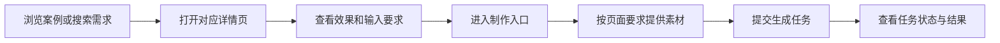
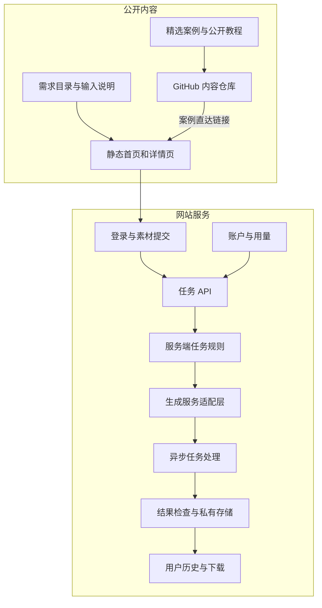

# Arquitetura do produto dearsketch

[中文](../../README.md) · [English](../../README.en.md) · [Português](../../README.pt.md) · [Español](../../README.es.md) · [Français](../../README.fr.md) · [Deutsch](../../README.de.md) · [عربي](../../README.ar.md) · [русский](../../README.ru.md) · [日本語](../../README.ja.md) · [हिंदी](../../README.hi.md)


dearsketch organiza "Quais imagens eu quero completar" em um diretório navegável de requisitos. Cada requisito possui uma página independente que explica a finalidade, os materiais necessários e os requisitos de resultado; os usuários entram no processo de produção na página correspondente.

Esta descrição descreve as responsabilidades do módulo e o fluxo de dados. A biblioteca de conteúdo público, os serviços do site e os modelos gerados realizam tarefas diferentes; este warehouse fornece casos públicos, 50 modelos recém-editados e Agent Skill, e a produção online é realizada no site.

## Caminho do usuário



Diferentes tarefas podem exigir fotos, manuscritos de design designados, redação precisa ou recursos de vários personagens. Desenhos de série e planos múltiplos são produzidos separadamente em uma única base; quando são necessários textos, vetores ou arquivos de produção precisos, as ferramentas correspondentes são necessárias após a visualização visual.

## Camadas de conteúdo e geração



As páginas de conteúdo estático são responsáveis ​​pela descoberta, interpretação e inclusão de pesquisa. A tarefa API é responsável por validar a entrada do usuário e criar tarefas. A regra do lado do servidor e a camada de adaptação de geração são responsáveis ​​pela execução dos requisitos selecionados. A camada de histórico e armazenamento é responsável por retornar os resultados aos usuários correspondentes.

Os módulos na figura refletem a divisão de responsabilidades no código-fonte atual e não são um compromisso com todas as funções online, status de pagamento ou níveis de serviço; ao utilizá-los, prevalecerão o próprio acesso e as instruções fornecidas pelo site.

## Responsabilidades do módulo

| módulo | Problema resolvido |
| --- | --- |
| Catálogo de Requisitos | Organize tarefas de imagem com propósitos, entradas, saídas e cenários |
| Construção de página | Gere endereços estáveis, conteúdo de página e metadados de pesquisa para suas necessidades |
| Insira o contrato | Explique quais materiais são necessários, quais são opcionais e quais são as relações entre os materiais. |
| Contas e tarefas API | Verifique a identidade, a integridade da entrada e solicite a duplicação |
| Regras de tarefas do servidor | Organize o conteúdo de execução com base nas necessidades e nas informações atuais |
| Gerar camada de adaptação | Conecte-se a serviços de build externos e lide com tarefas assíncronas |
| Resultados e histórico | Verifique os resultados, economize recursos e forneça acesso aos usuários apropriados |
| Conta e uso | Lidar com qualificações de uso, pontos e status relacionado ao pedido |

## Método de implementação

| camada | O método no código-fonte atual |
| --- | --- |
| Construção de conteúdo | O script Node.js gera HTML, página de detalhes e metadados de pesquisa a partir de requisitos estruturados |
| Interação do navegador | JavaScript lida com filtragem, entrada de material e status de tarefa; algumas interações usam React e são empacotadas pela Vite |
| Servidor | Os módulos Node.js lidam com autenticação, uploads, tarefas de construção, histórico e uso |
| dados | Banco de dados relacional registra contas, propriedade de recursos e status de tarefas |
| documento | Armazenamento de objetos privados separados dos dados empresariais, acessados ​​através de endereços controlados |
| gerar | O servidor se adapta a serviços gerados externamente e processa tarefas e resultados assíncronos. |

Essas escolhas técnicas podem explicar como o sistema divide o trabalho sem expor números de contas de produção, IDs de projetos, nomes de buckets ou valores de variáveis ​​de ambiente.

## Exemplo de dados públicos

```json
{
  "id": "I026",
  "title": "宠物定制肖像",
  "input": "1张宠物照片",
  "output": "宠物肖像图片",
  "roles": [
    { "kind": "image", "label": "宠物照片", "requirement": "required", "quantity": "1张" }
  ]
}
```

Esses campos explicam as tarefas do usuário e não contêm instruções completas de geração no lado do servidor. Consulte [cases.json](../../data/cases.json) para dados de casos selecionados, consulte [gallery.json](../../data/gallery.json) para outros exemplos de resultados e consulte [public-prompts.json](../../data/public-prompts.json) para o novo modelo público. As habilidades públicas são responsáveis ​​apenas pela preparação de listas de entrada e palavras de alerta, e não têm acesso às regras internas de geração.

## Limites de acesso e conteúdo

Imagens de casos públicos e recursos enviados por usuários são dois tipos de conteúdo. Os casos são usados ​​para ilustrar a direção visual; imagens originais do usuário, resultados de tarefas e registros de contas não pertencem à biblioteca pública de casos. O serviço de geração precisa verificar o tipo de material, tamanho e propriedade, e a entrada do usuário não pode substituir as restrições de execução do servidor.

Diagramas de módulos, responsabilidades, estruturas de dados abstratas, especificações de entrada e princípios gerais de confiabilidade podem ser expostos. Expor uma implementação do lado do servidor ou um conjunto de estruturas de banco de dados é uma área de código aberto que pode ser decidida de forma independente; eles não são automaticamente secretos apenas porque estão no lado do servidor.

O escopo deste warehouse são casos, tutoriais básicos e descrições de arquitetura de produto, e não inclui código-fonte de serviço de produção, habilidades internas completas ou recursos de implantação. Credenciais, sessões, registros reais de usuários e endereços de recursos privados não são conteúdo público.

## Como conectar o GitHub ao site

Cada imagem em destaque e link “fazer o mesmo” levam à página de demanda correspondente. Os links usam parâmetros de origem para distinguir README, detalhes de caso e entradas de tutorial; estes parâmetros apenas expressam a fonte e não podem, por si só, provar que um sistema estatístico foi implementado.

O site não possui caixas de entrada de palavras para os visitantes. Tutoriais básicos são divulgados para que os usuários experimentem as ferramentas de sua preferência; o site fornece entradas de materiais correspondentes com base nas necessidades selecionadas.
