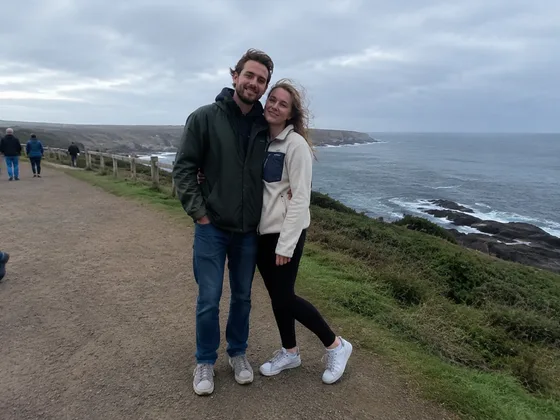
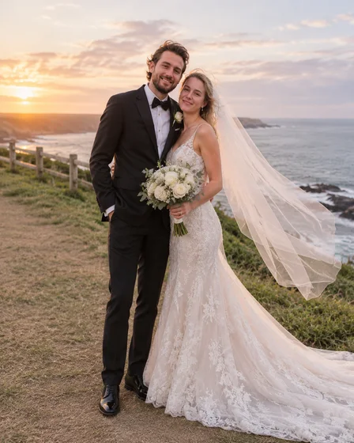

# Retrato de casal estilo casamento · Retrato estilo vestido de noiva e casamento

[中文](../../../README.md) · [English](../../../README.en.md) · [Português](../../../README.pt.md) · [Español](../../../README.es.md) · [Français](../../../README.fr.md) · [Deutsch](../../../README.de.md) · [عربي](../../../README.ar.md) · [русский](../../../README.ru.md) · [日本語](../../../README.ja.md) · [हिंदी](../../../README.hi.md)


Crie um retrato inspirado em um casamento a partir de uma foto de casal sem apresentá-lo como um registro real de um evento.

Gere retratos de casamento ou fotos em estilo de casamento. Usado para comemorações de casamento e convites.

[Copiar prompt](#public-prompt) · [ é produzido por dearsketch / Experimente online](https://dearsketch.com/pt/intent/i023-create-a-wedding-portrait-or-bridal-style-photo.html?utm_source=github&utm_medium=case&utm_campaign=dearsketch-public-cases&utm_content=i023_cta) · [Voltar ao tópico / Coleção](../guides/pets-family.md)

## Material de referência e direção do resultado

<table>
<thead><tr><th width="50%">Material de referência</th><th width="50%">Exemplo de resultados</th></tr></thead>
<tbody><tr><td valign="top"><p><strong>fotos de casal</strong><br></p></td><td valign="top"><a href="https://dearsketch.com/pt/intent/i023-create-a-wedding-portrait-or-bridal-style-photo.html?utm_source=github&amp;utm_medium=case&amp;utm_campaign=dearsketch-public-cases&amp;utm_content=i023_image"></a></td></tr></tbody>
</table>

Os materiais de referência e resultados são usados ​​para ilustrar a direção visual. O modelo público não é a instrução de geração original para as imagens que o acompanham e não há garantia de reprodução dos mesmos resultados.

## O que preparar/Insumos

| Material | Tipo / Tipo | Quantidade / Quantidade | Condição/Requisito |
| --- | --- | --- | --- |
| fotos de casal | Foto/Imagem | 1 peça | Obrigatório / Obrigatório |

Apenas uma imagem é gerada por vez.

## Manter e alterar/Editar resumo

- **Preservar / 保留：** Mantenha ambas as identidades, relacionamento natural e proporções corporais.
- **Alterar / 改变：** Mude o guarda-roupa, o cenário, o estilo floral e o clima cerimonial.

## Public prompt

**Modelo público recém-editado · Recém-criado · Não testado em geração.** Substitua os parâmetros de colchetes e anexe os materiais necessários na ferramenta que suporta edição de imagens; entradas opcionais e condicionais são preparadas conforme tabela acima. Este modelo não foi usado para gerar os exemplos nesta página.

```text
Create one wedding-inspired portrait from [COUPLE PHOTO].
Preserve both people’s identities, facial structure, skin tone, hair, and natural relationship.
Dress them in [BRIDAL / FORMAL WARDROBE DIRECTION] with believable fabric and fit.
Place them in [CEREMONIAL SETTING] using [FLORAL STYLE], [PALETTE], and [LIGHTING].
Keep hands, rings, garment edges, pose, and body contact anatomically coherent.
Do not invent a real venue, ceremony, legal status, or event documentation.
Use an original composition rather than imitating a named photographer or campaign.
Add text only when [EXACT NAMES AND DATE] are confirmed.
Treat the image as a creative style preview, not evidence of a real wedding.
Deliver one finished portrait image only.
```

[Faça online com seus próprios materiais / Faça online](https://dearsketch.com/pt/intent/i023-create-a-wedding-portrait-or-bridal-style-photo.html?utm_source=github&utm_medium=case&utm_campaign=dearsketch-public-cases&utm_content=i023_after-prompt) · [Deixe o agente ajudá-lo a organizar / Use a habilidade](../quickstart.md#agent-skill)

## Confira os principais pontos/revisão

A identidade e o relacionamento natural de ambas as partes são preservados; a imagem é uma prévia criativa e não representa a filmagem real do casamento.

Confirme os rostos e divulgue que o resultado é uma prévia criativa.

Direção do resultado: retratos de casamento. Quando for necessário texto exato, arquivos transparentes, vetores ou entrega impressa, verifique o arquivo real; os recursos e taxas disponíveis estão sujeitos à descrição do site.

## Casos relacionados/Tarefas relacionadas

- [Transforme uma foto de animal de estimação em um retrato personalizado · Retrato personalizado de animal de estimação ](./i026-turn-a-pet-photo-into-a-custom-portrait.md#public-prompt)
- [Transforme um animal de estimação em um retrato real ou histórico · Retrato real de animal de estimação](./i028-turn-a-pet-into-a-royal-or-historical-portrait.md#public-prompt)
- [Coloque um animal de estimação em uma cena divertida no banheiro ou na cozinha · Pintura de cena interessante para animais de estimação ](./i029-place-a-pet-in-a-playful-bathroom-or-kitchen-scene.md#public-prompt)

## Referência de histórico de requisitos

- [ERetrato de família de Tsy](https://www.etsy.com/market/ai_family_portrait)
- [LightXTodas as ferramentas](https://www.lightxeditor.com/all-tools/all-tools/)

Esses links servem apenas para auxiliar na compreensão do propósito e não são prova da origem ou autorização das imagens desta página.

Para o escopo de uso de imagens e materiais, consulte a descrição do conteúdo [ ](../content-policy.md). [Veja todos os 50 modelos ](../prompts.md).
