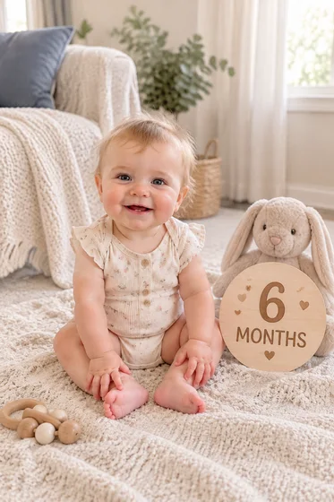

# Retrato do marco do bebê · Fotos do marco do crescimento do bebê

[中文](../../../README.md) · [English](../../../README.en.md) · [Português](../../../README.pt.md) · [Español](../../../README.es.md) · [Français](../../../README.fr.md) · [Deutsch](../../../README.de.md) · [عربي](../../../README.ar.md) · [русский](../../../README.ru.md) · [日本語](../../../README.ja.md) · [हिंदी](../../../README.hi.md)


Crie uma imagem marcante usando uma foto de bebê e fatos confirmados pelos pais.

Gere fotos da idade ou dos marcos de crescimento do seu bebê. Usado para registros de crescimento.

[Copiar prompt](#public-prompt) · [ é produzido por dearsketch / Experimente online](https://dearsketch.com/pt/intent/i025-create-baby-milestone-or-monthly-growth-photos.html?utm_source=github&utm_medium=case&utm_campaign=dearsketch-public-cases&utm_content=i025_cta) · [Voltar ao tópico / Coleção](../guides/pets-family.md)

## Material de referência e direção do resultado

<table>
<thead><tr><th width="50%">Material de referência</th><th width="50%">Exemplo de resultados</th></tr></thead>
<tbody><tr><td valign="top"><p><strong>fotos de bebê</strong><br></p></td><td valign="top"><a href="https://dearsketch.com/pt/intent/i025-create-baby-milestone-or-monthly-growth-photos.html?utm_source=github&amp;utm_medium=case&amp;utm_campaign=dearsketch-public-cases&amp;utm_content=i025_image"></a></td></tr></tbody>
</table>

Os materiais de referência e resultados são usados ​​para ilustrar a direção visual. O modelo público não é a instrução de geração original para as imagens que o acompanham e não há garantia de reprodução dos mesmos resultados.

## O que preparar/Insumos

| Material | Tipo / Tipo | Quantidade / Quantidade | Condição/Requisito |
| --- | --- | --- | --- |
| fotos de bebê | Foto/Imagem | 1 peça | Obrigatório / Obrigatório |
| Idade ou marco mensal | Personagem/Texto | 1 item | Obrigatório / Obrigatório |

Apenas uma imagem é gerada por vez.

## Manter e alterar/Editar resumo

- **Preservar / 保留:** Mantenha a identidade do bebê, a anatomia apropriada à idade e o texto confirmado dos marcos.
- **Alterar / 改变：** Altere o cenário, os adereços, a paleta de cores e o layout comemorativo.

## Public prompt

**Modelo público recém-editado · Recém-criado · Não testado em geração.** Substitua os parâmetros de colchetes e anexe os materiais necessários na ferramenta que suporta edição de imagens; entradas opcionais e condicionais são preparadas conforme tabela acima. Este modelo não foi usado para gerar os exemplos nesta página.

```text
Create one baby milestone portrait from [BABY PHOTO].
Use only the parent-confirmed milestone “[EXACT AGE OR MILESTONE]” and optional date “[CONFIRMED DATE]”.
Preserve the baby’s identity, skin tone, facial features, hair, and age-appropriate proportions.
Keep pose, hands, feet, and support surfaces physically safe and believable.
Design [BACKDROP THEME] with [PALETTE] and a small number of [PROPS].
Do not infer age, birth date, weight, name, or developmental achievement from the photo.
Do not add unsafe objects or show the baby unsupported in a risky pose.
If text is requested, render the supplied wording exactly and leave room for later typesetting.
Keep the result gentle, uncluttered, and suitable for [ALBUM / CARD / SOCIAL POST].
Deliver one finished milestone image only and proofread all rendered text.
```

[Faça online com seus próprios materiais / Faça online](https://dearsketch.com/pt/intent/i025-create-baby-milestone-or-monthly-growth-photos.html?utm_source=github&utm_medium=case&utm_campaign=dearsketch-public-cases&utm_content=i025_after-prompt) · [Deixe o agente ajudá-lo a organizar / Use a habilidade](../quickstart.md#agent-skill)

## Confira os principais pontos/revisão

Idades, datas e marcos são fornecidos pelos pais; não adivinhe esses fatos pelas fotos.

Nunca inferir idade ou marco; revise todos os fatos fornecidos.

Resultados na direção de: Fotos comemorativas do Milestone. Quando for necessário texto exato, arquivos transparentes, vetores ou entrega impressa, verifique o arquivo real; os recursos e taxas disponíveis estão sujeitos à descrição do site.

## Casos relacionados/Tarefas relacionadas

- [Transforme uma foto de animal de estimação em um retrato personalizado · Retrato personalizado de animal de estimação ](./i026-turn-a-pet-photo-into-a-custom-portrait.md#public-prompt)
- [Transforme um animal de estimação em um retrato real ou histórico · Retrato real de animal de estimação](./i028-turn-a-pet-into-a-royal-or-historical-portrait.md#public-prompt)
- [Coloque um animal de estimação em uma cena divertida no banheiro ou na cozinha · Pintura de cena interessante para animais de estimação ](./i029-place-a-pet-in-a-playful-bathroom-or-kitchen-scene.md#public-prompt)

## Referência de histórico de requisitos

- [LightXTodas as ferramentas](https://www.lightxeditor.com/all-tools/all-tools/)

Esses links servem apenas para auxiliar na compreensão do propósito e não são prova da origem ou autorização das imagens desta página.

Para o escopo de uso de imagens e materiais, consulte a descrição do conteúdo [ ](../content-policy.md). [Veja todos os 50 modelos ](../prompts.md).
