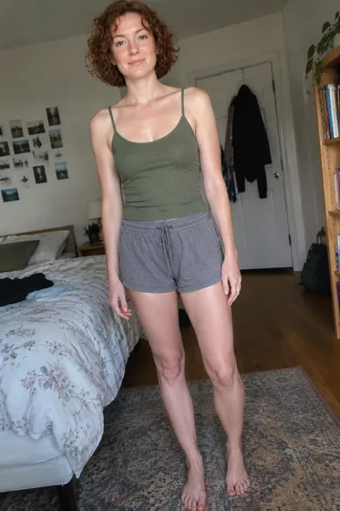
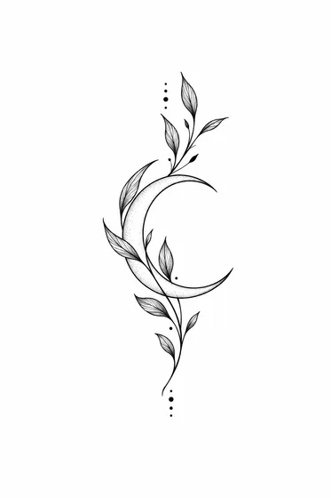
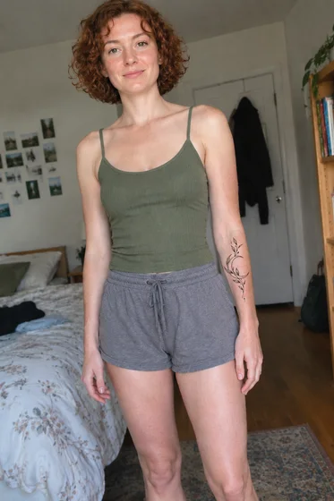

# Visualização da colocação da tatuagem · Visualização da parte superior do corpo da tatuagem

[中文](../../../README.md) · [English](../../../README.en.md) · [Português](../../../README.pt.md) · [Español](../../../README.es.md) · [Français](../../../README.fr.md) · [Deutsch](../../../README.de.md) · [عربي](../../../README.ar.md) · [русский](../../../README.ru.md) · [日本語](../../../README.ja.md) · [हिंदी](../../../README.hi.md)


Aplique um desenho de tatuagem fornecido em uma área específica do corpo.

Pré-visualização da tatuagem na foto do corpo. para a tomada de decisão sobre tatuagem.

[Copiar prompt](#public-prompt) · [ é produzido por dearsketch / Experimente online](https://dearsketch.com/pt/intent/i038-preview-a-tattoo-on-a-body-photo.html?utm_source=github&utm_medium=case&utm_campaign=dearsketch-public-cases&utm_content=i038_cta) · [Voltar ao tópico / Coleção](../guides/people.md)

## Material de referência e direção do resultado

<table>
<thead><tr><th width="50%">Material de referência</th><th width="50%">Exemplo de resultados</th></tr></thead>
<tbody><tr><td valign="top"><p><strong>Foto original da skin do personagem</strong><br></p>
<p><strong>Desenhos de tatuagem alvo</strong><br></p></td><td valign="top"><a href="https://dearsketch.com/pt/intent/i038-preview-a-tattoo-on-a-body-photo.html?utm_source=github&amp;utm_medium=case&amp;utm_campaign=dearsketch-public-cases&amp;utm_content=i038_image"></a></td></tr></tbody>
</table>

Os materiais de referência e resultados são usados ​​para ilustrar a direção visual. O modelo público não é a instrução de geração original para as imagens que o acompanham e não há garantia de reprodução dos mesmos resultados.

## O que preparar/Insumos

| Material | Tipo / Tipo | Quantidade / Quantidade | Condição/Requisito |
| --- | --- | --- | --- |
| Foto original da skin do personagem | Foto/Imagem | 1 peça | Obrigatório / Obrigatório |
| Desenhos de tatuagem alvo | Foto/Imagem | 1 peça | Obrigatório / Obrigatório |
| localização da tatuagem | Personagem/Texto | 1 item | Obrigatório / Obrigatório |

Apenas uma imagem é gerada por vez.

## Manter e alterar/Editar resumo

- **Preservar / 保留:** Mantenha a pessoa, a textura da pele, a anatomia do corpo e a arte da tatuagem inalteradas.
- **Alterar / 改变：** Altere apenas posicionamento, escala, curvatura, opacidade e integração.

## Public prompt

**Modelo público recém-editado · Recém-criado · Não testado em geração.** Substitua os parâmetros de colchetes e anexe os materiais necessários na ferramenta que suporta edição de imagens; entradas opcionais e condicionais são preparadas conforme tabela acima. Este modelo não foi usado para gerar os exemplos nesta página.

```text
Create one tattoo placement preview from [BODY PHOTO] and [TATTOO DESIGN IMAGE].
Place the design at [EXACT BODY LOCATION] with [SIZE] and [ORIENTATION].
Preserve the person’s identity, body anatomy, skin tone, texture, lighting, and pose.
Preserve the tattoo artwork’s line work, symbols, lettering, and proportions exactly.
Warp the design only enough to follow the body’s natural curvature and perspective.
Blend ink with plausible skin interaction while keeping the design readable.
Do not add extra symbols, alter lettering, remove scars, or reshape the body.
Keep boundaries clean and avoid floating, mirrored, or duplicated tattoo elements.
Treat the result as a visual preview, not a tattoo stencil, placement guarantee, or medical advice.
Deliver one edited preview image only.
```

[Faça online com seus próprios materiais / Faça online](https://dearsketch.com/pt/intent/i038-preview-a-tattoo-on-a-body-photo.html?utm_source=github&utm_medium=case&utm_campaign=dearsketch-public-cases&utm_content=i038_after-prompt) · [Deixe o agente ajudá-lo a organizar / Use a habilidade](../quickstart.md#agent-skill)

## Confira os principais pontos/revisão

Verifique o contorno do desenho, o texto, a posição e o ajuste da superfície curva; o desenho finalizado não é um modelo de construção de tatuagem.

Verifique detalhes e posição do projeto; a imagem não é um estêncil ou uma visualização médica.

Resultados na direção de: Visualização da parte superior do corpo da tatuagem. Quando for necessário texto exato, arquivos transparentes, vetores ou entrega impressa, verifique o arquivo real; os recursos e taxas disponíveis estão sujeitos à descrição do site.

## Casos relacionados/Tarefas relacionadas

- [Crie uma foto profissional no LinkedIn a partir de uma selfie · De selfie a uma foto profissional ](./i001-create-a-professional-linkedin-headshot-from-a-selfie.md#public-prompt)
- [Substitua roupas casuais por trajes profissionais · ](./i015-replace-casual-clothing-with-professional-attire.md#public-prompt)
- [Transforme-se em um retrato real, vintage ou histórico · Retrato real e vintage ](./i052-turn-yourself-into-a-royal-vintage-or-historical-portrait.md#public-prompt)

## Referência de histórico de requisitos

- [Ferramenta de IA Picsart](https://picsart.com/ai/)
- [LightXTodas as ferramentas](https://www.lightxeditor.com/all-tools/all-tools/)

Esses links servem apenas para auxiliar na compreensão do propósito e não são prova da origem ou autorização das imagens desta página.

Para o escopo de uso de imagens e materiais, consulte a descrição do conteúdo [ ](../content-policy.md). [Veja todos os 50 modelos ](../prompts.md).
