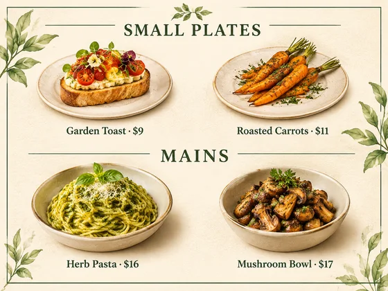

# Visual do menu do restaurante · Visual do menu e dos pratos

[中文](../../../README.md) · [English](../../../README.en.md) · [Português](../../../README.pt.md) · [Español](../../../README.es.md) · [Français](../../../README.fr.md) · [Deutsch](../../../README.de.md) · [عربي](../../../README.ar.md) · [русский](../../../README.ru.md) · [日本語](../../../README.ja.md) · [हिंदी](../../../README.hi.md)


Crie um visual de menu a partir de nomes de pratos confirmados, preços, categorias e fotografias opcionais de comida real.

Gere recursos visuais de menu de restaurante e ilustrações de pratos. Para uso em restaurantes, para viagem.

[Copiar prompt](#public-prompt) · [ é produzido por dearsketch / Experimente online](https://dearsketch.com/pt/intent/i124-create-restaurant-menu-visuals-and-dish-imagery.html?utm_source=github&utm_medium=case&utm_campaign=dearsketch-public-cases&utm_content=i124_cta) · [Voltar ao tópico / Coleção](../guides/design.md)

## Material de referência e direção do resultado

<p><strong>Exemplo de resultados</strong></p>
<p><a href="https://dearsketch.com/pt/intent/i124-create-restaurant-menu-visuals-and-dish-imagery.html?utm_source=github&amp;utm_medium=case&amp;utm_campaign=dearsketch-public-cases&amp;utm_content=i124_image"></a></p>
<p>Este exemplo não inclui uma referência de imagem e a visualização da entrada deve ser concluída; veja os requisitos de material abaixo.</p>

Os materiais de referência e resultados são usados ​​para ilustrar a direção visual. O modelo público não é a instrução de geração original para as imagens que o acompanham e não há garantia de reprodução dos mesmos resultados.

## O que preparar/Insumos

| Material | Tipo / Tipo | Quantidade / Quantidade | Condição/Requisito |
| --- | --- | --- | --- |
| Fotos originais de pratos reais | Foto/Imagem | 0–1; vários materiais podem ser combinados em uma placa de referência rotulada | Opcional/Opcional: Quando o cardápio deseja mostrar os pratos reais do restaurante |
| Nome dos pratos, preço exato, classificação | Personagem/Texto | 1 porção | Obrigatório / Obrigatório |

Desta vez, uma única visualização visual é gerada. Cálculo de dados, composição tipográfica precisa, arquivos vetoriais ou de produção ainda precisam ser verificados pelas ferramentas correspondentes.

## Manter e alterar/Editar resumo

- **Preservar / 保留:** Mantenha todos os fatos do menu e a aparência real do prato exatos.
- **Alterar / 改变：** Alterar layout, plano de fundo, sistema decorativo, recortes de imagens e hierarquia.

## Public prompt

**Modelo público recém-editado · Recém-criado · Não testado em geração.** Substitua os parâmetros de colchetes e anexe os materiais necessários na ferramenta que suporta edição de imagens; entradas opcionais e condicionais são preparadas conforme tabela acima. Este modelo não foi usado para gerar os exemplos nesta página.

```text
Create one restaurant menu visual using [CONFIRMED DISH NAMES, PRICES, AND CATEGORIES] and [OPTIONAL REAL DISH PHOTO].
Preserve the actual dish appearance when a restaurant photo is supplied.
Organize items under the exact supplied categories with a clear [MENU FORMAT] hierarchy.
Use [BRAND PALETTE], [TYPE DIRECTION], [BACKGROUND], and restrained [DECORATIVE MOTIFS].
Reproduce every dish name, price, currency, qualifier, and category exactly.
Do not invent ingredients, allergens, availability, portion size, offers, or prices.
Clearly distinguish an illustrative food concept from a photograph of the actual dish.
Treat generated lettering as a layout draft requiring line-by-line proofreading and final typesetting.
Verify accessibility, print size, bleed, and digital dimensions in a production tool.
Deliver one menu preview image only.
```

[Faça online com seus próprios materiais / Faça online](https://dearsketch.com/pt/intent/i124-create-restaurant-menu-visuals-and-dish-imagery.html?utm_source=github&utm_medium=case&utm_campaign=dearsketch-public-cases&utm_content=i124_after-prompt) · [Deixe o agente ajudá-lo a organizar / Use a habilidade](../quickstart.md#agent-skill)

## Confira os principais pontos/revisão

O preço, nome e categoria devem ser confirmados um a um, e as fotos dos pratos reais e as instruções criativas devem ser claramente diferenciadas.

Revise cada nome e preço e diferencie fotos reais de pratos de conceitos ilustrativos.

Direção dos resultados: Menu. Quando for necessário texto exato, arquivos transparentes, vetores ou entrega impressa, verifique o arquivo real; os recursos e taxas disponíveis estão sujeitos à descrição do site.

## Casos relacionados/Tarefas relacionadas

- [Criar uma miniatura de vídeo do YouTube · Miniatura de vídeo do YouTube ](./i106-create-a-youtube-video-thumbnail.md#public-prompt)
- [Crie um pôster promocional a partir de um tópico e copie · Pôster promocional do tema ](./i107-create-a-promotional-poster-from-a-topic-and-copy.md#public-prompt)
- [Crie um pôster de promoção do Dia das Mães, da Black Friday ou de fim de ano · Pôster de promoção de fim de ano](./i112-create-a-mother-s-day-black-friday-or-holiday-sale-poster.md#public-prompt)

## Referência de histórico de requisitos

- [Freepik AI](https://www.freepik.com/ai)

Esses links servem apenas para auxiliar na compreensão do propósito e não são prova da origem ou autorização das imagens desta página.

Para o escopo de uso de imagens e materiais, consulte a descrição do conteúdo [ ](../content-policy.md). [Veja todos os 50 modelos ](../prompts.md).
