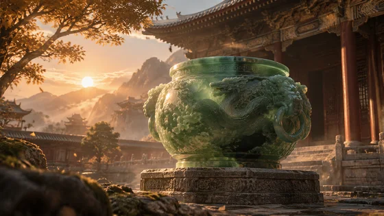

# Arte conceitual de construção de mundo·Arte conceitual de construção de mundo

[中文](../../../README.md) · [English](../../../README.en.md) · [Português](../../../README.pt.md) · [Español](../../../README.es.md) · [Français](../../../README.fr.md) · [Deutsch](../../../README.de.md) · [عربي](../../../README.ar.md) · [русский](../../../README.ru.md) · [日本語](../../../README.ja.md) · [हिंदी](../../../README.hi.md)


Crie um quadro de arte conceitual para o seu briefing especificado apenas a partir do texto.

Gere arte conceitual de filme, jogo ou publicidade a partir de texto. Usado para desenvolvimento inicial e propostas.

[Copiar prompt](#public-prompt) · [ é produzido por dearsketch / Experimente online](https://dearsketch.com/pt/intent/i147-create-concept-art-for-film-games-or-advertising-from-text.html?utm_source=github&utm_medium=case&utm_campaign=dearsketch-public-cases&utm_content=i147_cta) · [Voltar ao tópico / Coleção](../guides/text-only.md)

## Material de referência e direção do resultado

<p><strong>Exemplo de resultados</strong></p>
<p><a href="https://dearsketch.com/pt/intent/i147-create-concept-art-for-film-games-or-advertising-from-text.html?utm_source=github&amp;utm_medium=case&amp;utm_campaign=dearsketch-public-cases&amp;utm_content=i147_image"></a></p>
<p>Este exemplo é uma entrada de texto, nenhuma referência de imagem está anexada.</p>

Os materiais de referência e resultados são usados ​​para ilustrar a direção visual. O modelo público não é a instrução de geração original para as imagens que o acompanham e não há garantia de reprodução dos mesmos resultados.

## O que preparar/Insumos

| Material | Tipo / Tipo | Quantidade / Quantidade | Condição/Requisito |
| --- | --- | --- | --- |
| Resumo de criação de texto: preencha o tema, propósito e parâmetros factuais nas palavras de alerta | Personagem/Texto | 1 porção | Obrigatório / Obrigatório |

**Geração de texto puro/Somente texto: não é necessária imagem, logotipo, esboço ou outro anexo.** Use apenas o resumo do texto abaixo para criar novos conceitos.

Apenas uma imagem é gerada por vez, sem necessidade de upload de imagens.

## Manter e alterar/Editar resumo

- **Preservar / 保留：** Honrar os fatos escritos fornecidos, o texto exato e as restrições.
- **Alterar / 改变：** Mostrar [FOCAL SUBJECT] em [ENVIRONMENT] durante [NARRATIVE MOMENT]. Use [CAMERA POSITION], [SCALE CUES], [LIGHTING] e [PALETTE] para comunicar [MOOD].

## Public prompt

**Modelo público recém-compilado · Recém-criado · Não testado em geração.** Basta substituir os parâmetros de colchetes, sem necessidade de fazer upload de imagens de referência. Este modelo não foi usado para gerar os exemplos nesta página.

```text
Create one concept-art frame for [FILM OR GAME PREMISE] from the following written brief only. No reference image or other attachment is needed.
Show [FOCAL SUBJECT] in [ENVIRONMENT] during [NARRATIVE MOMENT]. Use [CAMERA POSITION], [SCALE CUES], [LIGHTING] and [PALETTE] to communicate [MOOD].
Make geography, foreground and background readable; use original designs rather than existing franchise assets.
Use an original design. Do not imply fidelity to any existing person, product, property or artwork that has not been supplied.
Return one finished image only. Replace every bracketed field with your own details before generating.
```

[Faça online com seus próprios materiais / Faça online](https://dearsketch.com/pt/intent/i147-create-concept-art-for-film-games-or-advertising-from-text.html?utm_source=github&utm_medium=case&utm_campaign=dearsketch-public-cases&utm_content=i147_after-prompt) · [Deixe o agente ajudá-lo a organizar / Use a habilidade](../quickstart.md#agent-skill)

## Confira os principais pontos/revisão

Torne a geografia, o primeiro plano e o plano de fundo legíveis; use designs originais em vez de ativos de franquia existentes.

Torne a geografia, o primeiro plano e o plano de fundo legíveis; use designs originais em vez de ativos de franquia existentes.

Direção do resultado: Arte conceitual. Quando for necessário texto exato, arquivos transparentes, vetores ou entrega impressa, verifique o arquivo real; os recursos e taxas disponíveis estão sujeitos à descrição do site.

## Casos relacionados/Tarefas relacionadas

- [Crie uma foto de perfil para YouTube ou streaming · Avatar do canal gerado por texto ](./i054-create-a-profile-picture-for-youtube-or-streaming.md#public-prompt)
- [Crie um emoji personalizado a partir de texto · Emoji personalizado](./i057-create-a-custom-emoji-from-text.md#public-prompt)
- [Crie estampas perfeitas e padrões de tecido para roupas · ](./i100-create-seamless-prints-and-fabric-patterns-for-clothing.md#public-prompt)

## Referência de histórico de requisitos

- [Freepik AI](https://www.freepik.com/ai)
- [Geração de imagem OpenArt ](https://openart.ai/ai-image-generator/)

Esses links servem apenas para auxiliar na compreensão do propósito e não são prova da origem ou autorização das imagens desta página.

Para o escopo de uso de imagens e materiais, consulte a descrição do conteúdo [ ](../content-policy.md). [Ver todos os 100 modelos ](../prompts.md).
