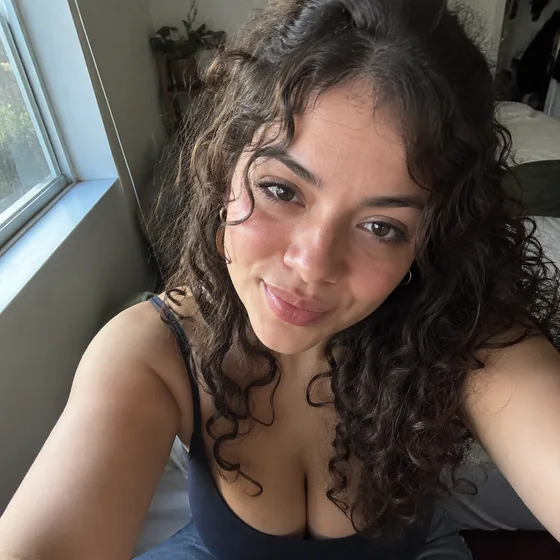
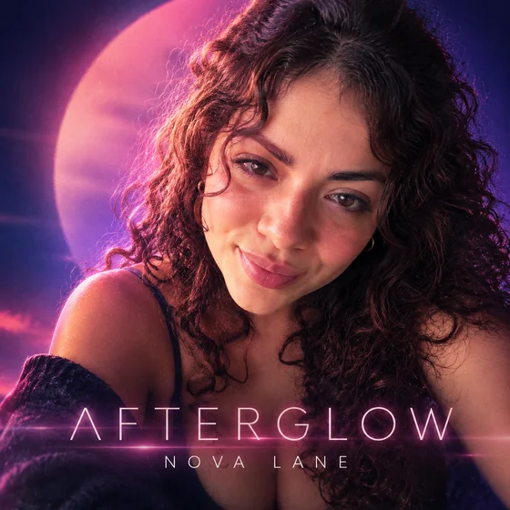

# Arte da capa da música·Capa do lançamento da música

[中文](../../../README.md) · [English](../../../README.en.md) · [Português](../../../README.pt.md) · [Español](../../../README.es.md) · [Français](../../../README.fr.md) · [Deutsch](../../../README.de.md) · [عربي](../../../README.ar.md) · [русский](../../../README.ru.md) · [日本語](../../../README.ja.md) · [हिंदी](../../../README.hi.md)


Crie uma arte original de capa de música para o seu briefing especificado apenas a partir do texto.

Gere capas de álbuns e visuais de lançamentos musicais. Usado para plataformas musicais e promoções.

[Copiar prompt](#public-prompt) · [ é produzido por dearsketch / Experimente online](https://dearsketch.com/pt/intent/i155-create-album-cover-art-and-music-release-visuals.html?utm_source=github&utm_medium=case&utm_campaign=dearsketch-public-cases&utm_content=i155_cta) · [Voltar ao tópico / Coleção](../guides/text-only.md)

## Material de referência e direção do resultado

<table>
<thead><tr><th width="50%">Material de referência</th><th width="50%">Exemplo de resultados</th></tr></thead>
<tbody><tr><td valign="top"><p><strong>Foto original do artista</strong><br></p></td><td valign="top"><a href="https://dearsketch.com/pt/intent/i155-create-album-cover-art-and-music-release-visuals.html?utm_source=github&amp;utm_medium=case&amp;utm_campaign=dearsketch-public-cases&amp;utm_content=i155_image"></a></td></tr></tbody>
</table>

Os materiais de referência e resultados são usados ​​para ilustrar a direção visual. O modelo público não é a instrução de geração original para as imagens que o acompanham e não há garantia de reprodução dos mesmos resultados.

## O que preparar/Insumos

| Material | Tipo / Tipo | Quantidade / Quantidade | Condição/Requisito |
| --- | --- | --- | --- |
| Resumo de criação de texto: preencha o tema, propósito e parâmetros factuais nas palavras de alerta | Personagem/Texto | 1 porção | Obrigatório / Obrigatório |

**Geração de texto puro/Somente texto: não é necessária imagem, logotipo, esboço ou outro anexo.** Use apenas o resumo do texto abaixo para criar novos conceitos.

Apenas uma imagem é gerada por vez, sem necessidade de upload de imagens.

## Manter e alterar/Editar resumo

- **Preservar / 保留：** Honrar os fatos escritos fornecidos, o texto exato e as restrições.
- **Alterar / 改变：** Traduza [THEME OR LYRICAL IMAGE] para [ABSTRACT OR FICTIONAL SCENE]. Use [PALETTE] e uma composição quadrada que permaneça reconhecível como uma miniatura.

## Public prompt

**Modelo público recém-compilado · Recém-criado · Não testado em geração.** Basta substituir os parâmetros de colchetes, sem necessidade de fazer upload de imagens de referência. Este modelo não foi usado para gerar os exemplos nesta página.

```text
Create one original music-cover artwork for [MUSIC MOOD AND GENRE] from the following written brief only. No reference image or other attachment is needed.
Translate [THEME OR LYRICAL IMAGE] into [ABSTRACT OR FICTIONAL SCENE]. Use [PALETTE] and a square composition that remains recognizable as a thumbnail.
Add only “[EXACT TITLE AND ARTIST OR NO TEXT]”; do not invent a likeness or claim a real artist’s endorsement.
Use an original design. Do not imply fidelity to any existing person, product, property or artwork that has not been supplied.
Return one finished image only. Replace every bracketed field with your own details before generating.
```

[Faça online com seus próprios materiais / Faça online](https://dearsketch.com/pt/intent/i155-create-album-cover-art-and-music-release-visuals.html?utm_source=github&utm_medium=case&utm_campaign=dearsketch-public-cases&utm_content=i155_after-prompt) · [Deixe o agente ajudá-lo a organizar / Use a habilidade](../quickstart.md#agent-skill)

## Confira os principais pontos/revisão

Adicione apenas “[EXACT TITLE AND ARTIST OR NO TEXT]”; não invente uma imagem nem reivindique o endosso de um artista real.

Adicione apenas “[EXACT TITLE AND ARTIST OR NO TEXT]”; não invente uma imagem nem reivindique o endosso de um artista real.

Direção do resultado: Capa do álbum. Quando for necessário texto exato, arquivos transparentes, vetores ou entrega impressa, verifique o arquivo real; os recursos e taxas disponíveis estão sujeitos à descrição do site.

## Casos relacionados/Tarefas relacionadas

- [Crie uma foto de perfil para YouTube ou streaming · Avatar do canal gerado por texto ](./i054-create-a-profile-picture-for-youtube-or-streaming.md#public-prompt)
- [Crie um emoji personalizado a partir de texto · Emoji personalizado](./i057-create-a-custom-emoji-from-text.md#public-prompt)
- [Crie estampas perfeitas e padrões de tecido para roupas · ](./i100-create-seamless-prints-and-fabric-patterns-for-clothing.md#public-prompt)

## Referência de histórico de requisitos

- [Freepik AI](https://www.freepik.com/ai)

Esses links servem apenas para auxiliar na compreensão do propósito e não são prova da origem ou autorização das imagens desta página.

Para o escopo de uso de imagens e materiais, consulte a descrição do conteúdo [ ](../content-policy.md). [Ver todos os 100 modelos ](../prompts.md).
