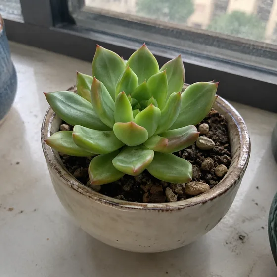
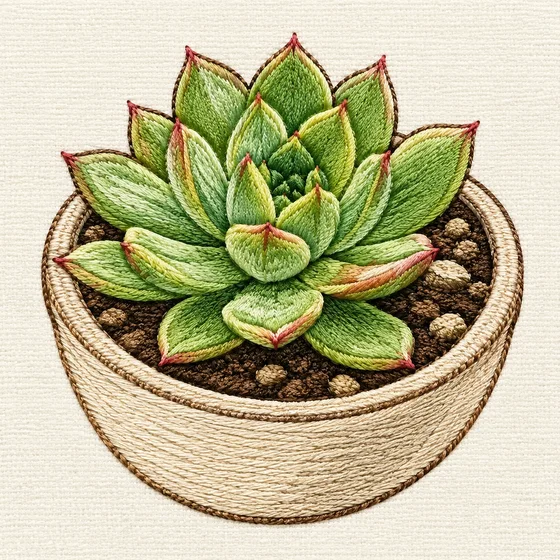

# Conceito de motivo de bordado · Conceito de padrão de estilo de bordado

[中文](../../../README.md) · [English](../../../README.en.md) · [Português](../../../README.pt.md) · [Español](../../../README.es.md) · [Français](../../../README.fr.md) · [Deutsch](../../../README.de.md) · [عربي](../../../README.ar.md) · [русский](../../../README.ru.md) · [日本語](../../../README.ja.md) · [हिंदी](../../../README.hi.md)


Crie um conceito de desenho de bordado do seu briefing especificado apenas a partir do texto.

Converta texto ou imagens em instruções de padrão de bordado. Usado para roupas, crachás, artesanato.

[Copiar prompt](#public-prompt) · [ é produzido por dearsketch / Experimente online](https://dearsketch.com/pt/intent/i160-turn-text-or-an-image-into-an-embroidery-design-direction.html?utm_source=github&utm_medium=case&utm_campaign=dearsketch-public-cases&utm_content=i160_cta) · [Voltar ao tópico / Coleção](../guides/text-only.md)

## Material de referência e direção do resultado

<table>
<thead><tr><th width="50%">Material de referência</th><th width="50%">Exemplo de resultados</th></tr></thead>
<tbody><tr><td valign="top"><p><strong>Foto ou logotipo original</strong><br></p></td><td valign="top"><a href="https://dearsketch.com/pt/intent/i160-turn-text-or-an-image-into-an-embroidery-design-direction.html?utm_source=github&amp;utm_medium=case&amp;utm_campaign=dearsketch-public-cases&amp;utm_content=i160_image"></a></td></tr></tbody>
</table>

Os materiais de referência e resultados são usados ​​para ilustrar a direção visual. O modelo público não é a instrução de geração original para as imagens que o acompanham e não há garantia de reprodução dos mesmos resultados.

## O que preparar/Insumos

| Material | Tipo / Tipo | Quantidade / Quantidade | Condição/Requisito |
| --- | --- | --- | --- |
| Resumo de criação de texto: preencha o tema, propósito e parâmetros factuais nas palavras de alerta | Personagem/Texto | 1 porção | Obrigatório / Obrigatório |

**Geração de texto puro/Somente texto: não é necessária imagem, logotipo, esboço ou outro anexo.** Use apenas o resumo do texto abaixo para criar novos conceitos.

Apenas uma imagem é gerada por vez, sem necessidade de upload de imagens. Escolha a ramificação do tema somente texto para o site.

## Manter e alterar/Editar resumo

- **Preservar / 保留：** Honrar os fatos escritos fornecidos, o texto exato e as restrições.
- **Alterar / 改变：** Use [THREAD COLORS], formas fechadas amplas e [LINE WEIGHT] adequado para [FINISHED SIZE AND PLACEMENT]. Evite gradientes, pequenas ilhas e detalhes excessivos sobrepostos.

## Public prompt

**Modelo público recém-compilado · Recém-criado · Não testado em geração.** Basta substituir os parâmetros de colchetes, sem necessidade de fazer upload de imagens de referência. Este modelo não foi usado para gerar os exemplos nesta página.

```text
Create one embroidery-design concept of [TEXT-DESCRIBED MOTIF] from the following written brief only. No reference image or other attachment is needed.
Use [THREAD COLORS], broad closed shapes and [LINE WEIGHT] suited to [FINISHED SIZE AND PLACEMENT]. Avoid gradients, tiny islands and excessive overlapping detail.
This is a visual motif, not digitized stitch instructions; stitch count, density and machine files need separate work.
Use an original design. Do not imply fidelity to any existing person, product, property or artwork that has not been supplied.
Return one finished image only. Replace every bracketed field with your own details before generating.
```

[Faça online com seus próprios materiais / Faça online](https://dearsketch.com/pt/intent/i160-turn-text-or-an-image-into-an-embroidery-design-direction.html?utm_source=github&utm_medium=case&utm_campaign=dearsketch-public-cases&utm_content=i160_after-prompt) · [Deixe o agente ajudá-lo a organizar / Use a habilidade](../quickstart.md#agent-skill)

## Confira os principais pontos/revisão

Este é um motivo visual, não instruções de costura digitalizadas; contagem de pontos, densidade e arquivos de máquina precisam de trabalho separado.

Este é um motivo visual, não instruções de costura digitalizadas; contagem de pontos, densidade e arquivos de máquina precisam de trabalho separado.

Resultados na direção de: desenhos de bordados. Quando for necessário texto exato, arquivos transparentes, vetores ou entrega impressa, verifique o arquivo real; os recursos e taxas disponíveis estão sujeitos à descrição do site.

## Casos relacionados/Tarefas relacionadas

- [Crie uma foto de perfil para YouTube ou streaming · Avatar do canal gerado por texto ](./i054-create-a-profile-picture-for-youtube-or-streaming.md#public-prompt)
- [Crie um emoji personalizado a partir de texto · Emoji personalizado](./i057-create-a-custom-emoji-from-text.md#public-prompt)
- [Crie estampas perfeitas e padrões de tecido para roupas · ](./i100-create-seamless-prints-and-fabric-patterns-for-clothing.md#public-prompt)

## Referência de histórico de requisitos

- [Cutout.pro](https://www.cutout.pro/)
- [LightXTodas as ferramentas](https://www.lightxeditor.com/all-tools/all-tools/)

Esses links servem apenas para auxiliar na compreensão do propósito e não são prova da origem ou autorização das imagens desta página.

Para o escopo de uso de imagens e materiais, consulte a descrição do conteúdo [ ](../content-policy.md). [Ver todos os 100 modelos ](../prompts.md).
