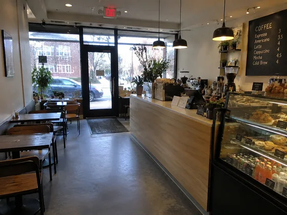

# Conceito de design de espaço comercial · Nova direção de design para espaço comercial

[中文](../../../README.md) · [English](../../../README.en.md) · [Português](../../../README.pt.md) · [Español](../../../README.es.md) · [Français](../../../README.fr.md) · [Deutsch](../../../README.de.md) · [عربي](../../../README.ar.md) · [русский](../../../README.ru.md) · [日本語](../../../README.ja.md) · [हिंदी](../../../README.hi.md)


Crie um novo conceito de interior breve especificado apenas a partir do texto.

Gere instruções de design de restaurantes, lojas ou showrooms. Para abertura de lojas, reformas e propostas.

[Copiar prompt](#public-prompt) · [ é produzido por dearsketch / Experimente online](https://dearsketch.com/pt/intent/i173-create-design-directions-for-a-restaurant-shop-or-showroom.html?utm_source=github&utm_medium=case&utm_campaign=dearsketch-public-cases&utm_content=i173_cta) · [Voltar ao tópico / Coleção](../guides/text-only.md)

## Material de referência e direção do resultado

<table>
<thead><tr><th width="50%">Material de referência</th><th width="50%">Exemplo de resultados</th></tr></thead>
<tbody><tr><td valign="top"><p><strong>Imagem original da cena espacial comercial</strong><br></p></td><td valign="top"><a href="https://dearsketch.com/pt/intent/i173-create-design-directions-for-a-restaurant-shop-or-showroom.html?utm_source=github&amp;utm_medium=case&amp;utm_campaign=dearsketch-public-cases&amp;utm_content=i173_image"></a></td></tr></tbody>
</table>

Os materiais de referência e resultados são usados ​​para ilustrar a direção visual. O modelo público não é a instrução de geração original para as imagens que o acompanham e não há garantia de reprodução dos mesmos resultados.

## O que preparar/Insumos

| Material | Tipo / Tipo | Quantidade / Quantidade | Condição/Requisito |
| --- | --- | --- | --- |
| Resumo de criação de texto: preencha o tema, propósito e parâmetros factuais nas palavras de alerta | Personagem/Texto | 1 porção | Obrigatório / Obrigatório |

**Geração de texto puro/Somente texto: não é necessária imagem, logotipo, esboço ou outro anexo.** Use apenas o resumo do texto abaixo para criar novos conceitos.

Apenas uma imagem é gerada por vez, sem necessidade de upload de imagens.

## Manter e alterar/Editar resumo

- **Preservar / 保留：** Honrar os fatos escritos fornecidos, o texto exato e as restrições.
- **Alterar / 改变：** O resumo é [CUSTOMER TYPE], [FUNCTIONAL ZONES], [CIRCULATION REQUIREMENTS] e [DESIGN DIRECTION]. Projete móveis, luminárias, divisórias, materiais e iluminação como um novo esquema coerente.

## Public prompt

**Modelo público recém-compilado · Recém-criado · Não testado em geração.** Basta substituir os parâmetros de colchetes, sem necessidade de fazer upload de imagens de referência. Este modelo não foi usado para gerar os exemplos nesta página.

```text
Create one new [RESTAURANT OR SHOP OR SHOWROOM] interior concept from the following written brief only. No reference image or other attachment is needed.
The brief is [CUSTOMER TYPE], [FUNCTIONAL ZONES], [CIRCULATION REQUIREMENTS] and [DESIGN DIRECTION]. Design furniture, display fixtures, partitions, materials and lighting as a coherent new scheme.
With no site photo this is a fictional space concept, not an alteration of an actual property or a construction plan.
Use an original design. Do not imply fidelity to any existing person, product, property or artwork that has not been supplied.
Return one finished image only. Replace every bracketed field with your own details before generating.
```

[Faça online com seus próprios materiais / Faça online](https://dearsketch.com/pt/intent/i173-create-design-directions-for-a-restaurant-shop-or-showroom.html?utm_source=github&utm_medium=case&utm_campaign=dearsketch-public-cases&utm_content=i173_after-prompt) · [Deixe o agente ajudá-lo a organizar / Use a habilidade](../quickstart.md#agent-skill)

## Confira os principais pontos/revisão

Sem foto do local, este é um conceito de espaço fictício, não uma alteração de um imóvel real ou de um plano de construção.

Sem foto do local, este é um conceito de espaço fictício, não uma alteração de um imóvel real ou de um plano de construção.

Direção do resultado: Desenho conceitual de espaço comercial. Quando for necessário texto exato, arquivos transparentes, vetores ou entrega impressa, verifique o arquivo real; os recursos e taxas disponíveis estão sujeitos à descrição do site.

## Casos relacionados/Tarefas relacionadas

- [Crie uma foto de perfil para YouTube ou streaming · Avatar do canal gerado por texto ](./i054-create-a-profile-picture-for-youtube-or-streaming.md#public-prompt)
- [Crie um emoji personalizado a partir de texto · Emoji personalizado](./i057-create-a-custom-emoji-from-text.md#public-prompt)
- [Crie estampas perfeitas e padrões de tecido para roupas · ](./i100-create-seamless-prints-and-fabric-patterns-for-clothing.md#public-prompt)

## Referência de histórico de requisitos

- [Design de sala Adobe](https://www.adobe.com/products/firefly/features/ai-room-design.html)

Esses links servem apenas para auxiliar na compreensão do propósito e não são prova da origem ou autorização das imagens desta página.

Para o escopo de uso de imagens e materiais, consulte a descrição do conteúdo [ ](../content-policy.md). [Ver todos os 100 modelos ](../prompts.md).
