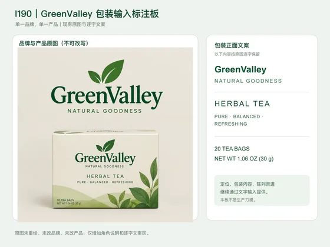
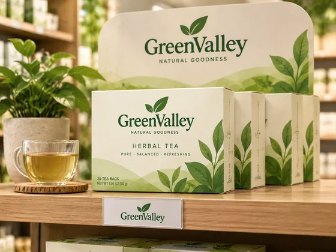

# Conceito de estrutura de embalagem · Estrutura de embalagem e conceito de exibição

[中文](../../../README.md) · [English](../../../README.en.md) · [Português](../../../README.pt.md) · [Español](../../../README.es.md) · [Français](../../../README.fr.md) · [Deutsch](../../../README.de.md) · [عربي](../../../README.ar.md) · [русский](../../../README.ru.md) · [日本語](../../../README.ja.md) · [हिंदी](../../../README.hi.md)


Crie um conceito de embalagem e prateleira para um briefing fictício especificado apenas a partir do texto.

Explore rapidamente diferentes estruturas de embalagem e efeitos de prateleira. Usado para tomada de decisões e testes de novos produtos.

[Copiar prompt](#public-prompt) · [ é produzido por dearsketch / Experimente online](https://dearsketch.com/pt/intent/i190-explore-packaging-structures-and-shelf-presence.html?utm_source=github&utm_medium=case&utm_campaign=dearsketch-public-cases&utm_content=i190_cta) · [Voltar ao tópico / Coleção](../guides/text-only.md)

## Material de referência e direção do resultado

<table>
<thead><tr><th width="50%">Material de referência</th><th width="50%">Exemplo de resultados</th></tr></thead>
<tbody><tr><td valign="top"><p><strong>Redação de produto, logotipo e embalagem real</strong><br></p></td><td valign="top"><a href="https://dearsketch.com/pt/intent/i190-explore-packaging-structures-and-shelf-presence.html?utm_source=github&amp;utm_medium=case&amp;utm_campaign=dearsketch-public-cases&amp;utm_content=i190_image"></a></td></tr></tbody>
</table>

Os materiais de referência e resultados são usados ​​para ilustrar a direção visual. O modelo público não é a instrução de geração original para as imagens que o acompanham e não há garantia de reprodução dos mesmos resultados.

## O que preparar/Insumos

| Material | Tipo / Tipo | Quantidade / Quantidade | Condição/Requisito |
| --- | --- | --- | --- |
| Resumo de criação de texto: preencha o tema, propósito e parâmetros factuais nas palavras de alerta | Personagem/Texto | 1 porção | Obrigatório / Obrigatório |

**Geração de texto puro/Somente texto: não é necessária imagem, logotipo, esboço ou outro anexo.** Use apenas o resumo do texto abaixo para criar novos conceitos.

Apenas uma imagem é gerada por vez, sem necessidade de upload de imagens. Seleção de imagem de referência das condições do local Não aplicável.

## Manter e alterar/Editar resumo

- **Preservar / 保留：** Honrar os fatos escritos fornecidos, o texto exato e as restrições.
- **Alterar / 改变：** Projete [BOX OR CONTAINER STRUCTURE] para [CHANNEL AND POSITIONING]. Mostre uma embalagem principal e um contexto de prateleira restrito; use apenas “[BRAND NAME]” e “[EXACT COPY]”.

## Public prompt

**Modelo público recém-compilado · Recém-criado · Não testado em geração.** Basta substituir os parâmetros de colchetes, sem necessidade de fazer upload de imagens de referência. Este modelo não foi usado para gerar os exemplos nesta página.

```text
Create one packaging-and-shelf concept for a fictional [PRODUCT CATEGORY] from the following written brief only. No reference image or other attachment is needed.
Design [BOX OR CONTAINER STRUCTURE] for [CHANNEL AND POSITIONING]. Show one main pack and a restrained shelf context; use only “[BRAND NAME]” and “[EXACT COPY]”.
Keep repeated packs consistent; do not imply a tested dieline, shelf load rating or actual stocked product.
Use an original design. Do not imply fidelity to any existing person, product, property or artwork that has not been supplied.
Return one finished image only. Replace every bracketed field with your own details before generating.
```

[Faça online com seus próprios materiais / Faça online](https://dearsketch.com/pt/intent/i190-explore-packaging-structures-and-shelf-presence.html?utm_source=github&utm_medium=case&utm_campaign=dearsketch-public-cases&utm_content=i190_after-prompt) · [Deixe o agente ajudá-lo a organizar / Use a habilidade](../quickstart.md#agent-skill)

## Confira os principais pontos/revisão

Mantenha embalagens repetidas consistentes; não implicam uma linha testada, classificação de carga de prateleira ou produto em estoque real.

Mantenha embalagens repetidas consistentes; não implicam uma linha testada, classificação de carga de prateleira ou produto em estoque real.

Direção do resultado: Desenho do conceito de embalagem. Quando for necessário texto exato, arquivos transparentes, vetores ou entrega impressa, verifique o arquivo real; os recursos e taxas disponíveis estão sujeitos à descrição do site.

## Casos relacionados/Tarefas relacionadas

- [Crie uma foto de perfil para YouTube ou streaming · Avatar do canal gerado por texto ](./i054-create-a-profile-picture-for-youtube-or-streaming.md#public-prompt)
- [Crie um emoji personalizado a partir de texto · Emoji personalizado](./i057-create-a-custom-emoji-from-text.md#public-prompt)
- [Crie estampas perfeitas e padrões de tecido para roupas · ](./i100-create-seamless-prints-and-fabric-patterns-for-clothing.md#public-prompt)

## Referência de histórico de requisitos

- [Freepik AI](https://www.freepik.com/ai)
- [Reconstruir](https://www.recraft.ai/Generate)

Esses links servem apenas para auxiliar na compreensão do propósito e não são prova da origem ou autorização das imagens desta página.

Para o escopo de uso de imagens e materiais, consulte a descrição do conteúdo [ ](../content-policy.md). [Ver todos os 100 modelos ](../prompts.md).
