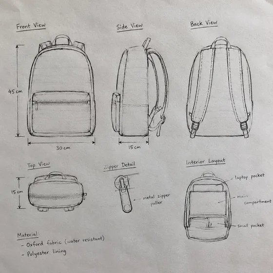
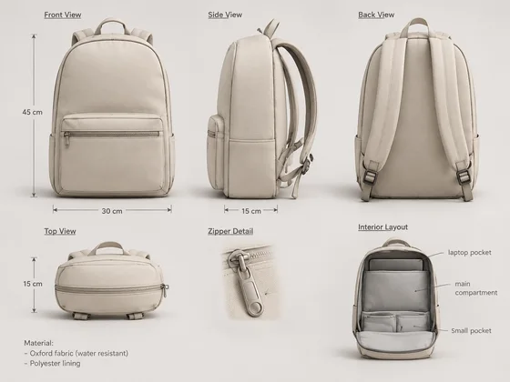

# Protótipo de Produto Virtual · Protótipo de Produto Virtual

[中文](../../../README.md) · [English](../../../README.en.md) · [Português](../../../README.pt.md) · [Español](../../../README.es.md) · [Français](../../../README.fr.md) · [Deutsch](../../../README.de.md) · [عربي](../../../README.ar.md) · [русский](../../../README.ru.md) · [日本語](../../../README.ja.md) · [हिंदी](../../../README.hi.md)


Crie um protótipo visual de um novo briefing especificado apenas a partir do texto.

Gere protótipos de produtos exibíveis antes de fabricar o produto real. Usado para financiamento, entrevistas com usuários e crowdfunding.

[Copiar prompt](#public-prompt) · [ é produzido por dearsketch / Experimente online](https://dearsketch.com/pt/intent/i191-create-a-presentation-ready-product-prototype-image-before-production.html?utm_source=github&utm_medium=case&utm_campaign=dearsketch-public-cases&utm_content=i191_cta) · [Voltar ao tópico / Coleção](../guides/text-only.md)

## Material de referência e direção do resultado

<table>
<thead><tr><th width="50%">Material de referência</th><th width="50%">Exemplo de resultados</th></tr></thead>
<tbody><tr><td valign="top"><p><strong>Esboço do produto ou manuscrito estrutural</strong><br></p></td><td valign="top"><a href="https://dearsketch.com/pt/intent/i191-create-a-presentation-ready-product-prototype-image-before-production.html?utm_source=github&amp;utm_medium=case&amp;utm_campaign=dearsketch-public-cases&amp;utm_content=i191_image"></a></td></tr></tbody>
</table>

Os materiais de referência e resultados são usados ​​para ilustrar a direção visual. O modelo público não é a instrução de geração original para as imagens que o acompanham e não há garantia de reprodução dos mesmos resultados.

## O que preparar/Insumos

| Material | Tipo / Tipo | Quantidade / Quantidade | Condição/Requisito |
| --- | --- | --- | --- |
| Resumo de criação de texto: preencha o tema, propósito e parâmetros factuais nas palavras de alerta | Personagem/Texto | 1 porção | Obrigatório / Obrigatório |

**Geração de texto puro/Somente texto: não é necessária imagem, logotipo, esboço ou outro anexo.** Use apenas o resumo do texto abaixo para criar novos conceitos.

Apenas uma imagem é gerada por vez, sem necessidade de upload de imagens.

## Manter e alterar/Editar resumo

- **Preservar / 保留：** Honrar os fatos escritos fornecidos, o texto exato e as restrições.
- **Change / 改变：** Use a estrutura escrita [COMPONENTS AND RELATIONSHIPS] para [USE SCENARIO]. Aplique [MATERIALS AND FINISHES] e mostre [VIEW] com juntas, contato e escala plausíveis.

## Public prompt

**Modelo público recém-compilado · Recém-criado · Não testado em geração.** Basta substituir os parâmetros de colchetes, sem necessidade de fazer upload de imagens de referência. Este modelo não foi usado para gerar os exemplos nesta página.

```text
Create one visual prototype of a new [PRODUCT] from the following written brief only. No reference image or other attachment is needed.
Use the written structure [COMPONENTS AND RELATIONSHIPS] for [USE SCENARIO]. Apply [MATERIALS AND FINISHES] and show [VIEW] with plausible joints, contact and scale.
This visualizes the written brief only; it does not establish internal engineering, safety or real-world performance.
Use an original design. Do not imply fidelity to any existing person, product, property or artwork that has not been supplied.
Return one finished image only. Replace every bracketed field with your own details before generating.
```

[Faça online com seus próprios materiais / Faça online](https://dearsketch.com/pt/intent/i191-create-a-presentation-ready-product-prototype-image-before-production.html?utm_source=github&utm_medium=case&utm_campaign=dearsketch-public-cases&utm_content=i191_after-prompt) · [Deixe o agente ajudá-lo a organizar / Use a habilidade](../quickstart.md#agent-skill)

## Confira os principais pontos/revisão

Isso visualiza apenas o resumo escrito; não estabelece engenharia interna, segurança ou desempenho no mundo real.

Isso visualiza apenas o resumo escrito; não estabelece engenharia interna, segurança ou desempenho no mundo real.

Direção do resultado: protótipo de produto virtual. Quando for necessário texto exato, arquivos transparentes, vetores ou entrega impressa, verifique o arquivo real; os recursos e taxas disponíveis estão sujeitos à descrição do site.

## Casos relacionados/Tarefas relacionadas

- [Crie uma foto de perfil para YouTube ou streaming · Avatar do canal gerado por texto ](./i054-create-a-profile-picture-for-youtube-or-streaming.md#public-prompt)
- [Crie um emoji personalizado a partir de texto · Emoji personalizado](./i057-create-a-custom-emoji-from-text.md#public-prompt)
- [Crie estampas perfeitas e padrões de tecido para roupas · ](./i100-create-seamless-prints-and-fabric-patterns-for-clothing.md#public-prompt)

## Referência de histórico de requisitos

- [Esboço OpenArt para imagem ](https://openart.ai/generator/sketch/)
- [insMind fotografia de produto](https://www.insmind.com/image-tools/ai-product-photography)

Esses links servem apenas para auxiliar na compreensão do propósito e não são prova da origem ou autorização das imagens desta página.

Para o escopo de uso de imagens e materiais, consulte a descrição do conteúdo [ ](../content-policy.md). [Ver todos os 100 modelos ](../prompts.md).
