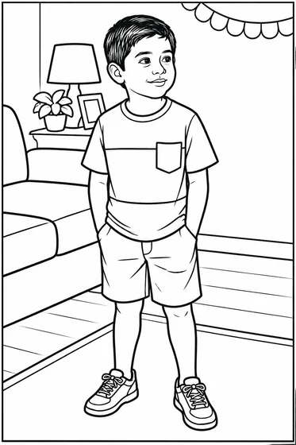

# Ilustrações, publicações e histórias

[中文](../../../README.md) · [English](../../../README.en.md) · [Português](../../../README.pt.md) · [Español](../../../README.es.md) · [Français](../../../README.fr.md) · [Deutsch](../../../README.de.md) · [عربي](../../../README.ar.md) · [русский](../../../README.ru.md) · [日本語](../../../README.ja.md) · [हिंदी](../../../README.hi.md)

6 cases fora do catálogo em destaque. As palavras de aviso não são divulgadas aqui, apenas os materiais de referência existentes, instruções de resultados e requisitos mínimos de materiais são exibidos.

[Voltar para mais catálogos de casos](./index.md) · [Voltar para a página inicial do armazém](../../../README.pt.md)

> Os materiais de referência e as imagens dos resultados são apenas para orientação visual; não há garantia de que o mesmo efeito possa ser reproduzido utilizando os mesmos materiais.

## I141 · Um livro infantil ilustrado que gera personagens consistentes a partir do texto da história

<strong>Exemplo de resultados</strong>

Este exemplo não inclui uma referência de imagem e a visualização da entrada deve ser concluída; veja os requisitos de material abaixo.

- **Tipo de entrada:** Este exemplo mostra apenas exemplos de resultados; a visualização da entrada da imagem deve ser adicionada
- **Requisitos de material:** Regras completas de história e paginação + quadro manuscrito de configuração de caracteres de livro ilustrado + modelo de estilo de ilustração de livro ilustrado + número de página atual ou página espelhada → dividir páginas e gerar ilustrações de personagens consistentes → livro ilustrado infantil único atual completo
- **Descrição:** Somente o atualmente selecionado é gerado por vez; outras fotos da série são executadas separadamente.

[ Verifique os requisitos específicos em dearsketch e faça ](https://dearsketch.com/pt/intent/i141-create-a-children-s-picture-book-with-consistent-characters-from-a-story.html?utm_source=github&utm_medium=gallery&utm_campaign=dearsketch-public-cases&utm_content=i141_cta)

---

## I144 · Gere storyboards ou painéis em quadrinhos que mantêm os personagens consistentes

<strong>Exemplo de resultados</strong>

Este exemplo não inclui uma referência de imagem e a visualização da entrada deve ser concluída; veja os requisitos de material abaixo.

- **Tipo de entrada:** Este exemplo mostra apenas exemplos de resultados; a visualização da entrada da imagem deve ser adicionada
- **Requisitos de material:** Roteiro e diálogo do storyboard + quadro de configuração de personagem e cena + página de quadrinhos atual → gerar cenas e composição contínuas → painel de quadrinhos único atual
- **Descrição:** Desta vez, uma única visualização visual é gerada. Cálculo de dados, composição tipográfica precisa, arquivos vetoriais ou de produção ainda precisam ser verificados pelas ferramentas correspondentes.

[ Verifique os requisitos específicos em dearsketch e faça ](https://dearsketch.com/pt/intent/i144-create-comic-panels-with-consistent-characters.html?utm_source=github&utm_medium=gallery&utm_campaign=dearsketch-public-cases&utm_content=i144_cta)

---

## I145 · Gerar roteiros ou ideias em storyboards de filmes e televisão

<strong>Exemplo de resultados</strong>

Este exemplo não inclui uma referência de imagem e a visualização da entrada deve ser concluída; veja os requisitos de material abaixo.

- **Tipo de entrada:** Este exemplo mostra apenas exemplos de resultados; a visualização da entrada da imagem deve ser adicionada
- **Requisitos de material:** Roteiro ou lista de tomadas + Quadro manuscrito de configuração de personagem e cena + Página atual do storyboard → Gerar esboço de sequência → Storyboard único atual
- **Descrição:** Desta vez, uma única visualização visual é gerada. Cálculo de dados, composição tipográfica precisa, arquivos vetoriais ou de produção ainda precisam ser verificados pelas ferramentas correspondentes.

[ Verifique os requisitos específicos em dearsketch e faça ](https://dearsketch.com/pt/intent/i145-turn-a-script-or-idea-into-a-film-storyboard.html?utm_source=github&utm_medium=gallery&utm_campaign=dearsketch-public-cases&utm_content=i145_cta)

---

## I148 · Converta esboços em ilustrações totalmente acabadas

<table>
<thead><tr><th width="50%">Material de referência</th><th width="50%">Exemplo de resultados</th></tr></thead>
<tbody><tr><td valign="top">
<strong>Esboço desenhado à mão ou digital</strong> 
</td><td valign="top"></td></tr></tbody>
</table>

- **Tipo de entrada:** Inclui visualização do material de referência e exemplo de resultado
- **Requisitos de material:** Esboço desenhado à mão ou digital + faixa de modificação permitida → Manter a composição e adicionar cores e detalhes → Completar a ilustração na imagem única atual
- **Descrição:** Apenas uma imagem é gerada por vez.

[ Verifique os requisitos específicos em dearsketch e faça ](https://dearsketch.com/pt/intent/i148-turn-a-rough-sketch-into-a-polished-illustration.html?utm_source=github&utm_medium=gallery&utm_campaign=dearsketch-public-cases&utm_content=i148_cta)

---

## I149 · Gere páginas para colorir infantis a partir de fotos ou texto

<table>
<thead><tr><th width="50%">Material de referência</th><th width="50%">Exemplo de resultados</th></tr></thead>
<tbody><tr><td valign="top">
<strong>Foto original a ser convertida</strong> 
</td><td valign="top"></td></tr></tbody>
</table>

- **Tipo de entrada:** Inclui visualização do material de referência e exemplo de resultado
- **Requisitos de material:** Foto original a ser convertida → Simplificado em desenho de linha preto e branco claro → Página atual para colorir de crianças solteiras
- **Descrição:** Apenas uma imagem é gerada por vez.

[ Verifique os requisitos específicos em dearsketch e faça ](https://dearsketch.com/pt/intent/i149-create-a-children-s-coloring-page-from-a-photo-or-text.html?utm_source=github&utm_medium=gallery&utm_campaign=dearsketch-public-cases&utm_content=i149_cta)

---

## I153 · Gere ilustrações de tarô, jogos de tabuleiro ou cartas colecionáveis

<strong>Exemplo de resultados</strong>

Este exemplo não inclui uma referência de imagem e a visualização da entrada deve ser concluída; veja os requisitos de material abaixo.

- **Tipo de entrada:** Este exemplo mostra apenas exemplos de resultados; a visualização da entrada da imagem deve ser adicionada
- **Requisitos de material:** Tabela de dados do cartão + Visão de mundo do cartão e modelo de especificação de borda + Cartão atual → Gerar borda unificada e série de ilustrações → Ilustração de cartão único atual
- **Descrição:** Somente o atualmente selecionado é gerado por vez; outras fotos da série são executadas separadamente.

[ Verifique os requisitos específicos em dearsketch e faça ](https://dearsketch.com/pt/intent/i153-create-artwork-for-tarot-board-game-or-collectible-cards.html?utm_source=github&utm_medium=gallery&utm_campaign=dearsketch-public-cases&utm_content=i153_cta)
