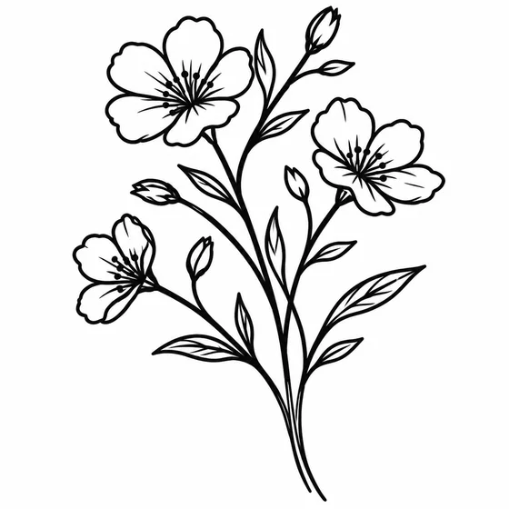
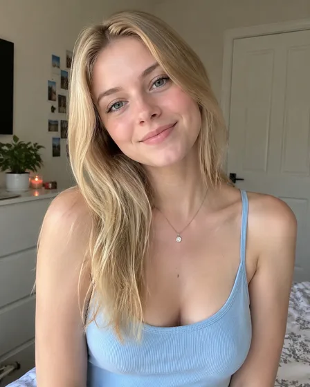

# POD e produtos personalizados

[中文](../../../README.md) · [English](../../../README.en.md) · [Português](../../../README.pt.md) · [Español](../../../README.es.md) · [Français](../../../README.fr.md) · [Deutsch](../../../README.de.md) · [عربي](../../../README.ar.md) · [русский](../../../README.ru.md) · [日本語](../../../README.ja.md) · [हिंदी](../../../README.hi.md)

6 cases fora do catálogo em destaque. As palavras de aviso não são divulgadas aqui, apenas os materiais de referência existentes, instruções de resultados e requisitos mínimos de materiais são exibidos.

[Voltar para mais catálogos de casos](./index.md) · [Voltar para a página inicial do armazém](../../../README.pt.md)

> Os materiais de referência e as imagens dos resultados são apenas para orientação visual; não há garantia de que o mesmo efeito possa ser reproduzido utilizando os mesmos materiais.

## I264 · Converter logotipo ou ilustração em arquivo de ponto de máquina de bordar

<table>
<thead><tr><th width="50%">Material de referência</th><th width="50%">Exemplo de resultados</th></tr></thead>
<tbody><tr><td valign="top">
<strong>Logotipo ou ilustração transparente a ser digitalizada para bordado</strong> 
</td><td valign="top"></td></tr></tbody>
</table>

- **Tipo de entrada:** Inclui visualização do material de referência e exemplo de resultado
- **Requisitos de material:** Logotipo transparente ou ilustração necessária a ser digitalizada para bordado (1) + Especificações de produção de bordado necessárias (1 cópia)
- **Descrição:** Desta vez, uma única visualização visual é gerada. Cálculo de dados, composição tipográfica precisa, arquivos vetoriais ou de produção ainda precisam ser verificados pelas ferramentas correspondentes.

[ Verifique os requisitos específicos em dearsketch e faça ](https://dearsketch.com/pt/intent/i264-convert-a-logo-or-illustration-into-an-embroidery-stitch-file.html?utm_source=github&utm_medium=gallery&utm_campaign=dearsketch-public-cases&utm_content=i264_cta)

---

## I268 · Organize imagens ou texto em arquivos vetoriais de gravação e corte a laser

<table>
<thead><tr><th width="50%">Material de referência</th><th width="50%">Exemplo de resultados</th></tr></thead>
<tbody><tr><td valign="top">
<strong>Imagem ou logotipo a ser gravado/cortado</strong> 
</td><td valign="top"></td></tr></tbody>
</table>

- **Tipo de entrada:** Inclui visualização do material de referência e exemplo de resultado
- **Requisitos de material:** Imagens ou logotipos opcionais a serem gravados/cortados (0 ou 1) + métodos de processamento necessários, materiais e restrições de máquina (1 cópia) + condições que exigem processamento de texto e glifos (1 cópia)
- **Descrição:** Desta vez, uma única visualização visual é gerada. Cálculo de dados, composição tipográfica precisa, arquivos vetoriais ou de produção ainda precisam ser verificados pelas ferramentas correspondentes.

[ Verifique os requisitos específicos em dearsketch e faça ](https://dearsketch.com/pt/intent/i268-prepare-an-image-or-text-as-a-vector-file-for-laser-engraving-or-cutting.html?utm_source=github&utm_medium=gallery&utm_campaign=dearsketch-public-cases&utm_content=i268_cta)

---

## I271 · Converta fotos em desenhos digitais de pintura a óleo

<table>
<thead><tr><th width="50%">Material de referência</th><th width="50%">Exemplo de resultados</th></tr></thead>
<tbody><tr><td valign="top">
<strong>Foto principal da pintura a óleo digital a ser convertida</strong> 
</td><td valign="top"></td></tr></tbody>
</table>

- **Tipo de entrada:** Inclui visualização do material de referência e exemplo de resultado
- **Requisitos de material:** Foto principal necessária da pintura a óleo digital a ser transferida (1 foto) + gama necessária de produto acabado e número de cores de tinta (1 conjunto)
- **Descrição:** Desta vez, uma única visualização visual é gerada. Cálculo de dados, composição tipográfica precisa, arquivos vetoriais ou de produção ainda precisam ser verificados pelas ferramentas correspondentes.

[ Verifique os requisitos específicos em dearsketch e faça ](https://dearsketch.com/pt/intent/i271-turn-a-photo-into-a-paint-by-numbers-pattern.html?utm_source=github&utm_medium=gallery&utm_campaign=dearsketch-public-cases&utm_content=i271_cta)

---

## I273 · Converta fotos em modelos que podem ser cortados ou pintados com spray

<table>
<thead><tr><th width="50%">Material de referência</th><th width="50%">Exemplo de resultados</th></tr></thead>
<tbody><tr><td valign="top">
<strong>Foto ou logotipo em alto contraste do modelo a ser convertido</strong> 
</td><td valign="top"></td></tr></tbody>
</table>

- **Tipo de entrada:** Inclui visualização do material de referência e exemplo de resultado
- **Requisitos de material:** Foto ou logotipo de alto contraste necessário do modelo a ser transferido (1 foto) + finalidade do modelo necessária, material e conexão mínima (1 cópia)
- **Descrição:** Desta vez, uma única visualização visual é gerada. Cálculo de dados, composição tipográfica precisa, arquivos vetoriais ou de produção ainda precisam ser verificados pelas ferramentas correspondentes.

[ Verifique os requisitos específicos em dearsketch e faça ](https://dearsketch.com/pt/intent/i273-turn-a-photo-into-a-cuttable-or-paintable-stencil.html?utm_source=github&utm_medium=gallery&utm_campaign=dearsketch-public-cases&utm_content=i273_cta)

---

## I284 · Crie um fã de apoio ou um quadro de nomes com fotos de pessoas e texto em negrito

<table>
<thead><tr><th width="50%">Material de referência</th><th width="50%">Exemplo de resultados</th></tr></thead>
<tbody><tr><td valign="top">
<strong>Fotos de pessoas com permissão de uso</strong> 
</td><td valign="top"></td></tr></tbody>
</table>

- **Tipo de entrada:** Inclui visualização do material de referência e exemplo de resultado
- **Requisitos de material:** Deve ter o direito de usar fotos de pessoas (1 foto) + nomes ou frases de incentivo obrigatórias (1 conjunto) + tipos de produtos acabados obrigatórios e cores representativas (1 conjunto)
- **Descrição:** Apenas uma imagem é gerada por vez.

[ Verifique os requisitos específicos em dearsketch e faça ](https://dearsketch.com/pt/intent/i284-create-a-fan-support-uchiwa-or-name-board-from-a-portrait.html?utm_source=github&utm_medium=gallery&utm_campaign=dearsketch-public-cases&utm_content=i284_cta)

---

## I287 · Crie várias selfies em tiras de fotos de quatro quadros e bordas temáticas

<table>
<thead><tr><th width="50%">Material de referência</th><th width="50%">Exemplo de resultados</th></tr></thead>
<tbody><tr><td valign="top">
<strong>Referência histórica/entrada de pré-transformação</strong> 

<strong>Referência histórica/entrada de pré-transformação</strong> 

<strong>Referência histórica/entrada de pré-transformação</strong> 

<strong>Referência histórica/entrada de pré-transformação</strong> 
</td><td valign="top"></td></tr></tbody>
</table>

- **Tipo de entrada:** Inclui visualização do material de referência e exemplo de resultado
- **Requisitos de material:** Disparo contínuo/fotos selfie (2 a 4 fotos) + ordem de quadro superior e inferior obrigatória das tiras de fotos (1 cópia) + data opcional, frase curta, logotipo e cor do tema (0 ou 1 grupo)
- **Descrição:** Apenas uma imagem é gerada por vez.

[ Verifique os requisitos específicos em dearsketch e faça ](https://dearsketch.com/pt/intent/i287-turn-selfies-into-a-four-cut-photo-strip-with-a-themed-frame.html?utm_source=github&utm_medium=gallery&utm_campaign=dearsketch-public-cases&utm_content=i287_cta)
