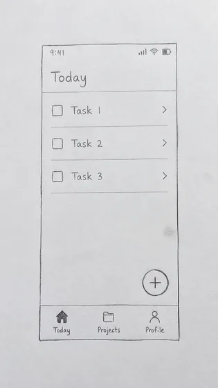

# Conceito de Produto e Design Industrial

[中文](../../../README.md) · [English](../../../README.en.md) · [Português](../../../README.pt.md) · [Español](../../../README.es.md) · [Français](../../../README.fr.md) · [Deutsch](../../../README.de.md) · [عربي](../../../README.ar.md) · [русский](../../../README.ru.md) · [日本語](../../../README.ja.md) · [हिंदी](../../../README.hi.md)

4 cases fora do catálogo em destaque. As palavras de aviso não são divulgadas aqui, apenas os materiais de referência existentes, instruções de resultados e requisitos mínimos de materiais são exibidos.

[Voltar para mais catálogos de casos](./index.md) · [Voltar para a página inicial do armazém](../../../README.pt.md)

> Os materiais de referência e as imagens dos resultados são apenas para orientação visual; não há garantia de que o mesmo efeito possa ser reproduzido utilizando os mesmos materiais.

## I184 · Converta esboços de produtos em representações realistas de produtos

<table>
<thead><tr><th width="50%">Material de referência</th><th width="50%">Exemplo de resultados</th></tr></thead>
<tbody><tr><td valign="top">
<strong>Esboços de produtos desenhados à mão</strong> 
</td><td valign="top"></td></tr></tbody>
</table>

- **Tipo de entrada:** Inclui visualização do material de referência e exemplo de resultado
- **Requisitos de material:** Esboço do produto desenhado à mão + uso do produto, recursos imutáveis ​​no esboço → manter a forma e gerar materiais, luz e sombra e fundo → renderização atual do produto único
- **Descrição:** Apenas uma imagem é gerada por vez.

[ Verifique os requisitos específicos em dearsketch e faça ](https://dearsketch.com/pt/intent/i184-turn-a-product-sketch-into-a-realistic-product-render.html?utm_source=github&utm_medium=gallery&utm_campaign=dearsketch-public-cases&utm_content=i184_cta)

---

## I186 · Pré-visualização do produto em diferentes cores, materiais e tratamentos de superfície

<table>
<thead><tr><th width="50%">Material de referência</th><th width="50%">Exemplo de resultados</th></tr></thead>
<tbody><tr><td valign="top">
<strong>Imagens de produtos ou renderizações 3D</strong> 
</td><td valign="top"></td></tr></tbody>
</table>

- **Tipo de entrada:** Inclui visualização do material de referência e exemplo de resultado
- **Requisitos de material:** Desenho do produto ou renderização 3D + cor ou material alvo → Substituir cor, material e textura → Desenho de plano CMF único atual
- **Descrição:** Apenas uma imagem é gerada por vez.

[ Verifique os requisitos específicos em dearsketch e faça ](https://dearsketch.com/pt/intent/i186-preview-product-colors-materials-and-finishes.html?utm_source=github&utm_medium=gallery&utm_campaign=dearsketch-public-cases&utm_content=i186_cta)

---

## I188 · Gere renderizações de produtos de móveis a partir de esboços

<table>
<thead><tr><th width="50%">Material de referência</th><th width="50%">Exemplo de resultados</th></tr></thead>
<tbody><tr><td valign="top">
<strong>esboços de móveis</strong> 
</td><td valign="top"></td></tr></tbody>
</table>

- **Tipo de entrada:** Inclui visualização do material de referência e exemplo de resultado
- **Requisitos de material:** Esboço de móveis + uso de móveis, estrutura que deve ser mantida → Gerar madeira, tecido e cenas de uso → Renderização atual de produto de mobiliário único
- **Descrição:** Apenas uma imagem é gerada por vez.

[ Verifique os requisitos específicos em dearsketch e faça ](https://dearsketch.com/pt/intent/i188-turn-a-furniture-sketch-into-a-product-render.html?utm_source=github&utm_medium=gallery&utm_campaign=dearsketch-public-cases&utm_content=i188_cta)

---

## I192 · Converta esboços de interface em modelos de UI mais completos

<table>
<thead><tr><th width="50%">Material de referência</th><th width="50%">Exemplo de resultados</th></tr></thead>
<tbody><tr><td valign="top">
<strong>Wireframes ou capturas de tela de interfaces existentes</strong> 
</td><td valign="top"></td></tr></tbody>
</table>

- **Tipo de entrada:** Inclui visualização do material de referência e exemplo de resultado
- **Requisitos de materiais:** Wireframes ou capturas de tela de interfaces existentes + tipo de produto e arquitetura de informações imutáveis ​​→ Estilo visual complementar, componentes e cenários de dispositivos → Mapa conceitual de UI única atual
- **Descrição:** Apenas uma imagem é gerada por vez.

[ Verifique os requisitos específicos em dearsketch e faça ](https://dearsketch.com/pt/intent/i192-turn-a-ui-sketch-into-a-polished-interface-mockup.html?utm_source=github&utm_medium=gallery&utm_campaign=dearsketch-public-cases&utm_content=i192_cta)
