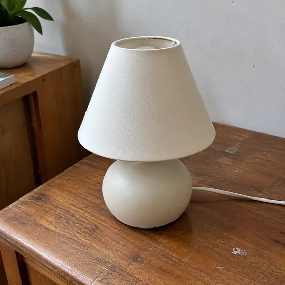
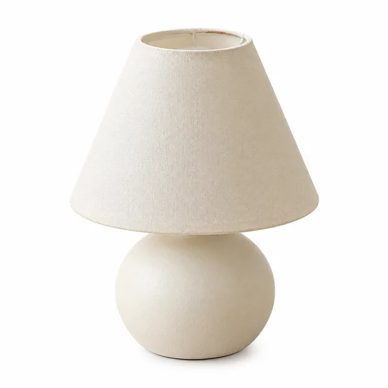
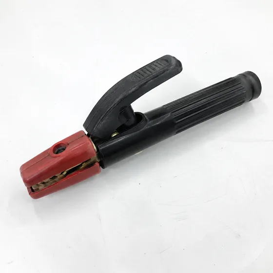
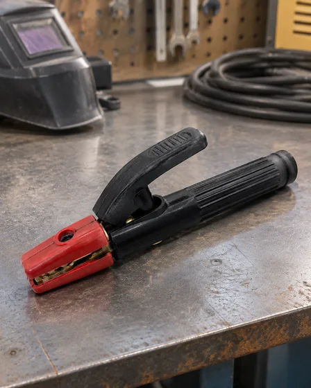

# Edição de fotos de produtos e solicitações de comércio eletrônico · Edição de fotos de produtos e exibição de comércio eletrônico

[中文](../../../README.md) · [English](../../../README.en.md) · [Português](../../../README.pt.md) · [Español](../../../README.es.md) · [Français](../../../README.fr.md) · [Deutsch](../../../README.de.md) · [عربي](../../../README.ar.md) · [русский](../../../README.ru.md) · [日本語](../../../README.ja.md) · [हिंदी](../../../README.hi.md)

Mantenha o mesmo produto enquanto altera a forma como ele é apresentado: uma imagem de listagem limpa, uma cena de estilo de vida, uma prévia de roupas de modelo ou um layout de informações do produto. A forma, a cor e a precisão do rótulo do produto são mais importantes do que os efeitos decorativos.

Primeiro verifique a estrutura do produto, a correspondência de cores e a rotulagem e, em seguida, observe a iluminação e a cena. Dimensões, argumentos de venda e especificações utilizam informações autênticas; fundos transparentes e entregas impressas devem ser conferidos no próprio documento.

## Escolha a tarefa certa

Forneça uma foto nítida do produto. Adicione dimensões, reivindicações aprovadas e cópia exata para layouts de informações. Forneça a roupa real para uma imagem do modelo; uma renderização atraente não se mostra adequada.

| Tarefa | Preservar | Mudar | Solicitação e entradas |
| --- | --- | --- | --- |
| Imagem da lista de produtos com fundo branco / imagem principal com fundo branco do produto | Mantenha a forma, as proporções, a cor, os rótulos, os detalhes da superfície e as peças incluídas do produto. | Altere o plano de fundo, o corte, o equilíbrio da iluminação e a sombra restrita. | [I065](../cases/i065-turn-an-ordinary-product-photo-into-a-white-background-listing-image.md#public-prompt) |
| Ativo de produto com fundo transparente/Material de produto com fundo transparente | Mantenha todas as bordas, aberturas, rótulos, cores e detalhes transparentes ou reflexivos do produto. | Altere apenas a remoção do fundo, a limpeza das bordas e o tratamento opcional de sombras neutras. | [I066](../cases/i066-create-a-reusable-product-png-with-a-transparent-background.md#public-prompt) |
| Cena de produto de estilo de vida/cena de estilo de vida de commodities | Mantenha o modelo do produto, geometria, cor, rótulos, materiais e proporções. | Mude o ambiente, o estilo, a luz, o contexto da câmera e os acessórios de suporte. | [I067](../cases/i067-place-a-product-in-a-realistic-lifestyle-scene.md#public-prompt) |
| Fotografia de produto de estúdio / foto de estúdio de produto | Mantenha geometria, rótulos, cores, materiais, textura e componentes incluídos. | Altere o cenário, o arranjo da luz, o polimento da câmera e o tratamento das sombras. | [I068](../cases/i068-turn-an-ordinary-photo-into-a-professional-studio-product-shot.md#public-prompt) |
| Imagem de campanha de produto sazonal/cena de mercadorias do festival | Mantenha a identidade do produto, design, rótulo, cor e informações promocionais fornecidas. | Altere a decoração, o cenário, a luz, a paleta e a composição da campanha. | [I069](../cases/i069-create-christmas-black-friday-or-seasonal-product-imagery.md#public-prompt) |
| Imagem comercial de comida ou bebida / Fotografia comercial de comida e bebida | Mantenha a porção, os ingredientes, a embalagem e a aparência reais no ramo de fotos. | Altere o revestimento, o cenário, a iluminação, o plano de fundo e o tratamento da câmera. | [I080](../cases/i080-create-commercial-photography-for-food-cakes-pizza-or-drinks.md#public-prompt) |
| Roupa plana para imagem no modelo / Imagem plana da roupa para modelar a imagem da parte superior do corpo | Mantenha a silhueta, a construção, a cor, a estampa, os detalhes do tecido, os acabamentos e a marca. | Mude a apresentação de flat lay para modelo, pose, cenário e iluminação. | [I089](../cases/i089-turn-flat-lay-clothing-into-an-on-model-image.md#public-prompt) |
| Imagem de interação do produto em mãos / Imagem de interação do produto em mãos | Mantenha o design do produto, as indicações de tamanho, o rótulo, a cor e a verdade funcional. | Mude as mãos, o contexto do usuário, o ambiente, o ângulo da câmera e a luz. | [I075](../cases/i075-show-a-product-being-held-or-used.md#public-prompt) |
| Infográfico de características do produto / infográfico de ponto de venda do produto | Mantenha a aparência do produto e todos os números, unidades e reivindicações fornecidos exatos. | Altere o layout, as legendas, os ícones, a hierarquia e o plano de fundo de suporte. | [I076](../cases/i076-create-a-product-infographic-with-dimensions-features-and-specifications.md#public-prompt) |
| Rascunho visual da página de detalhes de comércio eletrônico / Rascunho visual da página de detalhes de comércio eletrônico | Mantenha todas as visualizações de produtos consistentes e todas as declarações e textos fornecidos exatos. | Altere a ordem das seções, a hierarquia gráfica, os planos de fundo, as legendas e o contexto do estilo de vida. | [I077](../cases/i077-create-a-long-form-e-commerce-detail-image-from-product-information.md#public-prompt) |

## Material de referência e direção do resultado

### Imagem da lista de produtos com fundo branco

<table>
<thead><tr><th width="50%">Material de referência</th><th width="50%">Exemplo de resultado</th></tr></thead>
<tbody><tr><td valign="top">
<strong>Fotos do produto tiradas com celular</strong> 
</td><td valign="top"></td></tr></tbody>
</table>

[Leia os requisitos de prompt e entrada](../cases/i065-turn-an-ordinary-product-photo-into-a-white-background-listing-image.md#public-prompt) · [Tente com seu próprio material](https://dearsketch.com/pt/intent/i065-turn-an-ordinary-product-photo-into-a-white-background-listing-image.html?utm_source=github&utm_medium=guide&utm_campaign=dearsketch-public-cases&utm_content=i065_cta)

### Cena de produto de estilo de vida

<table>
<thead><tr><th width="50%">Material de referência</th><th width="50%">Exemplo de resultado</th></tr></thead>
<tbody><tr><td valign="top">
<strong>Imagem de fundo branco do produto</strong> 
</td><td valign="top"></td></tr></tbody>
</table>

[Leia os requisitos de prompt e entrada](../cases/i067-place-a-product-in-a-realistic-lifestyle-scene.md#public-prompt) · [Tente com seu próprio material](https://dearsketch.com/pt/intent/i067-place-a-product-in-a-realistic-lifestyle-scene.html?utm_source=github&utm_medium=guide&utm_campaign=dearsketch-public-cases&utm_content=i067_cta)

Estes são exemplos visuais. Os modelos públicos foram escritos recentemente e não foram testados em relação às entradas ilustradas. Revise os requisitos de identidade, conteúdo e arquivo antes de usar uma saída. Termos da imagem: [política de conteúdo](../content-policy.md).
