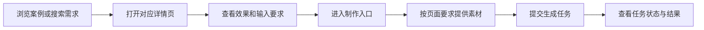
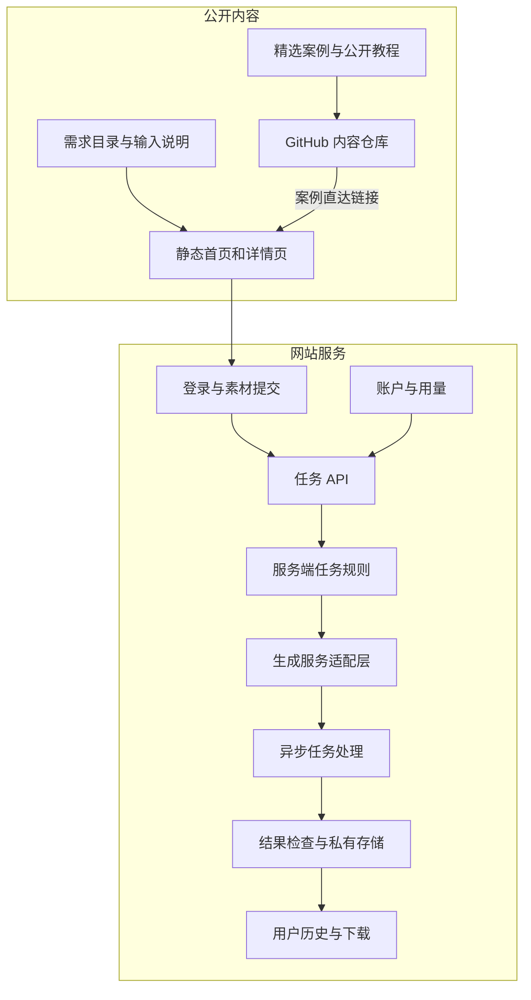

# dearsketch архитектура продукта

[中文](../../README.md) · [English](../../README.en.md) · [Português](../../README.pt.md) · [Español](../../README.es.md) · [Français](../../README.fr.md) · [Deutsch](../../README.de.md) · [عربي](../../README.ar.md) · [русский](../../README.ru.md) · [日本語](../../README.ja.md) · [हिंदी](../../README.hi.md)


dearsketch организует «Какие изображения я хочу завершить» в доступный для просмотра каталог требований. Каждое требование имеет отдельную страницу, на которой объясняется цель, необходимые материалы и требования к результату; пользователи входят в производственный процесс с соответствующей страницы.

В этом описании описываются обязанности модуля и поток данных. Публичная библиотека контента, сервисы веб-сайтов и сгенерированные модели решают разные задачи; на этом складе представлены публичные кейсы, 50 вновь отредактированных шаблонов и Agent Skill, а на сайте осуществляется онлайн-производство.

## Путь пользователя



Для различных заданий могут потребоваться фотографии, определенные дизайнерские рукописи, точный копирайтинг или несколько ресурсов персонажей. Серийные чертежи и несколько планов создаются отдельно на одной основе; когда требуется точный текст, векторные изображения или рабочие файлы, после визуального предварительного просмотра требуются соответствующие инструменты.

## Слои контента и генерации



Страницы со статическим контентом отвечают за обнаружение, интерпретацию и включение в поиск. Задача API отвечает за проверку ввода данных пользователем и создание задач. Уровень адаптации правил и генерации на стороне сервера отвечает за выполнение выбранных требований. Уровень истории и хранения отвечает за возврат результатов соответствующим пользователям.

Модули на рисунке отражают разделение обязанностей в текущем исходном коде и не являются обязательными для всех онлайн-функций, статуса оплаты или уровней обслуживания; при их использовании преимущественную силу имеют фактический вход и инструкции, предоставленные на веб-сайте.

## Обязанности модуля

| модуль | Проблема решена |
| --- | --- |
| Каталог требований | Организуйте задачи с картинками с указанием целей, входных данных, результатов и сценариев. |
| Создание страницы | Создавайте стабильные адреса, содержимое страниц и метаданные поиска для ваших нужд. |
| Введите договор | Объясните, какие материалы обязательны, какие необязательны и каковы взаимоотношения между материалами. |
| Учетные записи и задачи API | Проверьте идентичность, целостность ввода и запросите дублирование |
| Правила задач сервера | Организуйте контент выполнения на основе потребностей и текущих данных. |
| Создать адаптационный слой | Подключайтесь к внешним службам сборки и выполняйте асинхронные задачи. |
| Результаты и история | Проверяйте результаты, экономьте ресурсы и предоставляйте доступ соответствующим пользователям. |
| Аккаунт и использование | Обработка квалификаций использования, баллов и статуса, связанного с заказом. |

## Метод реализации

| слой | Метод в текущем исходном коде |
| --- | --- |
| Создание контента | Скрипт Node.js генерирует HTML, страницу сведений и метаданные поиска на основе структурированных требований. |
| Взаимодействие с браузером | JavaScript управляет фильтрацией, вводом материала и статусом задачи; некоторые взаимодействия используют React и упакованы Vite |
| Сервер | Модули Node.js обрабатывают аутентификацию, загрузку, задачи сборки, историю и использование. |
| данные | Реляционная база данных записывает учетные записи, владение ресурсами и статус задач. |
| документ | Хранилище частных объектов, отделенное от бизнес-данных, доступ к которым осуществляется через контролируемые адреса. |
| генерировать | Сервер адаптируется к внешним службам и обрабатывает асинхронные задачи и результаты. |

Эти технические решения могут объяснить, как система разделяет работу, не раскрывая номера производственных счетов, идентификаторы проектов, имена сегментов или значения переменных среды.

## Пример общедоступных данных

```json
{
  "id": "I026",
  "title": "宠物定制肖像",
  "input": "1张宠物照片",
  "output": "宠物肖像图片",
  "roles": [
    { "kind": "image", "label": "宠物照片", "requirement": "required", "quantity": "1张" }
  ]
}
```

Эти поля объясняют задачи пользователя и не содержат полных инструкций по созданию на стороне сервера. См. [cases.json](../../data/cases.json) для выбранных данных дела, см. [gallery.json](../../data/gallery.json) для других примеров результатов и см. [public-prompts.json](../../data/public-prompts.json) для нового общедоступного шаблона. Публичные навыки отвечают только за подготовку списков ввода и слов-подсказок и не имеют доступа к внутренним правилам генерации.

## Границы доступа и контента

Публичные изображения кейсов и ресурсы, загруженные пользователями, — это два типа контента. Кейсы используются для иллюстрации визуального направления; исходные изображения пользователей, результаты задач и записи учетных записей не относятся к общедоступной библиотеке дел. Службе генерации необходимо проверить тип, размер и принадлежность материала, а пользовательский ввод не может переопределить ограничения выполнения сервера.

Могут быть представлены диаграммы модулей, обязанности, абстрактные структуры данных, входные спецификации и общие принципы надежности. Раскрытие части серверной реализации или набора структур базы данных — это область открытого исходного кода, решение о которой может быть принято самостоятельно; они не являются автоматически секретными только потому, что находятся на стороне сервера.

В объем этого хранилища входят кейсы, базовые учебные пособия и описания архитектуры продуктов, и он не включает исходный код производственных сервисов, внутренние полные навыки или ресурсы для развертывания. Учетные данные, сеансы, записи реальных пользователей и адреса частных ресурсов не являются общедоступным контентом.

## Как подключить GitHub к сайту

Каждое избранное изображение и ссылка «Сделать то же самое» ведут на соответствующую страницу спроса. В ссылках используются параметры источника, чтобы различать README, подробности дела и записи учебника; эти параметры лишь отражают источник и сами по себе не могут служить доказательством того, что статистическая система была развернута.

На сайте нет полей для ввода слов для посетителей. Базовые руководства публикуются, чтобы пользователи могли опробовать инструменты по своему выбору; на веб-сайте предусмотрены соответствующие входы материалов в зависимости от выбранных потребностей.
