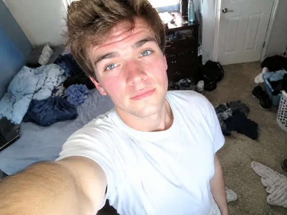
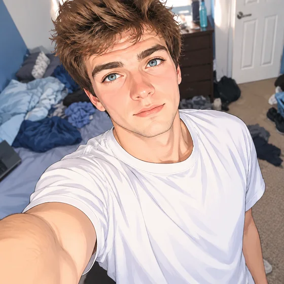

# Аватар в стиле аниме · Преобразование фотографии в персонажа аниме

[中文](../../../README.md) · [English](../../../README.en.md) · [Português](../../../README.pt.md) · [Español](../../../README.es.md) · [Français](../../../README.fr.md) · [Deutsch](../../../README.de.md) · [عربي](../../../README.ar.md) · [русский](../../../README.ru.md) · [日本語](../../../README.ja.md) · [हिंदी](../../../README.hi.md)


Создайте оригинальный портрет в стиле аниме, сохранив при этом индивидуальность.

Превратите настоящие фотографии в персонажей аниме. Используется для социальных аватаров и творений фанатов.

[Скопировать ](#public-prompt) · [ создан dearsketch / Попробуйте онлайн](https://dearsketch.com/ru/intent/i048-turn-a-portrait-photo-into-an-anime-character.html?utm_source=github&utm_medium=case&utm_campaign=dearsketch-public-cases&utm_content=i048_cta) · [Вернуться к теме / Коллекция](../guides/people.md)

## Справочный материал и направление результата

<table>
<thead><tr><th width="50%">Справочный материал</th><th width="50%">Пример результатов</th></tr></thead>
<tbody><tr><td valign="top"><p><strong>У меня есть четкое представление о моей голове</strong><br></p></td><td valign="top"><a href="https://dearsketch.com/ru/intent/i048-turn-a-portrait-photo-into-an-anime-character.html?utm_source=github&amp;utm_medium=case&amp;utm_campaign=dearsketch-public-cases&amp;utm_content=i048_image"></a></td></tr></tbody>
</table>

Справочные материалы и результаты используются для иллюстрации визуального направления. Общедоступный шаблон не является исходной инструкцией по созданию сопровождающих изображений, и воспроизведение тех же результатов не гарантируется.

## Что подготовить/Входы

| Материал | Тип/Тип | Количество / Количество | Условие/Требование |
| --- | --- | --- | --- |
| У меня есть четкое представление о моей голове | Изображение/Изображение | 1 шт. | Требуется / Требуется |

Одновременно создается только одно изображение.

## Сохранить и изменить / Краткое описание редактирования

- **Сохранение / 保留：** Сохраняйте форму лица, тон кожи, волосы, расположение глаз и характерные аксессуары.
- **Изменить / 改变：** Изменить работу линий, затенение, палитру, фон и уровень стилизации.

## Public prompt

**Недавно отредактированный общедоступный шаблон · Недавно созданный · Не проверенный поколением.** Замените параметры квадратных скобок и прикрепите необходимые материалы в инструменте, поддерживающем редактирование изображений; необязательные и условные входные данные подготавливаются в соответствии с таблицей выше. Этот шаблон не использовался для создания примеров на этой странице.

```text
Create one original anime-inspired avatar from [CLEAR HEAD PHOTO].
Preserve the person’s recognizable face shape, skin tone, hairstyle, hair color, and defining accessories.
Stylize the features with [LINE QUALITY], [SHADING METHOD], and [DETAIL LEVEL].
Keep the relationship between eyes, nose, mouth, jaw, and hair faithful enough for recognition.
Use [EXPRESSION], [PALETTE], and [BACKGROUND] for [INTENDED USE].
Do not turn the subject into a pre-existing anime or game character.
Do not imitate a named living artist or studio-specific signature look.
Keep anatomy, ears, hands if visible, and clothing edges coherent.
Add no writing unless [EXACT TEXT] is supplied.
Deliver one finished avatar image only.
```

[Сделайте это онлайн, используя свои собственные материалы / Сделайте это онлайн](https://dearsketch.com/ru/intent/i048-turn-a-portrait-photo-into-an-anime-character.html?utm_source=github&utm_medium=case&utm_campaign=dearsketch-public-cases&utm_content=i048_after-prompt) · [Позвольте агенту помочь вам это организовать / Используйте навык](../quickstart.md#agent-skill)

## Проверьте ключевые моменты/обзор

Сохраняйте личные характеристики, используйте оригинальные выражения и избегайте превращения всех в одно и то же лицо.

Убедитесь, что результат узнаваем и не является скопированным персонажем франшизы.

Направление результата: Аниме-аватар. Если требуется точный текст, прозрачные файлы, векторные изображения или распечатка, проверьте фактический файл; доступные функции и стоимость зависят от описания на веб-сайте.

## Связанные случаи/Связанные задачи

- [Создайте профессиональную фотографию в LinkedIn из селфи · Селфи в профессиональную фотографию ](./i001-create-a-professional-linkedin-headshot-from-a-selfie.md#public-prompt)
- [Заменить повседневную одежду профессиональной одеждой · ](./i015-replace-casual-clothing-with-professional-attire.md#public-prompt)
- [Превратите себя в королевский, винтажный или исторический портрет · Королевский и винтажный портрет ](./i052-turn-yourself-into-a-royal-vintage-or-historical-portrait.md#public-prompt)

## Справочная информация о требованиях

- [Инструмент Picsart AI](https://picsart.com/ai/)
- [LightXВсе инструменты](https://www.lightxeditor.com/all-tools/all-tools/)

Эти ссылки предназначены только для облегчения понимания цели и не являются доказательством источника или авторизации изображений на этой странице.

Объем использования изображений и материалов см. в описании контента [ ](../content-policy.md). [Просмотреть все 50 шаблонов ](../prompts.md).
