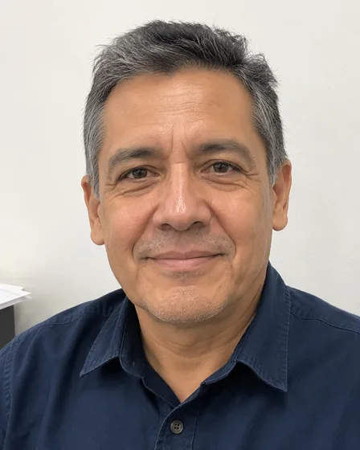

# Аватар канала · Текстовый аватар канала

[中文](../../../README.md) · [English](../../../README.en.md) · [Português](../../../README.pt.md) · [Español](../../../README.es.md) · [Français](../../../README.fr.md) · [Deutsch](../../../README.de.md) · [عربي](../../../README.ar.md) · [русский](../../../README.ru.md) · [日本語](../../../README.ja.md) · [हिंदी](../../../README.hi.md)


Создайте новый вымышленный аватар канала для указанного вами описания, используя только текст.

Создайте канал YouTube или аватар для прямой трансляции. Используется для YouTube и платформ потокового вещания.

[Скопировать ](#public-prompt) · [ создан dearsketch / Попробуйте онлайн](https://dearsketch.com/ru/intent/i054-create-a-profile-picture-for-youtube-or-streaming.html?utm_source=github&utm_medium=case&utm_campaign=dearsketch-public-cases&utm_content=i054_cta) · [Вернуться к теме / Коллекция](../guides/text-only.md)

## Справочный материал и направление результата

<table>
<thead><tr><th width="50%">Справочный материал</th><th width="50%">Пример результатов</th></tr></thead>
<tbody><tr><td valign="top"><p><strong>Фотографии людей или рисунки существующих персонажей.</strong><br></p></td><td valign="top"><a href="https://dearsketch.com/ru/intent/i054-create-a-profile-picture-for-youtube-or-streaming.html?utm_source=github&amp;utm_medium=case&amp;utm_campaign=dearsketch-public-cases&amp;utm_content=i054_image"></a></td></tr></tbody>
</table>

Справочные материалы и результаты используются для иллюстрации визуального направления. Общедоступный шаблон не является исходной инструкцией по созданию сопровождающих изображений, и воспроизведение тех же результатов не гарантируется.

## Что подготовить/Входы

| Материал | Тип/Тип | Количество / Количество | Условие/Требование |
| --- | --- | --- | --- |
| Бриф на создание текста: в подсказках укажите тему, цель и фактические параметры. | Символ/Текст | 1 порция | Требуется / Требуется |

**Генерация чистого текста/только текст: изображение, логотип, эскиз или другое вложение не требуется.** Для создания новых концепций используйте только текстовое описание ниже.

Одновременно создается только одно изображение, загружать изображения не нужно.

## Сохранить и изменить / Краткое описание редактирования

- **Сохранить / 保留：** Соблюдайте предоставленные письменные факты, точные формулировки и ограничения.
- **Изменить / Добавить:** Сделайте [SYMBOL OR FICTIONAL CHARACTER] читабельным внутри круговой обрезки размером 48 пикселей. Используйте [PALETTE] с простым силуэтом и лаконичным фоном.

## Public prompt

**Недавно скомпилированный общедоступный шаблон · Недавно созданный · Не проверен поколением.** Просто замените параметры в квадратных скобках, не нужно загружать эталонные изображения. Этот шаблон не использовался для создания примеров на этой странице.

```text
Create a new fictional channel avatar for [CHANNEL TOPIC] from the following written brief only. No reference image or other attachment is needed.
Make [SYMBOL OR FICTIONAL CHARACTER] readable inside a circular crop at 48 pixels. Use [PALETTE] with a simple silhouette and an uncluttered background.
Do not depict a real host or claim resemblance to an existing character.
Use an original design. Do not imply fidelity to any existing person, product, property or artwork that has not been supplied.
Return one finished image only. Replace every bracketed field with your own details before generating.
```

[Сделайте это онлайн, используя свои собственные материалы / Сделайте это онлайн](https://dearsketch.com/ru/intent/i054-create-a-profile-picture-for-youtube-or-streaming.html?utm_source=github&utm_medium=case&utm_campaign=dearsketch-public-cases&utm_content=i054_after-prompt) · [Позвольте агенту помочь вам это организовать / Используйте навык](../quickstart.md#agent-skill)

## Проверьте ключевые моменты/обзор

Не изображайте настоящего хозяина и не заявляйте о сходстве с существующим персонажем.

Не изображайте настоящего хозяина и не заявляйте о сходстве с существующим персонажем.

Направление результата: аватар автора. Если требуется точный текст, прозрачные файлы, векторные изображения или распечатка, проверьте фактический файл; доступные функции и стоимость зависят от описания на веб-сайте.

## Связанные случаи/Связанные задачи

- [Создание собственного смайлика из текста · Собственные смайлы](./i057-create-a-custom-emoji-from-text.md#public-prompt)
- [Создание бесшовных принтов и рисунков ткани для одежды · ](./i100-create-seamless-prints-and-fabric-patterns-for-clothing.md#public-prompt)
- [Создание визуальных элементов для повседневных публикаций в социальных сетях · Основной визуальный элемент для социальных сетей ](./i104-create-everyday-social-media-post-visuals.md#public-prompt)

## Справочная информация о требованиях

- [Инструмент Picsart AI](https://picsart.com/ai/)

Эти ссылки предназначены только для облегчения понимания цели и не являются доказательством источника или авторизации изображений на этой странице.

Объем использования изображений и материалов см. в описании контента [ ](../content-policy.md). [Просмотреть все 100 шаблонов ](../prompts.md).
