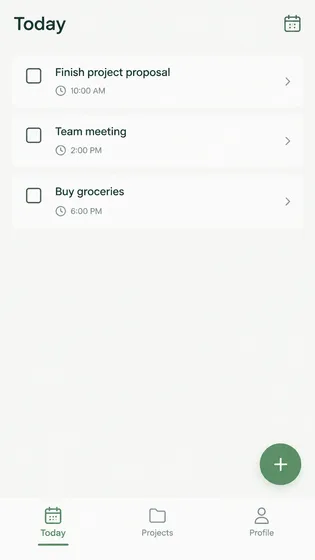
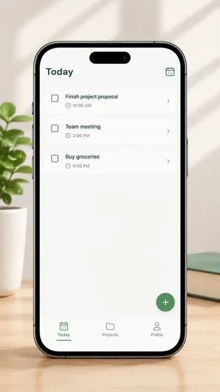

# Макет устройства приложения · Схема отображения устройства приложения

[中文](../../../README.md) · [English](../../../README.en.md) · [Português](../../../README.pt.md) · [Español](../../../README.es.md) · [Français](../../../README.fr.md) · [Deutsch](../../../README.de.md) · [عربي](../../../README.ar.md) · [русский](../../../README.ru.md) · [日本語](../../../README.ja.md) · [हिंदी](../../../README.hi.md)


Поместите скриншот реального приложения в презентацию указанного устройства, не изменяя интерфейс.

Создайте макет устройства с интерфейсом приложения и сохраните рекламные изображения. Используется в App Store и на официальном сайте.

[Скопировать ](#public-prompt) · [ создан dearsketch / Попробуйте онлайн](https://dearsketch.com/ru/intent/i121-create-device-mockups-and-app-store-promotional-images.html?utm_source=github&utm_medium=case&utm_campaign=dearsketch-public-cases&utm_content=i121_cta) · [Вернуться к теме / Коллекция](../guides/design.md)

## Справочный материал и направление результата

<table>
<thead><tr><th width="50%">Справочный материал</th><th width="50%">Пример результатов</th></tr></thead>
<tbody><tr><td valign="top"><p><strong>Скриншот реального интерфейса целевого приложения</strong><br></p></td><td valign="top"><a href="https://dearsketch.com/ru/intent/i121-create-device-mockups-and-app-store-promotional-images.html?utm_source=github&amp;utm_medium=case&amp;utm_campaign=dearsketch-public-cases&amp;utm_content=i121_image"></a></td></tr></tbody>
</table>

Справочные материалы и результаты используются для иллюстрации визуального направления. Общедоступный шаблон не является исходной инструкцией по созданию сопровождающих изображений, и воспроизведение тех же результатов не гарантируется.

## Что подготовить/Входы

| Материал | Тип/Тип | Количество / Количество | Условие/Требование |
| --- | --- | --- | --- |
| Скриншот реального интерфейса целевого приложения | Изображение/Изображение | 1 изображение текущего устройства | Требуется / Требуется |
| Целевое устройство и реальные функциональные преимущества | Символ/Текст | 1 порция | Требуется / Требуется |

На этот раз создается один визуальный предварительный просмотр. Расчет данных, точная верстка, векторные или производственные файлы по-прежнему требуют проверки соответствующими инструментами.

## Сохранить и изменить / Краткое описание редактирования

- **Сохранить / 保留：** Сохраняйте точность содержимого скриншотов и всех одобренных заявлений о функциях.
- **Изменить / 改变：** Измените рамку устройства, фон, композицию, освещение и маркетинговый контекст.

## Public prompt

**Недавно отредактированный общедоступный шаблон · Недавно созданный · Не проверенный поколением.** Замените параметры квадратных скобок и прикрепите необходимые материалы в инструменте, поддерживающем редактирование изображений; необязательные и условные входные данные подготавливаются в соответствии с таблицей выше. Этот шаблон не использовался для создания примеров на этой странице.

```text
Create one app device mockup from [ACTUAL APP SCREENSHOT].
Show it on [TARGET DEVICE] and use only the verified feature message “[APPROVED FEATURE CLAIM]”.
Preserve every visible interface element, text, icon, state, and screen proportion from the supplied screenshot.
Fit the screenshot to the display without redrawing, rewriting, or inventing UI.
Use [DEVICE ANGLE], [BACKGROUND], [PALETTE], and [LIGHTING] for [STORE OR WEBSITE USE].
Keep bezels, corners, reflections, perspective, and screen alignment physically coherent.
Do not show features, notifications, ratings, awards, or compatibility not confirmed by the product.
If marketing text is rendered, proofread it and keep it separate from the app UI.
Verify final store dimensions and platform rules outside the generator.
Deliver one mockup preview image only.
```

[Сделайте это онлайн, используя свои собственные материалы / Сделайте это онлайн](https://dearsketch.com/ru/intent/i121-create-device-mockups-and-app-store-promotional-images.html?utm_source=github&utm_medium=case&utm_campaign=dearsketch-public-cases&utm_content=i121_after-prompt) · [Позвольте агенту помочь вам это организовать / Используйте навык](../quickstart.md#agent-skill)

## Проверьте ключевые моменты/обзор

Интерфейс и преимущества должны исходить из реальных продуктов, а эффект прототипа устройства не означает, что функции реализованы.

Проверьте разборчивость интерфейса и никогда не намекайте на нереализованную функцию.

Направление результата: Мокап приложения. Если требуется точный текст, прозрачные файлы, векторные изображения или распечатка, проверьте фактический файл; доступные функции и стоимость зависят от описания на веб-сайте.

## Связанные случаи/Связанные задачи

- [Создать миниатюру видео YouTube · Миниатюра видео YouTube ](./i106-create-a-youtube-video-thumbnail.md#public-prompt)
- [Создайте рекламный плакат по теме и скопируйте · Рекламный плакат темы ](./i107-create-a-promotional-poster-from-a-topic-and-copy.md#public-prompt)
- [Создайте плакат ко Дню матери, Черной пятнице или праздничной распродаже · Плакат с праздничной распродажей](./i112-create-a-mother-s-day-black-friday-or-holiday-sale-poster.md#public-prompt)

## Справочная информация о требованиях

- [Freepik AI](https://www.freepik.com/ai)

Эти ссылки предназначены только для облегчения понимания цели и не являются доказательством источника или авторизации изображений на этой странице.

Объем использования изображений и материалов см. в описании контента [ ](../content-policy.md). [Просмотреть все 50 шаблонов ](../prompts.md).
