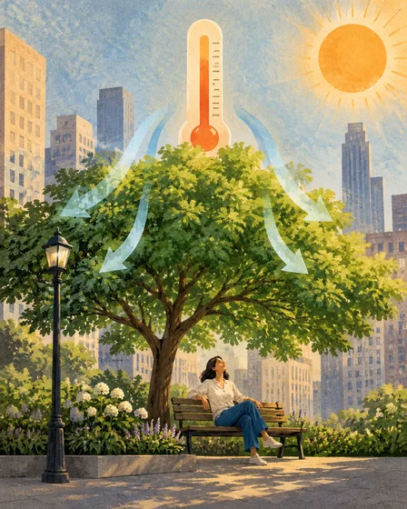

# Иллюстрация редакционной концепции · Иллюстрация концепции статьи

[中文](../../../README.md) · [English](../../../README.en.md) · [Português](../../../README.pt.md) · [Español](../../../README.es.md) · [Français](../../../README.fr.md) · [Deutsch](../../../README.de.md) · [عربي](../../../README.ar.md) · [русский](../../../README.ru.md) · [日本語](../../../README.ja.md) · [हिंदी](../../../README.hi.md)


Создайте одну редакционную иллюстрацию для статьи, доказывающую заданное вами краткое изложение, используя только текст.

Создавайте концептуальные иллюстрации для статей, журналов и отчетов. Для СМИ сообщает.

[Скопировать ](#public-prompt) · [ создан dearsketch / Попробуйте онлайн](https://dearsketch.com/ru/intent/i154-create-editorial-illustrations-for-articles-magazines-and-reports.html?utm_source=github&utm_medium=case&utm_campaign=dearsketch-public-cases&utm_content=i154_cta) · [Вернуться к теме / Коллекция](../guides/text-only.md)

## Справочный материал и направление результата

<p><strong>Пример результатов</strong></p>
<p><a href="https://dearsketch.com/ru/intent/i154-create-editorial-illustrations-for-articles-magazines-and-reports.html?utm_source=github&amp;utm_medium=case&amp;utm_campaign=dearsketch-public-cases&amp;utm_content=i154_image"></a></p>
<p>В этом примере введен текст, ссылка на изображение не прилагается.</p>

Справочные материалы и результаты используются для иллюстрации визуального направления. Общедоступный шаблон не является исходной инструкцией по созданию сопровождающих изображений, и воспроизведение тех же результатов не гарантируется.

## Что подготовить/Входы

| Материал | Тип/Тип | Количество / Количество | Условие/Требование |
| --- | --- | --- | --- |
| Бриф на создание текста: в подсказках укажите тему, цель и фактические параметры. | Символ/Текст | 1 порция | Требуется / Требуется |

**Генерация чистого текста/только текст: изображение, логотип, эскиз или другое вложение не требуется.** Для создания новых концепций используйте только текстовое описание ниже.

Одновременно создается только одно изображение, загружать изображения не нужно.

## Сохранить и изменить / Краткое описание редактирования

- **Сохранить / 保留：** Соблюдайте предоставленные письменные факты, точные формулировки и ограничения.
- **Изменить / 改变：** Выразите аргумент через [ORIGINAL VISUAL METAPHOR], [COMPOSITION], [MEDIUM] и [PALETTE]. Оставьте [AREA] в заголовке публикации.

## Public prompt

**Недавно скомпилированный общедоступный шаблон · Недавно созданный · Не проверен поколением.** Просто замените параметры в квадратных скобках, не нужно загружать эталонные изображения. Этот шаблон не использовался для создания примеров на этой странице.

```text
Create one editorial illustration for an article arguing [CORE IDEA] from the following written brief only. No reference image or other attachment is needed.
Express the argument through [ORIGINAL VISUAL METAPHOR], [COMPOSITION], [MEDIUM] and [PALETTE]. Keep [AREA] clear for the publication’s own headline.
Do not depict fictional actions as factual events or invent portraits of real people.
Use an original design. Do not imply fidelity to any existing person, product, property or artwork that has not been supplied.
Return one finished image only. Replace every bracketed field with your own details before generating.
```

[Сделайте это онлайн, используя свои собственные материалы / Сделайте это онлайн](https://dearsketch.com/ru/intent/i154-create-editorial-illustrations-for-articles-magazines-and-reports.html?utm_source=github&utm_medium=case&utm_campaign=dearsketch-public-cases&utm_content=i154_after-prompt) · [Позвольте агенту помочь вам это организовать / Используйте навык](../quickstart.md#agent-skill)

## Проверьте ключевые моменты/обзор

Не изображайте вымышленные действия как реальные события и не придумывайте портреты реальных людей.

Не изображайте вымышленные действия как реальные события и не придумывайте портреты реальных людей.

Направление результата: редакционная иллюстрация. Если требуется точный текст, прозрачные файлы, векторные изображения или распечатка, проверьте фактический файл; доступные функции и стоимость зависят от описания на веб-сайте.

## Связанные случаи/Связанные задачи

- [Создайте изображение профиля для YouTube или потоковой передачи · Текстовый аватар канала ](./i054-create-a-profile-picture-for-youtube-or-streaming.md#public-prompt)
- [Создание собственного смайлика из текста · Собственные смайлы](./i057-create-a-custom-emoji-from-text.md#public-prompt)
- [Создание бесшовных принтов и рисунков ткани для одежды · ](./i100-create-seamless-prints-and-fabric-patterns-for-clothing.md#public-prompt)

## Справочная информация о требованиях

- [Freepik AI](https://www.freepik.com/ai)
- [Рекрафт](https://www.recraft.ai/Generate)

Эти ссылки предназначены только для облегчения понимания цели и не являются доказательством источника или авторизации изображений на этой странице.

Объем использования изображений и материалов см. в описании контента [ ](../content-policy.md). [Просмотреть все 100 шаблонов ](../prompts.md).
