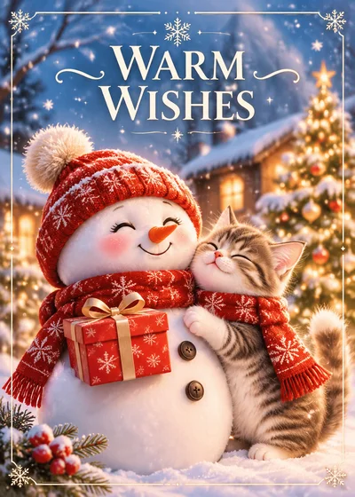

# Вход в коллекцию праздничных открыток · Буклет с поздравительной открыткой к праздничной серии

[中文](../../../README.md) · [English](../../../README.en.md) · [Português](../../../README.pt.md) · [Español](../../../README.es.md) · [Français](../../../README.fr.md) · [Deutsch](../../../README.de.md) · [عربي](../../../README.ar.md) · [русский](../../../README.ru.md) · [日本語](../../../README.ja.md) · [हिंदी](../../../README.hi.md)


Создайте одну карточку в новой указанной вами краткой коллекции только из текста.

Создавайте наборы праздничных открыток, которые продаются. Для использования на Etsy, фирменные подарки.

[Скопировать ](#public-prompt) · [ создан dearsketch / Попробуйте онлайн](https://dearsketch.com/ru/intent/i164-create-a-sellable-set-of-holiday-greeting-cards.html?utm_source=github&utm_medium=case&utm_campaign=dearsketch-public-cases&utm_content=i164_cta) · [Вернуться к теме / Коллекция](../guides/text-only.md)

## Справочный материал и направление результата

<p><strong>Пример результатов</strong></p>
<p><a href="https://dearsketch.com/ru/intent/i164-create-a-sellable-set-of-holiday-greeting-cards.html?utm_source=github&amp;utm_medium=case&amp;utm_campaign=dearsketch-public-cases&amp;utm_content=i164_image"></a></p>
<p>В этом примере введен текст, ссылка на изображение не прилагается.</p>

Справочные материалы и результаты используются для иллюстрации визуального направления. Общедоступный шаблон не является исходной инструкцией по созданию сопровождающих изображений, и воспроизведение тех же результатов не гарантируется.

## Что подготовить/Входы

| Материал | Тип/Тип | Количество / Количество | Условие/Требование |
| --- | --- | --- | --- |
| Бриф на создание текста: в подсказках укажите тему, цель и фактические параметры. | Символ/Текст | 1 порция | Требуется / Требуется |

**Генерация чистого текста/только текст: изображение, логотип, эскиз или другое вложение не требуется.** Для создания новых концепций используйте только текстовое описание ниже.

Одновременно создается только одно изображение, загружать изображения не нужно.

## Сохранить и изменить / Краткое описание редактирования

- **Сохранить / 保留：** Соблюдайте предоставленные письменные факты, точные формулировки и ограничения.
- **Изменить / 改变：** Для этой карты используйте [CURRENT MESSAGE AND MOTIF] с правилами сбора [PALETTE], [BORDER], [LETTERING STYLE] и [FORMAT]. Держите фокус простым, а послание точным.

## Public prompt

**Недавно скомпилированный общедоступный шаблон · Недавно созданный · Не проверен поколением.** Просто замените параметры в квадратных скобках, не нужно загружать эталонные изображения. Этот шаблон не использовался для создания примеров на этой странице.

```text
Create one card in a new [HOLIDAY] collection from the following written brief only. No reference image or other attachment is needed.
For this card use [CURRENT MESSAGE AND MOTIF], with the collection rules [PALETTE], [BORDER], [LETTERING STYLE] and [FORMAT]. Keep the focal point simple and the message exact.
Create only this entry; keeping later cards identical in style requires reusing these written rules and reviewing the series.
Use an original design. Do not imply fidelity to any existing person, product, property or artwork that has not been supplied.
Return one finished image only. Replace every bracketed field with your own details before generating.
```

[Сделайте это онлайн, используя свои собственные материалы / Сделайте это онлайн](https://dearsketch.com/ru/intent/i164-create-a-sellable-set-of-holiday-greeting-cards.html?utm_source=github&utm_medium=case&utm_campaign=dearsketch-public-cases&utm_content=i164_after-prompt) · [Позвольте агенту помочь вам это организовать / Используйте навык](../quickstart.md#agent-skill)

## Проверьте ключевые моменты/обзор

Создайте только эту запись; сохранение идентичности стиля последующих карточек требует повторного использования этих письменных правил и пересмотра серии.

Создайте только эту запись; сохранение идентичности стиля последующих карточек требует повторного использования этих письменных правил и пересмотра серии.

Направление результата: Распечатанные поздравительные открытки. Если требуется точный текст, прозрачные файлы, векторные изображения или распечатка, проверьте фактический файл; доступные функции и стоимость зависят от описания на веб-сайте.

## Связанные случаи/Связанные задачи

- [Создайте изображение профиля для YouTube или потоковой передачи · Текстовый аватар канала ](./i054-create-a-profile-picture-for-youtube-or-streaming.md#public-prompt)
- [Создание собственного смайлика из текста · Собственные смайлы](./i057-create-a-custom-emoji-from-text.md#public-prompt)
- [Создание бесшовных принтов и рисунков ткани для одежды · ](./i100-create-seamless-prints-and-fabric-patterns-for-clothing.md#public-prompt)

## Справочная информация о требованиях

- [Cutout.pro](https://www.cutout.pro/)

Эти ссылки предназначены только для облегчения понимания цели и не являются доказательством источника или авторизации изображений на этой странице.

Объем использования изображений и материалов см. в описании контента [ ](../content-policy.md). [Просмотреть все 100 шаблонов ](../prompts.md).
