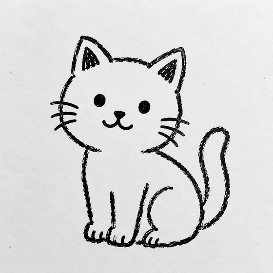
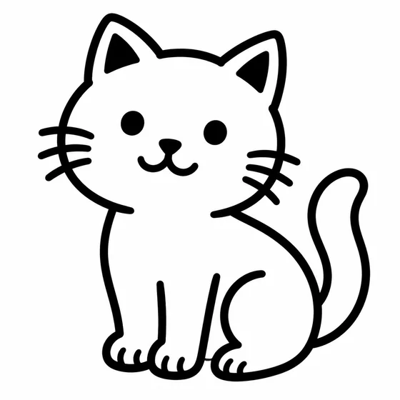

# Концепция линии раскроя·Концепция линии раскроя

[中文](../../../README.md) · [English](../../../README.en.md) · [Português](../../../README.pt.md) · [Español](../../../README.es.md) · [Français](../../../README.fr.md) · [Deutsch](../../../README.de.md) · [عربي](../../../README.ar.md) · [русский](../../../README.ru.md) · [日本語](../../../README.ja.md) · [हिंदी](../../../README.hi.md)


Создайте одну оригинальную концепцию дизайна указанного вами брифа для указанного вами брифа, используя только текст.

Создавайте векторные линии, подходящие для Cricut или лазерной резки. Для Cricut — лазерная резка.

[Скопировать ](#public-prompt) · [ создан dearsketch / Попробуйте онлайн](https://dearsketch.com/ru/intent/i166-create-vector-line-art-for-cricut-or-laser-cutting.html?utm_source=github&utm_medium=case&utm_campaign=dearsketch-public-cases&utm_content=i166_cta) · [Вернуться к теме / Коллекция](../guides/text-only.md)

## Справочный материал и направление результата

<table>
<thead><tr><th width="50%">Справочный материал</th><th width="50%">Пример результатов</th></tr></thead>
<tbody><tr><td valign="top"><p><strong>Исходное изображение для конвертации</strong><br></p></td><td valign="top"><a href="https://dearsketch.com/ru/intent/i166-create-vector-line-art-for-cricut-or-laser-cutting.html?utm_source=github&amp;utm_medium=case&amp;utm_campaign=dearsketch-public-cases&amp;utm_content=i166_image"></a></td></tr></tbody>
</table>

Справочные материалы и результаты используются для иллюстрации визуального направления. Общедоступный шаблон не является исходной инструкцией по созданию сопровождающих изображений, и воспроизведение тех же результатов не гарантируется.

## Что подготовить/Входы

| Материал | Тип/Тип | Количество / Количество | Условие/Требование |
| --- | --- | --- | --- |
| Бриф на создание текста: в подсказках укажите тему, цель и фактические параметры. | Символ/Текст | 1 порция | Требуется / Требуется |

**Генерация чистого текста/только текст: изображение, логотип, эскиз или другое вложение не требуется.** Для создания новых концепций используйте только текстовое описание ниже.

Одновременно создается только одно изображение, загружать изображения не нужно.

## Сохранить и изменить / Краткое описание редактирования

- **Сохранить / 保留：** Соблюдайте предоставленные письменные факты, точные формулировки и ограничения.
- **Изменить / Добавить:** Используйте простые закрытые силуэты, [MINIMUM FEATURE WIDTH] и специальные перемычки, которые удерживают детали интерьера. Визуально отделите [LAYERS] и избегайте случайных следов.

## Public prompt

**Недавно скомпилированный общедоступный шаблон · Недавно созданный · Не проверен поколением.** Просто замените параметры в квадратных скобках, не нужно загружать эталонные изображения. Этот шаблон не использовался для создания примеров на этой странице.

```text
Create one original cutting-design concept of [MOTIF] for [MATERIAL AND PROCESS] from the following written brief only. No reference image or other attachment is needed.
Use simple closed silhouettes, [MINIMUM FEATURE WIDTH] and intentional bridges that keep interior pieces attached. Separate [LAYERS] visually and avoid stray marks.
The image is a drafting reference, not an executable cut file; rebuild and test vector paths in the cutting software.
Use an original design. Do not imply fidelity to any existing person, product, property or artwork that has not been supplied.
Return one finished image only. Replace every bracketed field with your own details before generating.
```

[Сделайте это онлайн, используя свои собственные материалы / Сделайте это онлайн](https://dearsketch.com/ru/intent/i166-create-vector-line-art-for-cricut-or-laser-cutting.html?utm_source=github&utm_medium=case&utm_campaign=dearsketch-public-cases&utm_content=i166_after-prompt) · [Позвольте агенту помочь вам это организовать / Используйте навык](../quickstart.md#agent-skill)

## Проверьте ключевые моменты/обзор

Изображение представляет собой образец чертежа, а не исполняемый вырезанный файл; перестроить и протестировать векторные траектории в программном обеспечении для резки.

Изображение представляет собой образец чертежа, а не исполняемый вырезанный файл; перестроить и протестировать векторные траектории в программном обеспечении для резки.

Направление результата: вырезанный файл SVG. Если требуется точный текст, прозрачные файлы, векторные изображения или распечатка, проверьте фактический файл; доступные функции и стоимость зависят от описания на веб-сайте.

## Связанные случаи/Связанные задачи

- [Создайте изображение профиля для YouTube или потоковой передачи · Текстовый аватар канала ](./i054-create-a-profile-picture-for-youtube-or-streaming.md#public-prompt)
- [Создание собственного смайлика из текста · Собственные смайлы](./i057-create-a-custom-emoji-from-text.md#public-prompt)
- [Создание бесшовных принтов и рисунков ткани для одежды · ](./i100-create-seamless-prints-and-fabric-patterns-for-clothing.md#public-prompt)

## Справочная информация о требованиях

- [Настенное искусство Etsy AI](https://www.etsy.com/market/ai_wall_art)
- [Рекрафт](https://www.recraft.ai/Generate)

Эти ссылки предназначены только для облегчения понимания цели и не являются доказательством источника или авторизации изображений на этой странице.

Объем использования изображений и материалов см. в описании контента [ ](../content-policy.md). [Просмотреть все 100 шаблонов ](../prompts.md).
