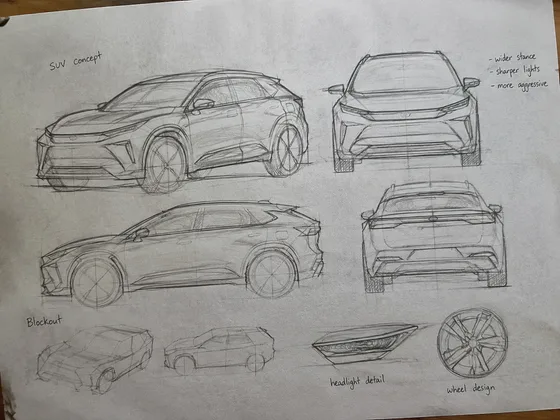
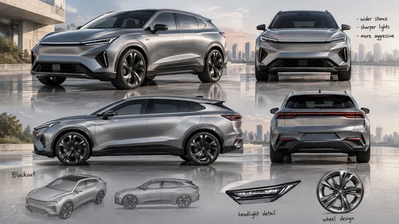

# Концепция стайлинга автомобиля · Текстовый стайлинг автомобиля

[中文](../../../README.md) · [English](../../../README.en.md) · [Português](../../../README.pt.md) · [Español](../../../README.es.md) · [Français](../../../README.fr.md) · [Deutsch](../../../README.de.md) · [عربي](../../../README.ar.md) · [русский](../../../README.ru.md) · [日本語](../../../README.ja.md) · [हिंदी](../../../README.hi.md)


Создайте один оригинал заданной вами краткой концепции стиля, используя только текст.

Создавайте концепции стиля автомобиля на основе текста или эскизов. Для исследования дизайна, содержания.

[Скопировать ](#public-prompt) · [ создан dearsketch / Попробуйте онлайн](https://dearsketch.com/ru/intent/i187-create-a-car-design-concept-from-text-or-a-sketch.html?utm_source=github&utm_medium=case&utm_campaign=dearsketch-public-cases&utm_content=i187_cta) · [Вернуться к теме / Коллекция](../guides/text-only.md)

## Справочный материал и направление результата

<table>
<thead><tr><th width="50%">Справочный материал</th><th width="50%">Пример результатов</th></tr></thead>
<tbody><tr><td valign="top"><p><strong>Эскиз автомобиля или исходный рисунок кузова</strong><br></p></td><td valign="top"><a href="https://dearsketch.com/ru/intent/i187-create-a-car-design-concept-from-text-or-a-sketch.html?utm_source=github&amp;utm_medium=case&amp;utm_campaign=dearsketch-public-cases&amp;utm_content=i187_image"></a></td></tr></tbody>
</table>

Справочные материалы и результаты используются для иллюстрации визуального направления. Общедоступный шаблон не является исходной инструкцией по созданию сопровождающих изображений, и воспроизведение тех же результатов не гарантируется.

## Что подготовить/Входы

| Материал | Тип/Тип | Количество / Количество | Условие/Требование |
| --- | --- | --- | --- |
| Бриф на создание текста: в подсказках укажите тему, цель и фактические параметры. | Символ/Текст | 1 порция | Требуется / Требуется |

**Генерация чистого текста/только текст: изображение, логотип, эскиз или другое вложение не требуется.** Для создания новых концепций используйте только текстовое описание ниже.

Одновременно создается только одно изображение, загружать изображения не нужно.

## Сохранить и изменить / Краткое описание редактирования

- **Сохранить / 保留：** Соблюдайте предоставленные письменные факты, точные формулировки и ограничения.
- **Изменить/Добавить:** Используйте [PROPORTIONS], [BODY LANGUAGE], [MATERIALS] и [COLOR] для [USE CASE]. Покажите целостный вид с поворотом в три четверти с правдоподобным расположением колес и единообразной геометрией панели.

## Public prompt

**Недавно скомпилированный общедоступный шаблон · Недавно созданный · Не проверен поколением.** Просто замените параметры в квадратных скобках, не нужно загружать эталонные изображения. Этот шаблон не использовался для создания примеров на этой странице.

```text
Create one original [VEHICLE TYPE] styling concept from the following written brief only. No reference image or other attachment is needed.
Use [PROPORTIONS], [BODY LANGUAGE], [MATERIALS] and [COLOR] for [USE CASE]. Show a coherent three-quarter view with believable wheel alignment and consistent panel geometry.
This is an exterior concept, not validated aerodynamics, engineering or a redesign of an unseen real model.
Use an original design. Do not imply fidelity to any existing person, product, property or artwork that has not been supplied.
Return one finished image only. Replace every bracketed field with your own details before generating.
```

[Сделайте это онлайн, используя свои собственные материалы / Сделайте это онлайн](https://dearsketch.com/ru/intent/i187-create-a-car-design-concept-from-text-or-a-sketch.html?utm_source=github&utm_medium=case&utm_campaign=dearsketch-public-cases&utm_content=i187_after-prompt) · [Позвольте агенту помочь вам это организовать / Используйте навык](../quickstart.md#agent-skill)

## Проверьте ключевые моменты/обзор

Это концепция внешнего вида, а не проверенная аэродинамика, инженерия или редизайн невидимой реальной модели.

Это концепция внешнего вида, а не проверенная аэродинамика, инженерия или редизайн невидимой реальной модели.

Направление результата: концептуальные чертежи автомобилей. Если требуется точный текст, прозрачные файлы, векторные изображения или распечатка, проверьте фактический файл; доступные функции и стоимость зависят от описания на веб-сайте.

## Связанные случаи/Связанные задачи

- [Создайте изображение профиля для YouTube или потоковой передачи · Текстовый аватар канала ](./i054-create-a-profile-picture-for-youtube-or-streaming.md#public-prompt)
- [Создание собственного смайлика из текста · Собственные смайлы](./i057-create-a-custom-emoji-from-text.md#public-prompt)
- [Создание бесшовных принтов и рисунков ткани для одежды · ](./i100-create-seamless-prints-and-fabric-patterns-for-clothing.md#public-prompt)

## Справочная информация о требованиях

- [LightXВсе инструменты](https://www.lightxeditor.com/all-tools/all-tools/)
- [OpenArt эскиз к изображению ](https://openart.ai/generator/sketch/)

Эти ссылки предназначены только для облегчения понимания цели и не являются доказательством источника или авторизации изображений на этой странице.

Объем использования изображений и материалов см. в описании контента [ ](../content-policy.md). [Просмотреть все 100 шаблонов ](../prompts.md).
