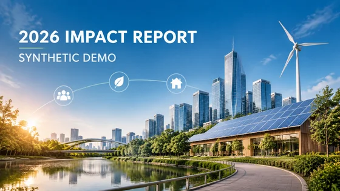

# Маркетинг, реклама и контент для социальных сетей

[中文](../../../README.md) · [English](../../../README.en.md) · [Português](../../../README.pt.md) · [Español](../../../README.es.md) · [Français](../../../README.fr.md) · [Deutsch](../../../README.de.md) · [عربي](../../../README.ar.md) · [русский](../../../README.ru.md) · [日本語](../../../README.ja.md) · [हिंदी](../../../README.hi.md)

6 чехлов вне представленного каталога. Слова-подсказки здесь не раскрываются, отображаются только существующие справочные материалы, направления результатов и минимальные требования к материалам.

[Вернуться к другим каталогам ящиков](./index.md) · [Вернуться на домашнюю страницу склада](../../../README.ru.md)

> Справочные материалы и изображения результатов предназначены только для визуального ознакомления; нет никакой гарантии, что тот же эффект можно воспроизвести с использованием тех же материалов.

## I110 · Создание эффективных креативов на основе изображений продуктов.

<table>
<thead><tr><th width="50%">Справочный материал</th><th width="50%">Пример результатов</th></tr></thead>
<tbody><tr><td valign="top">
<strong>Изображения продуктов, преимущества и аудитория</strong> 
</td><td valign="top"></td></tr></tbody>
</table>

- **Тип входных данных:** включает предварительный просмотр справочного материала и пример результата.
- **Требования к материалам:** Изображения продукта, преимущества продажи и аудитория + преимущества продукта, целевая аудитория → сочетание сцен, копирайтинга и элементов бренда → текущая единая рекламная креативная картинка.
- **Описание:** Одновременно создается только одно изображение.

[ Проверьте конкретные требования в dearsketch и создайте ](https://dearsketch.com/ru/intent/i110-create-performance-ad-creative-from-a-product-image.html?utm_source=github&utm_medium=gallery&utm_campaign=dearsketch-public-cases&utm_content=i110_cta).

---

## I125 · Изменение одного и того же рекламного изображения на разные языковые и культурные версии.

<table>
<thead><tr><th width="50%">Справочный материал</th><th width="50%">Пример результатов</th></tr></thead>
<tbody><tr><td valign="top">
<strong>Полная оригинальная реклама</strong> 
</td><td valign="top"></td></tr></tbody>
</table>

- **Тип входных данных:** включает предварительный просмотр справочного материала и пример результата.
- **Требования к материалам:** 1 полное оригинальное объявление + целевая страна или регион (можно добавить указанный язык, культурные предпочтения или исправленный перевод)
- **Описание:** Одновременно создается только одно изображение.

[ Проверьте конкретные требования в dearsketch и создайте ](https://dearsketch.com/ru/intent/i125-adapt-one-ad-visual-for-different-languages-and-cultures.html?utm_source=github&utm_medium=gallery&utm_campaign=dearsketch-public-cases&utm_content=i125_cta).

---

## I260 · Превратите свою коллекцию одежды в лукбук или каталог модной одежды

<table>
<thead><tr><th width="50%">Справочный материал</th><th width="50%">Пример результатов</th></tr></thead>
<tbody><tr><td valign="top">
<strong>Модель L02 с изображением</strong> 

<strong>L02 полное изображение продукта спереди</strong> 
</td><td valign="top"></td></tr></tbody>
</table>

- **Тип входных данных:** включает предварительный просмотр справочного материала и пример результата.
- **Требования к материалам:** Необходимые изображения модели и изображения продукта (несколько изображений всей серии) + необходимая тема серии, номер стиля, порядок и количество страниц (1 экземпляр)
- **Описание:** На этот раз создается один визуальный предварительный просмотр. Расчет данных, точная верстка, векторные или производственные файлы по-прежнему требуют проверки соответствующими инструментами.

[ Проверьте конкретные требования в dearsketch и создайте ](https://dearsketch.com/ru/intent/i260-turn-a-clothing-collection-into-a-lookbook-or-fashion-catalog.html?utm_source=github&utm_medium=gallery&utm_campaign=dearsketch-public-cases&utm_content=i260_cta).

---

## I261 · Создать обложку подкаста

<table>
<thead><tr><th width="50%">Справочный материал</th><th width="50%">Пример результатов</th></tr></thead>
<tbody><tr><td valign="top">
<strong>Портрет хозяина</strong> 
</td><td valign="top"></td></tr></tbody>
</table>

- **Тип входных данных:** включает предварительный просмотр справочного материала и пример результата.
- **Требования к материалам:** Необязательный портрет хоста (0 или 1) + необходимое название программы, тема и целевая платформа (1 копия) + необходимое название программы и необходимый подзаголовок (1 комплект).
- **Описание:** Одновременно создается только одно изображение.

[ Проверьте конкретные требования в dearsketch и создайте ](https://dearsketch.com/ru/intent/i261-create-podcast-cover-art.html?utm_source=github&utm_medium=gallery&utm_campaign=dearsketch-public-cases&utm_content=i261_cta).

---

## I262 · Создание иллюстраций для ежегодных отчетов или тематических исследований.

<strong>Пример результатов</strong>

Этот пример не включает ссылку на изображение, и предварительный просмотр ввода должен быть завершен; см. требования к материалам ниже.

- **Тип ввода:** В этом примере показаны только примеры результатов; предварительный просмотр изображения должен быть добавлен
- **Требования к материалам:** Дополнительные спецификации бренда или существующие привязки иллюстраций отчета (от 0 до нескольких) + обязательный список глав и краткое содержание каждой главы (1 копия) + проверенные данные о состоянии (1 копия) + дополнительные спецификации бренда (0 или 1 копия)
- **Описание:** Одновременно генерируется только выбранный в данный момент файл; остальные картины серии выполняются отдельно.

[ Проверьте конкретные требования в dearsketch и создайте ](https://dearsketch.com/ru/intent/i262-create-illustrations-for-an-annual-report-white-paper-or-case-study.html?utm_source=github&utm_medium=gallery&utm_campaign=dearsketch-public-cases&utm_content=i262_cta).

---

## I263 · Создание единых концептуальных иллюстраций и диаграмм для презентаций.

<strong>Пример результатов</strong>

Этот пример не включает ссылку на изображение, и предварительный просмотр ввода должен быть завершен; см. требования к материалам ниже.

- **Тип ввода:** В этом примере показаны только примеры результатов; предварительный просмотр изображения должен быть добавлен
- **Требования к материалам:** Дополнительный визуальный якорь бренда или роуд-шоу (0 или 1 фотография) + обязательный список страниц и основная информация на каждой странице (1 копия) + требуемая бизнес-модель или пользовательский процесс (1 копия) + дополнительные спецификации бренда (0 или 1 копия)
- **Описание:** Одновременно генерируется только выбранный в данный момент файл; остальные картины серии выполняются отдельно.

[ Проверьте конкретные требования в dearsketch и создайте ](https://dearsketch.com/ru/intent/i263-create-consistent-illustrations-and-diagrams-for-a-pitch-deck.html?utm_source=github&utm_medium=gallery&utm_campaign=dearsketch-public-cases&utm_content=i263_cta).
