# Ресурсы для брендинга и графического дизайна

[中文](../../../README.md) · [English](../../../README.en.md) · [Português](../../../README.pt.md) · [Español](../../../README.es.md) · [Français](../../../README.fr.md) · [Deutsch](../../../README.de.md) · [عربي](../../../README.ar.md) · [русский](../../../README.ru.md) · [日本語](../../../README.ja.md) · [हिंदी](../../../README.hi.md)

7 чехлов вне представленного каталога. Слова-подсказки здесь не раскрываются, отображаются только существующие справочные материалы, направления результатов и минимальные требования к материалам.

[Вернуться к другим каталогам ящиков](./index.md) · [Вернуться на домашнюю страницу склада](../../../README.ru.md)

> Справочные материалы и изображения результатов предназначены только для визуального ознакомления; нет никакой гарантии, что тот же эффект можно воспроизвести с использованием тех же материалов.

## I130 · Создать многоразовый визуальный дизайн талисмана бренда VI.

<table>
<thead><tr><th width="50%">Справочный материал</th><th width="50%">Пример результатов</th></tr></thead>
<tbody><tr><td valign="top">
<strong>Один логотип бренда и визуальные характеристики</strong> 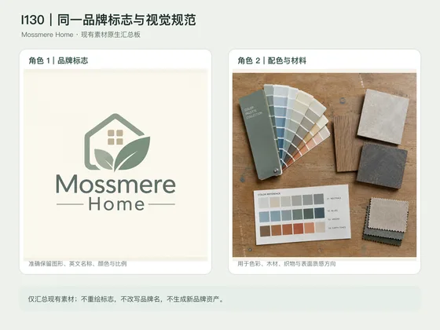

<strong>Прототип талисмана или карта направлений</strong> 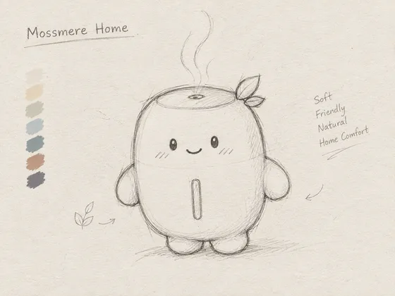
</td><td valign="top"><a href="https://dearsketch.com/ru/intent/i130-create-reusable-brand-identity-visuals-for-a-mascot.html?utm_source=github&amp;utm_medium=gallery&amp;utm_campaign=dearsketch-public-cases&amp;utm_content=i130_image">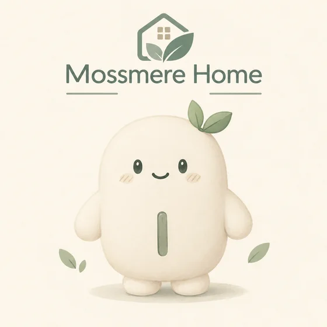</a></td></tr></tbody>
</table>

- **Тип входных данных:** включает предварительный просмотр справочного материала и пример результата.
- **Требования к материалам:** одинаковый логотип бренда и визуальные характеристики + прототип талисмана или карта направлений + индивидуальность бренда, аудитория и сценарии применения → Определите внешний вид персонажа и сохраняйте его единообразие в разных сценариях → Текущий талисман одного бренда
- **Описание:** Одновременно генерируется только выбранный в данный момент файл; остальные картины серии выполняются отдельно.

[ Проверьте конкретные требования в dearsketch и создайте ](https://dearsketch.com/ru/intent/i130-create-reusable-brand-identity-visuals-for-a-mascot.html?utm_source=github&utm_medium=gallery&utm_campaign=dearsketch-public-cases&utm_content=i130_cta).

---

## I131 · Сохраняйте группу изображений в соответствии со стилем бренда.

<table>
<thead><tr><th width="50%">Справочный материал</th><th width="50%">Пример результатов</th></tr></thead>
<tbody><tr><td valign="top">
<strong>Рисунок A. Визуальные тесты бренда</strong> 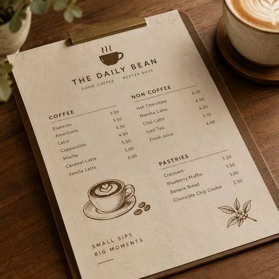

<strong>Рисунок B: Текущая карта контента должна быть унифицирована</strong> 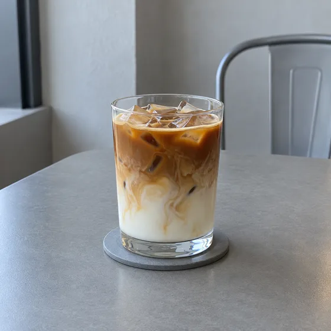
</td><td valign="top"><a href="https://dearsketch.com/ru/intent/i131-keep-a-set-of-images-consistent-with-one-brand-style.html?utm_source=github&amp;utm_medium=gallery&amp;utm_campaign=dearsketch-public-cases&amp;utm_content=i131_image">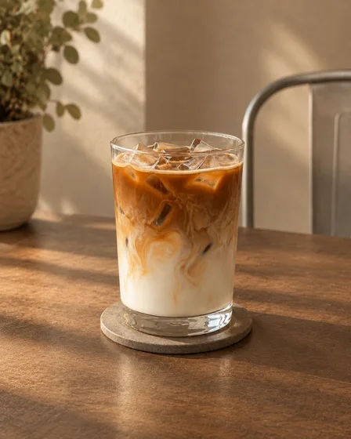</a></td></tr></tbody>
</table>

- **Тип входных данных:** включает предварительный просмотр справочного материала и пример результата.
- **Требования к материалам:** Изображение A: базовый визуальный образ бренда + Изображение B: изображение текущего контента должно быть унифицировано + список серий и неизменяемые правила → Применяйте только визуальные правила изображения A к изображению B → Текущий единый последовательный образ бренда
- **Описание:** Одновременно генерируется только выбранный в данный момент файл; остальные картины серии выполняются отдельно.

[ Проверьте конкретные требования в dearsketch и создайте ](https://dearsketch.com/ru/intent/i131-keep-a-set-of-images-consistent-with-one-brand-style.html?utm_source=github&utm_medium=gallery&utm_campaign=dearsketch-public-cases&utm_content=i131_cta).

---

## I136 · Применение дизайна к макетам оборудования, рекламных щитов, одежды и упаковки.

<table>
<thead><tr><th width="50%">Справочный материал</th><th width="50%">Пример результатов</th></tr></thead>
<tbody><tr><td valign="top">
<strong>Независимая рукопись по графическому дизайну</strong> 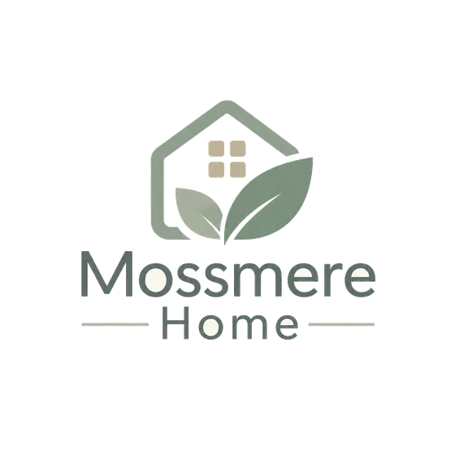

<strong>Векторное фото или шаблон текущего пункта назначения</strong> 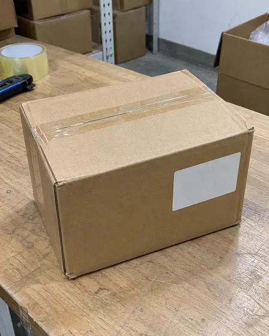
</td><td valign="top"><a href="https://dearsketch.com/ru/intent/i136-apply-a-design-to-device-billboard-apparel-and-packaging-mockups.html?utm_source=github&amp;utm_medium=gallery&amp;utm_campaign=dearsketch-public-cases&amp;utm_content=i136_image">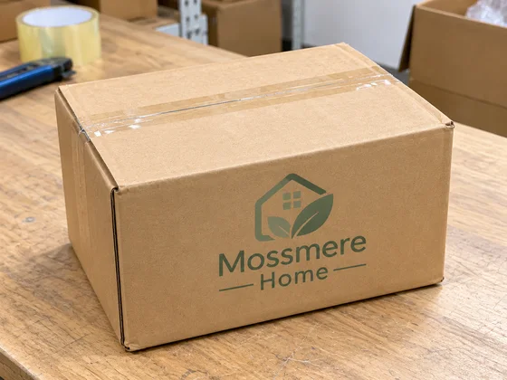</a></td></tr></tbody>
</table>

- **Тип входных данных:** включает предварительный просмотр справочного материала и пример результата.
- **Требования к материалу:** Независимый графический дизайн + текущая фотография или шаблон целевого носителя (при указании физического объекта) + текущий носитель и сцена отображения → Создайте текущий единый реальный прототип.
- **Описание:** На этот раз создается один визуальный предварительный просмотр. Расчет данных, точная верстка, векторные или производственные файлы по-прежнему требуют проверки соответствующими инструментами.

[ Проверьте конкретные требования в dearsketch и создайте ](https://dearsketch.com/ru/intent/i136-apply-a-design-to-device-billboard-apparel-and-packaging-mockups.html?utm_source=github&utm_medium=gallery&utm_campaign=dearsketch-public-cases&utm_content=i136_cta).

---

## I137 · Создание вариантов размера и композиции на основе одного дизайна.

<table>
<thead><tr><th width="50%">Справочный материал</th><th width="50%">Пример результатов</th></tr></thead>
<tbody><tr><td valign="top">
<strong>Ключевой визуальный мастер</strong> 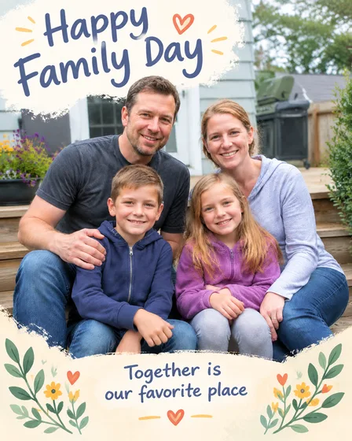
</td><td valign="top"><a href="https://dearsketch.com/ru/intent/i137-create-size-and-composition-variations-from-one-design.html?utm_source=github&amp;utm_medium=gallery&amp;utm_campaign=dearsketch-public-cases&amp;utm_content=i137_image">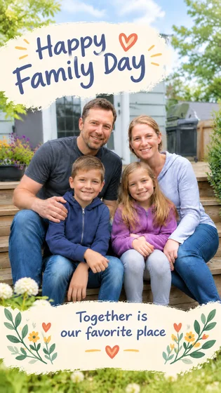</a></td></tr></tbody>
</table>

- **Тип входных данных:** включает предварительный просмотр справочного материала и пример результата.
- **Требования к материалам:** Основной визуальный образец + список целевых каналов и неизменяемые элементы → Расширение различных пропорций, макетов и фона → Многоканальные варианты ресурсов текущего отдельного листа.
- **Описание:** Одновременно генерируется только выбранный в данный момент файл; остальные картины серии выполняются отдельно.

[ Проверьте конкретные требования в dearsketch и создайте ](https://dearsketch.com/ru/intent/i137-create-size-and-composition-variations-from-one-design.html?utm_source=github&utm_medium=gallery&utm_campaign=dearsketch-public-cases&utm_content=i137_cta).

---

## I138 · Преобразование фотографий в штриховые рисунки, контуры или силуэты.

<table>
<thead><tr><th width="50%">Справочный материал</th><th width="50%">Пример результатов</th></tr></thead>
<tbody><tr><td valign="top">
<strong>фото</strong> 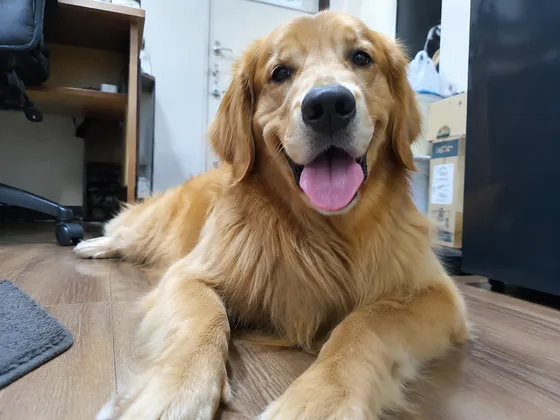
</td><td valign="top"><a href="https://dearsketch.com/ru/intent/i138-turn-a-photo-into-line-art-an-outline-or-a-silhouette.html?utm_source=github&amp;utm_medium=gallery&amp;utm_campaign=dearsketch-public-cases&amp;utm_content=i138_image">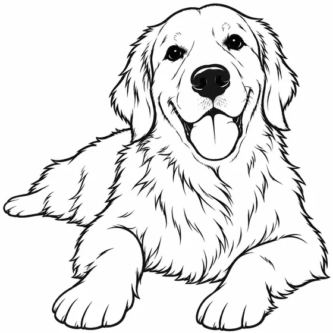</a></td></tr></tbody>
</table>

- **Тип входных данных:** включает предварительный просмотр справочного материала и пример результата.
- **Требования к материалу:** Фотография + тип вывода: рисунок линии, контур или силуэт, цель → Извлечь структуру и упростить ее до линий → Текущий однолинейный рисунок или силуэт.
- **Описание:** Одновременно создается только одно изображение.

[ Проверьте конкретные требования в dearsketch и создайте ](https://dearsketch.com/ru/intent/i138-turn-a-photo-into-line-art-an-outline-or-a-silhouette.html?utm_source=github&utm_medium=gallery&utm_campaign=dearsketch-public-cases&utm_content=i138_cta).

---

## I139 · Преобразование растровых логотипов или иллюстраций в масштабируемые векторы.

<table>
<thead><tr><th width="50%">Справочный материал</th><th width="50%">Пример результатов</th></tr></thead>
<tbody><tr><td valign="top">
<strong>растровое изображение низкого разрешения</strong> 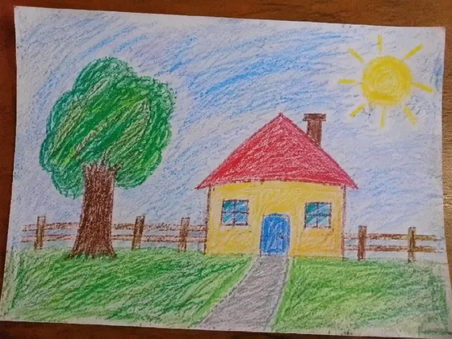
</td><td valign="top"><a href="https://dearsketch.com/ru/intent/i139-convert-a-bitmap-logo-or-illustration-into-a-scalable-vector.html?utm_source=github&amp;utm_medium=gallery&amp;utm_campaign=dearsketch-public-cases&amp;utm_content=i139_image">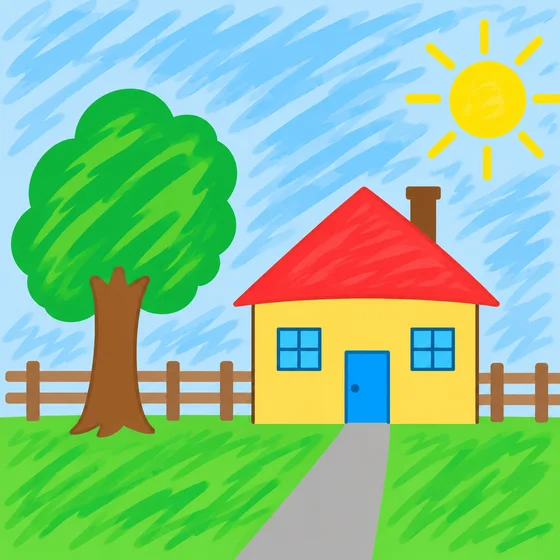</a></td></tr></tbody>
</table>

- **Тип входных данных:** включает предварительный просмотр справочного материала и пример результата.
- **Требования к материалу:** Растровое изображение низкого разрешения + предполагаемое использование → трассировка краев и создание SVG → текущий одиночный векторный файл.
- **Описание:** На этот раз создается один визуальный предварительный просмотр. Расчет данных, точная верстка, векторные или производственные файлы по-прежнему требуют проверки соответствующими инструментами.

[ Проверьте конкретные требования в dearsketch и создайте ](https://dearsketch.com/ru/intent/i139-convert-a-bitmap-logo-or-illustration-into-a-scalable-vector.html?utm_source=github&utm_medium=gallery&utm_campaign=dearsketch-public-cases&utm_content=i139_cta).

---

## I140 · Применение визуального стиля эталонного изображения к другому изображению.

<table>
<thead><tr><th width="50%">Справочный материал</th><th width="50%">Пример результатов</th></tr></thead>
<tbody><tr><td valign="top">
<strong>Рисунок A: Изображение исходного контента</strong> 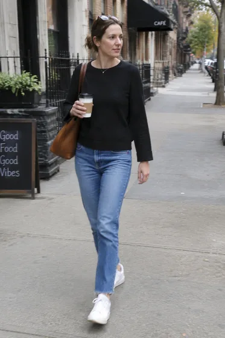

<strong>Рисунок B: Справочная таблица стилей</strong> 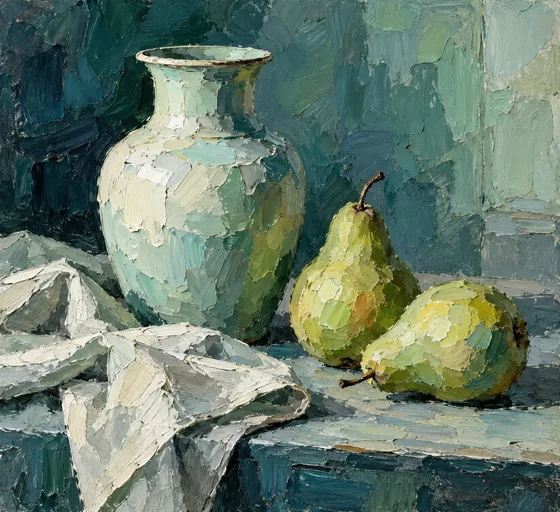
</td><td valign="top"><a href="https://dearsketch.com/ru/intent/i140-apply-the-visual-style-of-a-reference-image-to-another-image.html?utm_source=github&amp;utm_medium=gallery&amp;utm_campaign=dearsketch-public-cases&amp;utm_content=i140_image">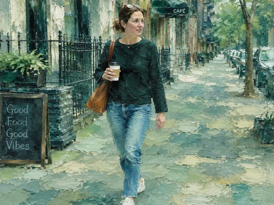</a></td></tr></tbody>
</table>

- **Тип входных данных:** включает предварительный просмотр справочного материала и пример результата.
- **Требования к материалу:** Изображение A: исходное изображение содержимого + Изображение B: эталонное изображение стиля + дополнительный размер миграции → применить стиль изображения B только к изображению A → текущее изображение единого стиля.
- **Описание:** Одновременно создается только одно изображение.

[ Проверьте конкретные требования в dearsketch и создайте ](https://dearsketch.com/ru/intent/i140-apply-the-visual-style-of-a-reference-image-to-another-image.html?utm_source=github&utm_medium=gallery&utm_campaign=dearsketch-public-cases&utm_content=i140_cta).
