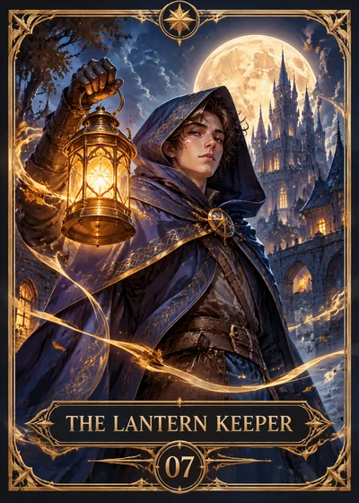

# Иллюстрации, публикации и рассказы

[中文](../../../README.md) · [English](../../../README.en.md) · [Português](../../../README.pt.md) · [Español](../../../README.es.md) · [Français](../../../README.fr.md) · [Deutsch](../../../README.de.md) · [عربي](../../../README.ar.md) · [русский](../../../README.ru.md) · [日本語](../../../README.ja.md) · [हिंदी](../../../README.hi.md)

6 чехлов вне представленного каталога. Слова-подсказки здесь не раскрываются, отображаются только существующие справочные материалы, направления результатов и минимальные требования к материалам.

[Вернуться к другим каталогам ящиков](./index.md) · [Вернуться на домашнюю страницу склада](../../../README.ru.md)

> Справочные материалы и изображения результатов предназначены только для визуального ознакомления; нет никакой гарантии, что тот же эффект можно воспроизвести с использованием тех же материалов.

## I141 · Детская книжка с картинками, в которой из текста рассказа создаются последовательные персонажи.

<strong>Пример результатов</strong>

Этот пример не включает ссылку на изображение, и предварительный просмотр ввода должен быть завершен; см. требования к материалам ниже.

- **Тип ввода:** В этом примере показаны только примеры результатов; предварительный просмотр изображения должен быть добавлен
- **Требования к материалам:** Полные правила истории и страниц + доска для рукописи с настройками персонажей книжки с картинками + шаблон стиля иллюстрации книжки с картинками + текущий номер страницы или разворот → разделить страницы и создать согласованные иллюстрации персонажей → текущая отдельная полная детская книжка с картинками
- **Описание:** Одновременно генерируется только выбранный в данный момент файл; остальные картины серии выполняются отдельно.

[ Проверьте конкретные требования в dearsketch и создайте ](https://dearsketch.com/ru/intent/i141-create-a-children-s-picture-book-with-consistent-characters-from-a-story.html?utm_source=github&utm_medium=gallery&utm_campaign=dearsketch-public-cases&utm_content=i141_cta).

---

## I144 · Создавайте раскадровки или панели комиксов, которые сохраняют единообразие персонажей.

<strong>Пример результатов</strong>

Этот пример не включает ссылку на изображение, и предварительный просмотр ввода должен быть завершен; см. требования к материалам ниже.

- **Тип ввода:** В этом примере показаны только примеры результатов; предварительный просмотр изображения должен быть добавлен
- **Требования к материалам:** Сценарий раскадровки и диалоги + панель настройки персонажей и сцен + текущая страница комикса → создание непрерывных сцен и композиции → текущая отдельная панель комиксов.
- **Описание:** На этот раз создается один визуальный предварительный просмотр. Расчет данных, точная верстка, векторные или производственные файлы по-прежнему требуют проверки соответствующими инструментами.

[ Проверьте конкретные требования в dearsketch и создайте ](https://dearsketch.com/ru/intent/i144-create-comic-panels-with-consistent-characters.html?utm_source=github&utm_medium=gallery&utm_campaign=dearsketch-public-cases&utm_content=i144_cta).

---

## I145 · Создавайте сценарии или идеи для раскадровки фильмов и телевидения.

<strong>Пример результатов</strong>

Этот пример не включает ссылку на изображение, и предварительный просмотр ввода должен быть завершен; см. требования к материалам ниже.

- **Тип ввода:** В этом примере показаны только примеры результатов; предварительный просмотр изображения должен быть добавлен
- **Требования к материалам:** Сценарий или список кадров + Доска с настройками персонажей и сцен + Текущая страница раскадровки → Создать эскиз последовательности → Текущая отдельная раскадровка
- **Описание:** На этот раз создается один визуальный предварительный просмотр. Расчет данных, точная верстка, векторные или производственные файлы по-прежнему требуют проверки соответствующими инструментами.

[ Проверьте конкретные требования в dearsketch и создайте ](https://dearsketch.com/ru/intent/i145-turn-a-script-or-idea-into-a-film-storyboard.html?utm_source=github&utm_medium=gallery&utm_campaign=dearsketch-public-cases&utm_content=i145_cta).

---

## I148 · Преобразование черновых эскизов в полностью готовые иллюстрации.

<table>
<thead><tr><th width="50%">Справочный материал</th><th width="50%">Пример результатов</th></tr></thead>
<tbody><tr><td valign="top">
<strong>Ручной рисунок или цифровой эскиз</strong> 
</td><td valign="top"></td></tr></tbody>
</table>

- **Тип входных данных:** включает предварительный просмотр справочного материала и пример результата.
- **Требования к материалам:** Нарисованный вручную или цифровой эскиз + допустимый диапазон изменений → Сохраните композицию, добавьте цвета и детали → Завершите иллюстрацию на текущем отдельном изображении.
- **Описание:** Одновременно создается только одно изображение.

[ Проверьте конкретные требования в dearsketch и создайте ](https://dearsketch.com/ru/intent/i148-turn-a-rough-sketch-into-a-polished-illustration.html?utm_source=github&utm_medium=gallery&utm_campaign=dearsketch-public-cases&utm_content=i148_cta).

---

## I149 · Создание детских раскрасок из фотографий или текста

<table>
<thead><tr><th width="50%">Справочный материал</th><th width="50%">Пример результатов</th></tr></thead>
<tbody><tr><td valign="top">
<strong>Исходное фото для конвертации</strong> 
</td><td valign="top"></td></tr></tbody>
</table>

- **Тип входных данных:** включает предварительный просмотр справочного материала и пример результата.
- **Требования к материалам:** Исходная фотография для конвертации → Упрощенная до четкого черно-белого линейного рисунка → Текущая детская раскраска.
- **Описание:** Одновременно создается только одно изображение.

[ Проверьте конкретные требования в dearsketch и создайте ](https://dearsketch.com/ru/intent/i149-create-a-children-s-coloring-page-from-a-photo-or-text.html?utm_source=github&utm_medium=gallery&utm_campaign=dearsketch-public-cases&utm_content=i149_cta).

---

## I153 · Создание иллюстраций Таро, настольных игр или коллекционных карточек.

<strong>Пример результатов</strong>

Этот пример не включает ссылку на изображение, и предварительный просмотр ввода должен быть завершен; см. требования к материалам ниже.

- **Тип ввода:** В этом примере показаны только примеры результатов; предварительный просмотр изображения должен быть добавлен
- **Требования к материалам:** Таблица данных карты + Шаблон представления карты и спецификации границы + Текущая карта → Создать единую серию рамок и иллюстраций → Текущая отдельная иллюстрация карты
- **Описание:** Одновременно генерируется только выбранный в данный момент файл; остальные картины серии выполняются отдельно.

[ Проверьте конкретные требования в dearsketch и создайте ](https://dearsketch.com/ru/intent/i153-create-artwork-for-tarot-board-game-or-collectible-cards.html?utm_source=github&utm_medium=gallery&utm_campaign=dearsketch-public-cases&utm_content=i153_cta).
