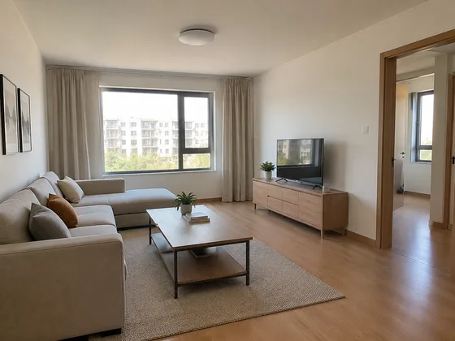

# Космос, архитектура и недвижимость

[中文](../../../README.md) · [English](../../../README.en.md) · [Português](../../../README.pt.md) · [Español](../../../README.es.md) · [Français](../../../README.fr.md) · [Deutsch](../../../README.de.md) · [عربي](../../../README.ar.md) · [русский](../../../README.ru.md) · [日本語](../../../README.ja.md) · [हिंदी](../../../README.hi.md)

2 чехла вне представленного каталога. Слова-подсказки здесь не раскрываются, отображаются только существующие справочные материалы, направления результатов и минимальные требования к материалам.

[Вернуться к другим каталогам ящиков](./index.md) · [Вернуться на домашнюю страницу склада](../../../README.ru.md)

> Справочные материалы и изображения результатов предназначены только для визуального ознакомления; нет никакой гарантии, что тот же эффект можно воспроизвести с использованием тех же материалов.

## I170 · Попробуйте различные расстановки и комбинации мебели.

<table>
<thead><tr><th width="50%">Справочный материал</th><th width="50%">Пример результатов</th></tr></thead>
<tbody><tr><td valign="top">
<strong>Фотографии свободных или существующих номеров</strong> 
</td><td valign="top"></td></tr></tbody>
</table>

- **Тип входных данных:** включает предварительный просмотр справочного материала и пример результата.
- **Требования к материалам:** Фотографии свободных или существующих комнат → Измените расположение существующих элементов дома только на исходном изображении → Предварительный просмотр текущей отдельной расстановки мебели.
- **Описание:** Одновременно создается только одно изображение.

[ Проверьте конкретные требования в dearsketch и создайте ](https://dearsketch.com/ru/intent/i170-try-different-furniture-arrangements-and-combinations.html?utm_source=github&utm_medium=gallery&utm_campaign=dearsketch-public-cases&utm_content=i170_cta).

---

## I180 · Создание нескольких материалов и направлений света в одном пространстве

<table>
<thead><tr><th width="50%">Справочный материал</th><th width="50%">Пример результатов</th></tr></thead>
<tbody><tr><td valign="top">
<strong>карта исходного пространства</strong> 
</td><td valign="top"></td></tr></tbody>
</table>

- **Тип входных данных:** включает предварительный просмотр справочного материала и пример результата.
- **Требования к материалам:** 1 ориентировочный чертеж помещения + целевое направление проектирования, требования к материалу поверхности и освещению.
- **Описание:** Одновременно создается только одно изображение.

[ Проверьте конкретные требования в dearsketch и создайте ](https://dearsketch.com/ru/intent/i180-create-material-and-lighting-variations-for-the-same-space.html?utm_source=github&utm_medium=gallery&utm_campaign=dearsketch-public-cases&utm_content=i180_cta).
