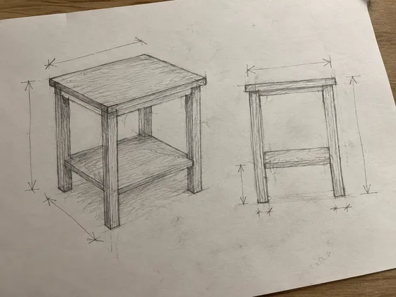

# Концепция продукта и промышленный дизайн

[中文](../../../README.md) · [English](../../../README.en.md) · [Português](../../../README.pt.md) · [Español](../../../README.es.md) · [Français](../../../README.fr.md) · [Deutsch](../../../README.de.md) · [عربي](../../../README.ar.md) · [русский](../../../README.ru.md) · [日本語](../../../README.ja.md) · [हिंदी](../../../README.hi.md)

4 чехла вне представленного каталога. Слова-подсказки здесь не раскрываются, отображаются только существующие справочные материалы, направления результатов и минимальные требования к материалам.

[Вернуться к другим каталогам ящиков](./index.md) · [Вернуться на домашнюю страницу склада](../../../README.ru.md)

> Справочные материалы и изображения результатов предназначены только для визуального ознакомления; нет никакой гарантии, что тот же эффект можно воспроизвести с использованием тех же материалов.

## I184 · Преобразование эскизов продуктов в реалистичные изображения продуктов.

<table>
<thead><tr><th width="50%">Справочный материал</th><th width="50%">Пример результатов</th></tr></thead>
<tbody><tr><td valign="top">
<strong>Эскизы продуктов ручной работы</strong> 
</td><td valign="top"></td></tr></tbody>
</table>

- **Тип входных данных:** включает предварительный просмотр справочного материала и пример результата.
- **Требования к материалам:** Нарисованный от руки эскиз продукта + использование продукта, неизменяемые элементы эскиза → сохранение формы и создание материалов, света, тени и фона → текущий рендеринг отдельного продукта.
- **Описание:** Одновременно создается только одно изображение.

[ Проверьте конкретные требования в dearsketch и создайте ](https://dearsketch.com/ru/intent/i184-turn-a-product-sketch-into-a-realistic-product-render.html?utm_source=github&utm_medium=gallery&utm_campaign=dearsketch-public-cases&utm_content=i184_cta).

---

## I186 · Предварительный просмотр продукта в различных цветах, материалах и способах обработки поверхности.

<table>
<thead><tr><th width="50%">Справочный материал</th><th width="50%">Пример результатов</th></tr></thead>
<tbody><tr><td valign="top">
<strong>Изображения продуктов или 3D-рендеринги</strong> 
</td><td valign="top"></td></tr></tbody>
</table>

- **Тип входных данных:** включает предварительный просмотр справочного материала и пример результата.
- **Требования к материалам:** Чертеж продукта или 3D-рендеринг + целевой цвет или материал → Заменить цвет, материал и текстуру → Текущий единый чертеж плана CMF.
- **Описание:** Одновременно создается только одно изображение.

[ Проверьте конкретные требования в dearsketch и создайте ](https://dearsketch.com/ru/intent/i186-preview-product-colors-materials-and-finishes.html?utm_source=github&utm_medium=gallery&utm_campaign=dearsketch-public-cases&utm_content=i186_cta).

---

## I188 · Создание визуализаций мебельных изделий на основе эскизов.

<table>
<thead><tr><th width="50%">Справочный материал</th><th width="50%">Пример результатов</th></tr></thead>
<tbody><tr><td valign="top">
<strong>эскизы мебели</strong> 
</td><td valign="top"></td></tr></tbody>
</table>

- **Тип входных данных:** включает предварительный просмотр справочного материала и пример результата.
- **Требования к материалам:** Эскиз мебели + использование мебели, структура, которую необходимо сохранить → Создать сцены дерева, ткани и использования → Текущий рендеринг отдельного мебельного изделия.
- **Описание:** Одновременно создается только одно изображение.

[ Проверьте конкретные требования в dearsketch и создайте ](https://dearsketch.com/ru/intent/i188-turn-a-furniture-sketch-into-a-product-render.html?utm_source=github&utm_medium=gallery&utm_campaign=dearsketch-public-cases&utm_content=i188_cta).

---

## I192 · Преобразование эскизов интерфейса в более полные макеты пользовательского интерфейса.

<table>
<thead><tr><th width="50%">Справочный материал</th><th width="50%">Пример результатов</th></tr></thead>
<tbody><tr><td valign="top">
<strong>Каркасы или скриншоты существующих интерфейсов</strong> 
</td><td valign="top"></td></tr></tbody>
</table>

- **Тип входных данных:** включает предварительный просмотр справочного материала и пример результата.
- **Требования к материалам:** Каркасы или снимки экрана существующих интерфейсов + тип продукта и неизменяемая информационная архитектура → Дополнительный визуальный стиль, компоненты и сценарии устройств → Текущая концепция единого пользовательского интерфейса.
- **Описание:** Одновременно создается только одно изображение.

[ Проверьте конкретные требования в dearsketch и создайте ](https://dearsketch.com/ru/intent/i192-turn-a-ui-sketch-into-a-polished-interface-mockup.html?utm_source=github&utm_medium=gallery&utm_campaign=dearsketch-public-cases&utm_content=i192_cta).
