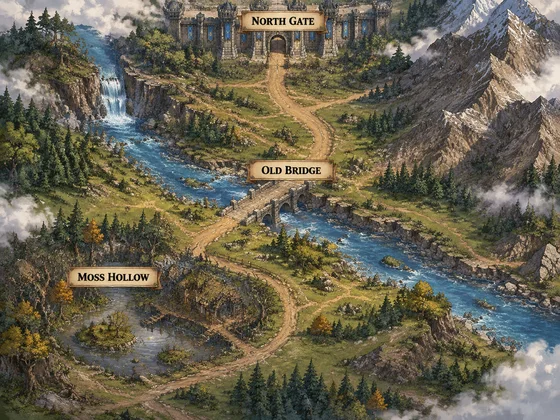
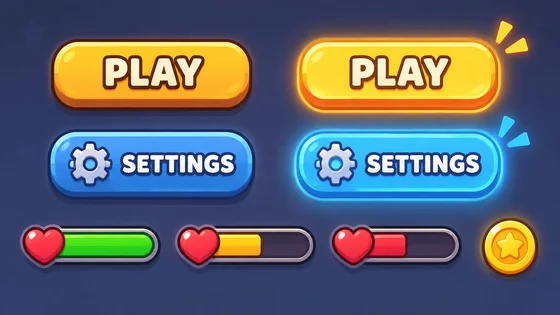

# Игры и виртуальные активы

[中文](../../../README.md) · [English](../../../README.en.md) · [Português](../../../README.pt.md) · [Español](../../../README.es.md) · [Français](../../../README.fr.md) · [Deutsch](../../../README.de.md) · [عربي](../../../README.ar.md) · [русский](../../../README.ru.md) · [日本語](../../../README.ja.md) · [हिंदी](../../../README.hi.md)

4 чехла вне представленного каталога. Слова-подсказки здесь не раскрываются, отображаются только существующие справочные материалы, направления результатов и минимальные требования к материалам.

[Вернуться к другим каталогам ящиков](./index.md) · [Вернуться на домашнюю страницу склада](../../../README.ru.md)

> Справочные материалы и изображения результатов предназначены только для визуального ознакомления; нет никакой гарантии, что тот же эффект можно воспроизвести с использованием тех же материалов.

## I199 · Создать фэнтезийный мир или карту битвы DND

<strong>Пример результатов</strong>

Этот пример не включает ссылку на изображение, и предварительный просмотр ввода должен быть завершен; см. требования к материалам ниже.

- **Тип ввода:** В этом примере показаны только примеры результатов; предварительный просмотр изображения должен быть добавлен
- **Требования к материалам:** Местность, местоположение и список маршрутов + Визуальная привязка карты + Текущий масштаб карты → Создать карту региона, города или сцены сражения → Текущая отдельная фэнтези-карта
- **Описание:** На этот раз создается один визуальный предварительный просмотр. Расчет данных, точная верстка, векторные или производственные файлы по-прежнему требуют проверки соответствующими инструментами.

[ Проверьте конкретные требования в dearsketch и создайте ](https://dearsketch.com/ru/intent/i199-create-a-fantasy-world-or-d-and-d-battle-map.html?utm_source=github&utm_medium=gallery&utm_campaign=dearsketch-public-cases&utm_content=i199_cta).

---

## I200 · Создание игровых значков, кнопок и элементов HUD

<strong>Пример результатов</strong>

Этот пример не включает ссылку на изображение, и предварительный просмотр ввода должен быть завершен; см. требования к материалам ниже.

- **Тип ввода:** В этом примере показаны только примеры результатов; предварительный просмотр изображения должен быть добавлен
- **Требования к материалам:** Список компонентов и статусов + визуальные характеристики игрового пользовательского интерфейса → Создание ресурсов интерфейса в едином стиле → Текущий значок пользовательского интерфейса отдельной игры.
- **Описание:** На этот раз создается один визуальный предварительный просмотр. Расчет данных, точная верстка, векторные или производственные файлы по-прежнему требуют проверки соответствующими инструментами.

[ Проверьте конкретные требования в dearsketch и создайте ](https://dearsketch.com/ru/intent/i200-create-game-icons-buttons-and-hud-elements.html?utm_source=github&utm_medium=gallery&utm_campaign=dearsketch-public-cases&utm_content=i200_cta).

---

## I204 · Создание поля, компонентов и обложки для настольной игры.

<strong>Пример результатов</strong>

Этот пример не включает ссылку на изображение, и предварительный просмотр ввода должен быть завершен; см. требования к материалам ниже.

- **Тип ввода:** В этом примере показаны только примеры результатов; предварительный просмотр изображения должен быть добавлен
- **Требования к материалам:** Дополнительный визуальный образец существующей шахматной доски или компонента (0 или 1) + необходимые правила настольной игры и список компонентов (1 экземпляр) + требуемый тип поставки и тема (1 комплект).
- **Описание:** На этот раз создается один визуальный предварительный просмотр. Расчет данных, точная верстка, векторные или производственные файлы по-прежнему требуют проверки соответствующими инструментами.

[ Проверьте конкретные требования в dearsketch и создайте ](https://dearsketch.com/ru/intent/i204-create-visuals-for-a-board-components-and-box-cover.html?utm_source=github&utm_medium=gallery&utm_campaign=dearsketch-public-cases&utm_content=i204_cta).

---

## I205 · Создание обложки игрового магазина и обложки ключа.

<strong>Пример результатов</strong>

Этот пример не включает ссылку на изображение, и предварительный просмотр ввода должен быть завершен; см. требования к материалам ниже.

- **Тип ввода:** В этом примере показаны только примеры результатов; предварительный просмотр изображения должен быть добавлен
- **Требования к материалам:** Необязательные подтвержденные персонажи, логотипы или игровые графические объекты (от 0 до нескольких) + необходимые слоты для ресурсов магазина и точки продажи игры (1 копия).
- **Описание:** Одновременно генерируется только выбранный в данный момент файл; остальные картины серии выполняются отдельно.

[ Проверьте конкретные требования в dearsketch и создайте ](https://dearsketch.com/ru/intent/i205-create-game-store-cover-art-and-key-art.html?utm_source=github&utm_medium=gallery&utm_campaign=dearsketch-public-cases&utm_content=i205_cta).
