# Восстановление, редактирование и повторное использование изображений

[中文](../../../README.md) · [English](../../../README.en.md) · [Português](../../../README.pt.md) · [Español](../../../README.es.md) · [Français](../../../README.fr.md) · [Deutsch](../../../README.de.md) · [عربي](../../../README.ar.md) · [русский](../../../README.ru.md) · [日本語](../../../README.ja.md) · [हिंदी](../../../README.hi.md)

23 чехла вне представленного каталога. Слова-подсказки здесь не раскрываются, отображаются только существующие справочные материалы, направления результатов и минимальные требования к материалам.

[Вернуться к другим каталогам ящиков](./index.md) · [Вернуться на домашнюю страницу склада](../../../README.ru.md)

> Справочные материалы и изображения результатов предназначены только для визуального ознакомления; нет никакой гарантии, что тот же эффект можно воспроизвести с использованием тех же материалов.

## I218 · Автоматически удалять фоны персонажей или продуктов.

<table>
<thead><tr><th width="50%">Справочный материал</th><th width="50%">Пример результатов</th></tr></thead>
<tbody><tr><td valign="top">
<strong>Исходное фото человека или товара, который нужно вырезать.</strong> 
</td><td valign="top"><a href="https://dearsketch.com/ru/intent/i218-remove-the-background-from-a-person-or-product-image.html?utm_source=github&amp;utm_medium=gallery&amp;utm_campaign=dearsketch-public-cases&amp;utm_content=i218_image">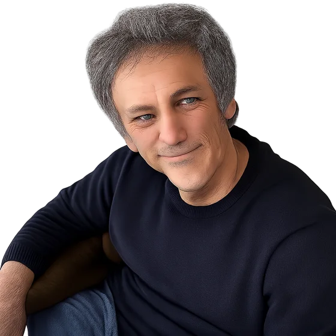</a></td></tr></tbody>
</table>

- **Тип входных данных:** включает предварительный просмотр справочного материала и пример результата.
- **Требования к материалам:** Необходимы оригинальные фотографии людей или товаров, которые нужно вырезать (1 фото) + предметы, которые необходимо сохранить (1 фото).
- **Описание:** Одновременно создается только одно изображение.

[ Проверьте конкретные требования в dearsketch и создайте ](https://dearsketch.com/ru/intent/i218-remove-the-background-from-a-person-or-product-image.html?utm_source=github&utm_medium=gallery&utm_campaign=dearsketch-public-cases&utm_content=i218_cta).

---

## I219 · Удаляйте с фотографий прохожих, помехи и отвлекающие элементы.

<table>
<thead><tr><th width="50%">Справочный материал</th><th width="50%">Пример результатов</th></tr></thead>
<tbody><tr><td valign="top">
<strong>Оригиналы фотографий, подлежащие очистке.</strong> 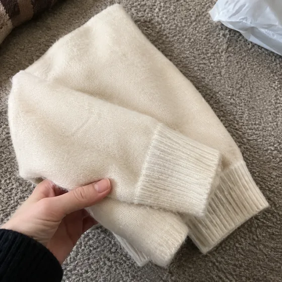
</td><td valign="top"><a href="https://dearsketch.com/ru/intent/i219-remove-bystanders-clutter-or-distractions-from-a-photo.html?utm_source=github&amp;utm_medium=gallery&amp;utm_campaign=dearsketch-public-cases&amp;utm_content=i219_image">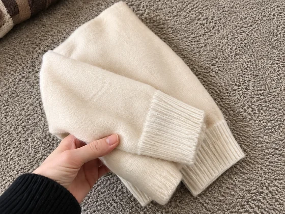</a></td></tr></tbody>
</table>

- **Тип входных данных:** включает предварительный просмотр справочного материала и пример результата.
- **Требования к материалам:** Необходимые фотографии для очистки (1 фотография) + Объекты или области, которые необходимо удалить (1 группа) + Дополнительные маски областей удаления (0 или 1 фотография)
- **Описание:** Одновременно создается только одно изображение.

[ Проверьте конкретные требования в dearsketch и создайте ](https://dearsketch.com/ru/intent/i219-remove-bystanders-clutter-or-distractions-from-a-photo.html?utm_source=github&utm_medium=gallery&utm_campaign=dearsketch-public-cases&utm_content=i219_cta).

---

## I220 · Добавление или замена объектов на фотографиях текстом

<table>
<thead><tr><th width="50%">Справочный материал</th><th width="50%">Пример результатов</th></tr></thead>
<tbody><tr><td valign="top">
<strong>Исходное изображение сцены, которую нужно частично отредактировать.</strong> 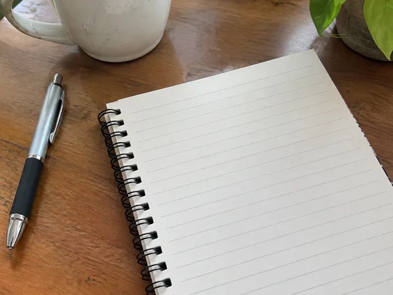
</td><td valign="top"><a href="https://dearsketch.com/ru/intent/i220-add-or-replace-an-object-in-a-photo-using-text.html?utm_source=github&amp;utm_medium=gallery&amp;utm_campaign=dearsketch-public-cases&amp;utm_content=i220_image">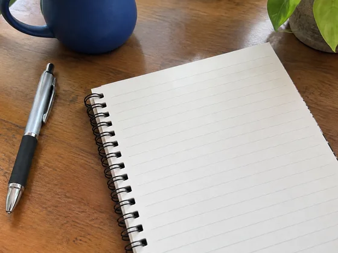</a></td></tr></tbody>
</table>

- **Тип входных данных:** включает предварительный просмотр справочного материала и пример результата.
- **Требования к материалу:** Необходимое исходное изображение сцены для частичного редактирования (1 изображение) + Обязательное описание частичного редактирования (1 копия) + Дополнительное добавление/замена маски области (0 или 1 изображение)
- **Описание:** Одновременно создается только одно изображение.

[ Проверьте конкретные требования в dearsketch и создайте ](https://dearsketch.com/ru/intent/i220-add-or-replace-an-object-in-a-photo-using-text.html?utm_source=github&utm_medium=gallery&utm_campaign=dearsketch-public-cases&utm_content=i220_cta).

---

## I221 · Расширить холст изображения, чтобы оно соответствовало новым пропорциям.

<table>
<thead><tr><th width="50%">Справочный материал</th><th width="50%">Пример результатов</th></tr></thead>
<tbody><tr><td valign="top">
<strong>Исходное изображение для увеличения</strong> 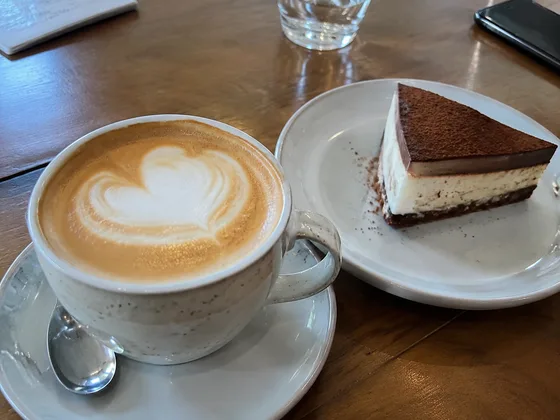
</td><td valign="top"><a href="https://dearsketch.com/ru/intent/i221-extend-an-image-canvas-to-a-new-aspect-ratio.html?utm_source=github&amp;utm_medium=gallery&amp;utm_campaign=dearsketch-public-cases&amp;utm_content=i221_image">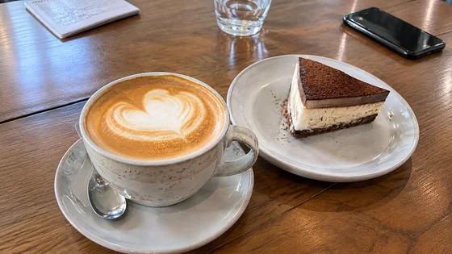</a></td></tr></tbody>
</table>

- **Тип входных данных:** включает предварительный просмотр справочного материала и пример результата.
- **Требования к материалам:** Требуется оригинальное изображение для увеличения (1 изображение) + требуемая целевая пропорция или новый диапазон холста (1 комплект).
- **Описание:** Одновременно создается только одно изображение.

[ Проверьте конкретные требования в dearsketch и создайте ](https://dearsketch.com/ru/intent/i221-extend-an-image-canvas-to-a-new-aspect-ratio.html?utm_source=github&utm_medium=gallery&utm_campaign=dearsketch-public-cases&utm_content=i221_cta).

---

## I222 · Обрезайте или расширяйте изображения для соответствия различным платформам.

<table>
<thead><tr><th width="50%">Справочный материал</th><th width="50%">Пример результатов</th></tr></thead>
<tbody><tr><td valign="top">
<strong>Готовое изображение платформы, подлежащей адаптации</strong> 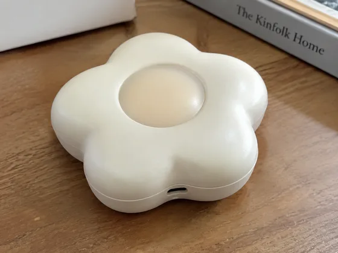
</td><td valign="top"><a href="https://dearsketch.com/ru/intent/i222-crop-or-extend-an-image-for-different-platforms.html?utm_source=github&amp;utm_medium=gallery&amp;utm_campaign=dearsketch-public-cases&amp;utm_content=i222_image">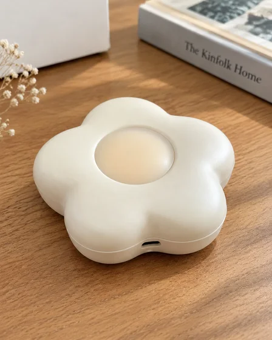</a></td></tr></tbody>
</table>

- **Тип входных данных:** включает предварительный просмотр справочного материала и пример результата.
- **Требования к материалам:** Необходимое готовое изображение адаптируемой платформы (1 изображение) + Требуемая целевая платформа и конкретное размещение (1 комплект).
- **Описание:** Одновременно создается только одно изображение.

[ Проверьте конкретные требования в dearsketch и создайте ](https://dearsketch.com/ru/intent/i222-crop-or-extend-an-image-for-different-platforms.html?utm_source=github&utm_medium=gallery&utm_campaign=dearsketch-public-cases&utm_content=i222_cta).

---

## I223 · Увеличение изображений с низким разрешением для больших экранов или печати.

<table>
<thead><tr><th width="50%">Справочный материал</th><th width="50%">Пример результатов</th></tr></thead>
<tbody><tr><td valign="top">
<strong>Исходное изображение для увеличения</strong> 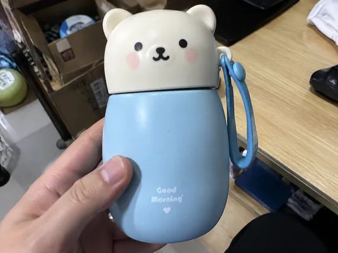
</td><td valign="top"><a href="https://dearsketch.com/ru/intent/i223-upscale-a-low-resolution-image-for-large-displays-or-print.html?utm_source=github&amp;utm_medium=gallery&amp;utm_campaign=dearsketch-public-cases&amp;utm_content=i223_image">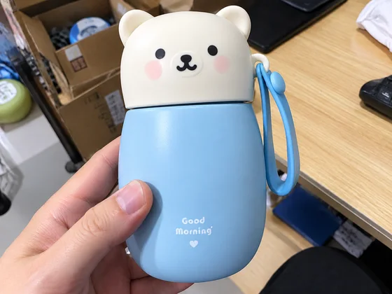</a></td></tr></tbody>
</table>

- **Тип входных данных:** включает предварительный просмотр справочного материала и пример результата.
- **Требования к материалам:** Необходимое исходное изображение для увеличения (1 изображение) + необходимое увеличение цели и цель вывода (1 комплект)
- **Описание:** На этот раз создается один визуальный предварительный просмотр. Расчет данных, точная верстка, векторные или производственные файлы по-прежнему требуют проверки соответствующими инструментами.

[ Проверьте конкретные требования в dearsketch и создайте ](https://dearsketch.com/ru/intent/i223-upscale-a-low-resolution-image-for-large-displays-or-print.html?utm_source=github&utm_medium=gallery&utm_campaign=dearsketch-public-cases&utm_content=i223_cta).

---

## I224 · Исправление расфокусированных или размытых фотографий

<table>
<thead><tr><th width="50%">Справочный материал</th><th width="50%">Пример результатов</th></tr></thead>
<tbody><tr><td valign="top">
<strong>Устранение размытия фотографий</strong> 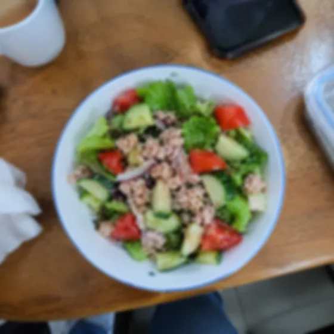
</td><td valign="top"><a href="https://dearsketch.com/ru/intent/i224-fix-an-out-of-focus-or-motion-blurred-photo.html?utm_source=github&amp;utm_medium=gallery&amp;utm_campaign=dearsketch-public-cases&amp;utm_content=i224_image">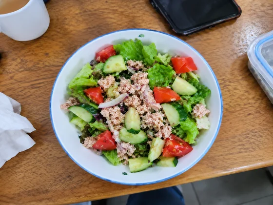</a></td></tr></tbody>
</table>

- **Тип входных данных:** включает предварительный просмотр справочного материала и пример результата.
- **Требования к материалам:** Фотографии должны быть размыты (1 фото).
- **Описание:** Одновременно создается только одно изображение.

[ Проверьте конкретные требования в dearsketch и создайте ](https://dearsketch.com/ru/intent/i224-fix-an-out-of-focus-or-motion-blurred-photo.html?utm_source=github&utm_medium=gallery&utm_campaign=dearsketch-public-cases&utm_content=i224_cta).

---

## I225 · Удаление фотошума, следов сжатия и зернистости.

<table>
<thead><tr><th width="50%">Справочный материал</th><th width="50%">Пример результатов</th></tr></thead>
<tbody><tr><td valign="top">
<strong>Фотографии, которые нужно удалить или сжать</strong> 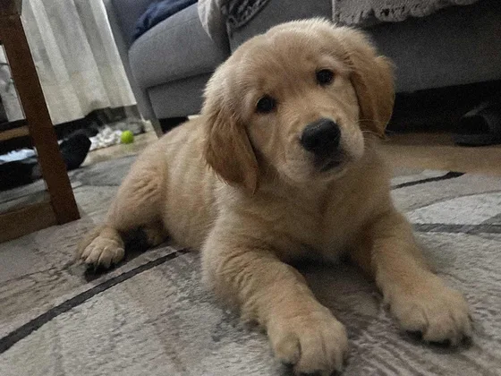
</td><td valign="top"><a href="https://dearsketch.com/ru/intent/i225-remove-noise-compression-artifacts-and-grain-from-a-photo.html?utm_source=github&amp;utm_medium=gallery&amp;utm_campaign=dearsketch-public-cases&amp;utm_content=i225_image">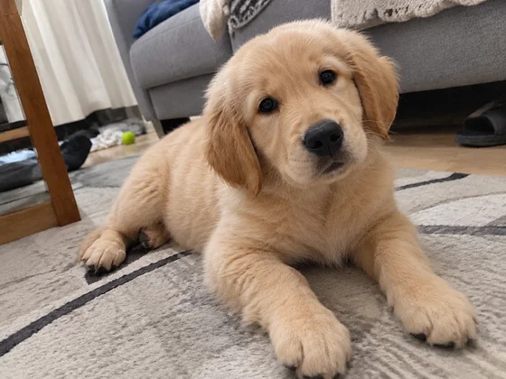</a></td></tr></tbody>
</table>

- **Тип входных данных:** включает предварительный просмотр справочного материала и пример результата.
- **Требования к материалам:** Требуются фотографии (1 фото), которые необходимо очистить от шума или распаковать.
- **Описание:** Одновременно создается только одно изображение.

[ Проверьте конкретные требования в dearsketch и создайте ](https://dearsketch.com/ru/intent/i225-remove-noise-compression-artifacts-and-grain-from-a-photo.html?utm_source=github&utm_medium=gallery&utm_campaign=dearsketch-public-cases&utm_content=i225_cta).

---

## I226 · Восстановить детали лица с низким разрешением или размытые.

<table>
<thead><tr><th width="50%">Справочный материал</th><th width="50%">Пример результатов</th></tr></thead>
<tbody><tr><td valign="top">
<strong>Портреты низкого разрешения, ожидающие улучшения лица</strong> 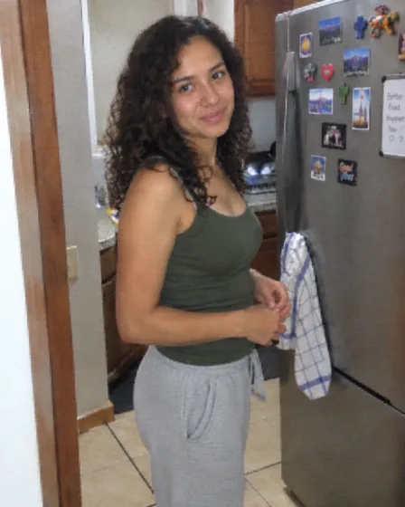
</td><td valign="top"><a href="https://dearsketch.com/ru/intent/i226-restore-facial-detail-in-a-low-quality-or-blurry-photo.html?utm_source=github&amp;utm_medium=gallery&amp;utm_campaign=dearsketch-public-cases&amp;utm_content=i226_image">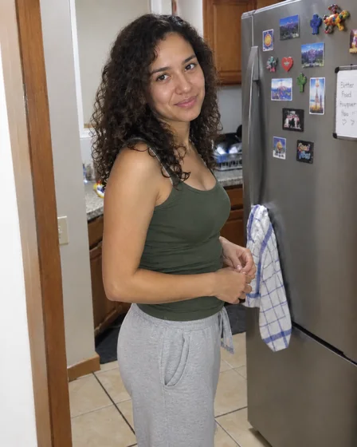</a></td></tr></tbody>
</table>

- **Тип входных данных:** включает предварительный просмотр справочного материала и пример результата.
- **Требования к материалам:** Требуется портрет низкого разрешения (1 фотография) с усилением лица.
- **Описание:** Одновременно создается только одно изображение.

[ Проверьте конкретные требования в dearsketch и создайте ](https://dearsketch.com/ru/intent/i226-restore-facial-detail-in-a-low-quality-or-blurry-photo.html?utm_source=github&utm_medium=gallery&utm_campaign=dearsketch-public-cases&utm_content=i226_cta).

---

## I227 · Ремонт поврежденных, выцветших и поцарапанных старых фотографий

<table>
<thead><tr><th width="50%">Справочный материал</th><th width="50%">Пример результатов</th></tr></thead>
<tbody><tr><td valign="top">
<strong>Сканы старых фотографий, подлежащих восстановлению.</strong> 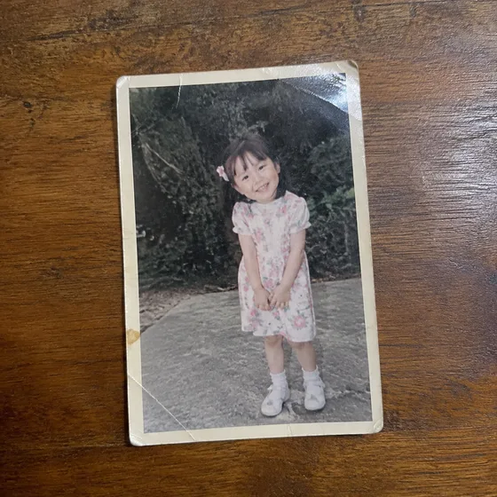
</td><td valign="top"><a href="https://dearsketch.com/ru/intent/i227-restore-a-damaged-faded-or-scratched-old-photo.html?utm_source=github&amp;utm_medium=gallery&amp;utm_campaign=dearsketch-public-cases&amp;utm_content=i227_image">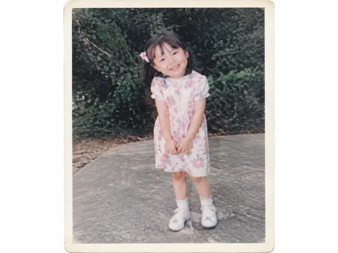</a></td></tr></tbody>
</table>

- **Тип входных данных:** включает предварительный просмотр справочного материала и пример результата.
- **Требования к материалам:** Сканы старых фотографий, требующих реставрации (1 фото)
- **Описание:** Одновременно создается только одно изображение.

[ Проверьте конкретные требования в dearsketch и создайте ](https://dearsketch.com/ru/intent/i227-restore-a-damaged-faded-or-scratched-old-photo.html?utm_source=github&utm_medium=gallery&utm_campaign=dearsketch-public-cases&utm_content=i227_cta).

---

## I228 · Естественное раскрашивание старых черно-белых фотографий

<table>
<thead><tr><th width="50%">Справочный материал</th><th width="50%">Пример результатов</th></tr></thead>
<tbody><tr><td valign="top">
<strong>Старые черно-белые фотографии людей.</strong> 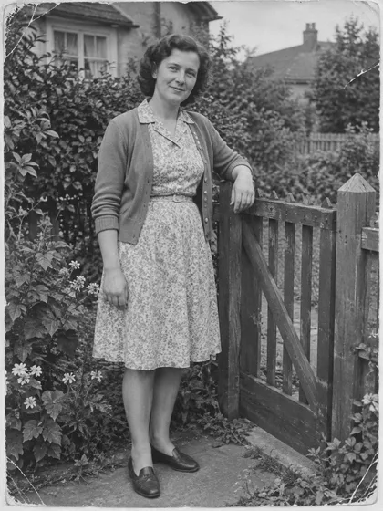
</td><td valign="top"><a href="https://dearsketch.com/ru/intent/i228-naturally-colorize-a-black-and-white-old-photo.html?utm_source=github&amp;utm_medium=gallery&amp;utm_campaign=dearsketch-public-cases&amp;utm_content=i228_image">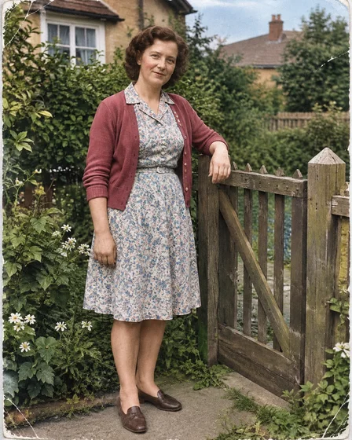</a></td></tr></tbody>
</table>

- **Тип входных данных:** включает предварительный просмотр справочного материала и пример результата.
- **Требования к материалам:** 1 старая черно-белая фотография людей.
- **Описание:** Одновременно создается только одно изображение.

[ Проверьте конкретные требования в dearsketch и создайте ](https://dearsketch.com/ru/intent/i228-naturally-colorize-a-black-and-white-old-photo.html?utm_source=github&utm_medium=gallery&utm_campaign=dearsketch-public-cases&utm_content=i228_cta).

---

## I229 · Измените атмосферу света и времени на фотографии.

<table>
<thead><tr><th width="50%">Справочный материал</th><th width="50%">Пример результатов</th></tr></thead>
<tbody><tr><td valign="top">
<strong>Фотографии, которые будут перезалиты</strong> 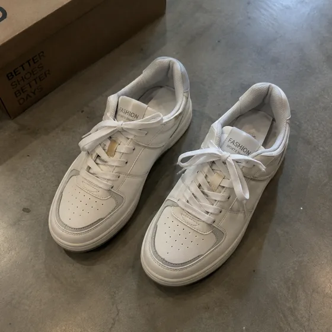
</td><td valign="top"><a href="https://dearsketch.com/ru/intent/i229-relight-a-photo-and-change-its-time-of-day-mood.html?utm_source=github&amp;utm_medium=gallery&amp;utm_campaign=dearsketch-public-cases&amp;utm_content=i229_image">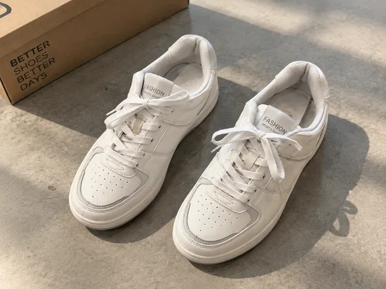</a></td></tr></tbody>
</table>

- **Тип входных данных:** включает предварительный просмотр справочного материала и пример результата.
- **Требования к материалам:** Необходимы фотографии для переосвещения (1 фото) + Требуемое время или световая атмосфера (1 группа)
- **Описание:** Одновременно создается только одно изображение.

[ Проверьте конкретные требования в dearsketch и создайте ](https://dearsketch.com/ru/intent/i229-relight-a-photo-and-change-its-time-of-day-mood.html?utm_source=github&utm_medium=gallery&utm_campaign=dearsketch-public-cases&utm_content=i229_cta).

---

## I230 · Удаление бликов, отражений и нежелательных теней с фотографий.

<table>
<thead><tr><th width="50%">Справочный материал</th><th width="50%">Пример результатов</th></tr></thead>
<tbody><tr><td valign="top">
<strong>оригинальное фото с бликами</strong> 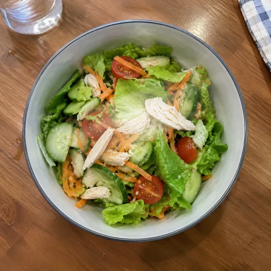
</td><td valign="top"><a href="https://dearsketch.com/ru/intent/i230-remove-glare-reflections-or-unwanted-shadows-from-a-photo.html?utm_source=github&amp;utm_medium=gallery&amp;utm_campaign=dearsketch-public-cases&amp;utm_content=i230_image">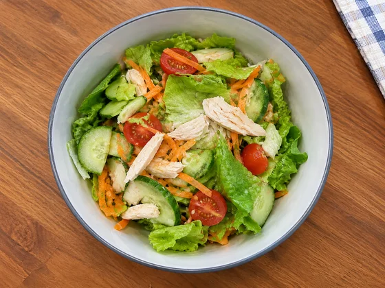</a></td></tr></tbody>
</table>

- **Тип входных данных:** включает предварительный просмотр справочного материала и пример результата.
- **Требования к материалу:** Должна быть исходная фотография с бликами, отражением или избыточной тенью (1 фотография) + область оптических помех, которую необходимо ослабить (1 группа) + дополнительная маска области бликов/отражения/тени (0 или 1 фотография)
- **Описание:** Одновременно создается только одно изображение.

[ Проверьте конкретные требования в dearsketch и создайте ](https://dearsketch.com/ru/intent/i230-remove-glare-reflections-or-unwanted-shadows-from-a-photo.html?utm_source=github&utm_medium=gallery&utm_campaign=dearsketch-public-cases&utm_content=i230_cta).

---

## I231 · Улучшите размытость текста на снимках экрана, сканах или изображениях продуктов.

<table>
<thead><tr><th width="50%">Справочный материал</th><th width="50%">Пример результатов</th></tr></thead>
<tbody><tr><td valign="top">
<strong>Скриншоты, сканы или изображения продуктов, содержащие текст, который необходимо улучшить.</strong> 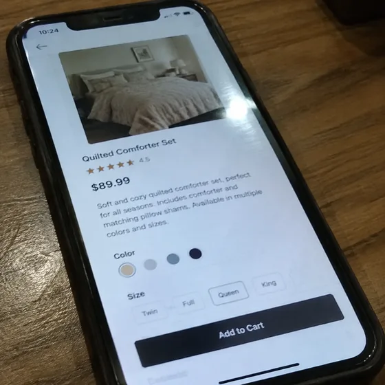
</td><td valign="top"><a href="https://dearsketch.com/ru/intent/i231-enhance-blurry-text-in-a-screenshot-scan-or-product-image.html?utm_source=github&amp;utm_medium=gallery&amp;utm_campaign=dearsketch-public-cases&amp;utm_content=i231_image">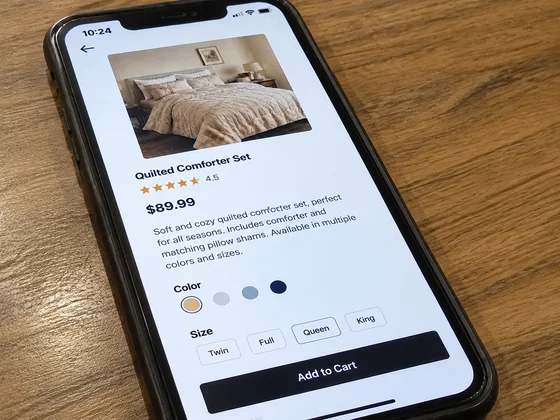</a></td></tr></tbody>
</table>

- **Тип входных данных:** включает предварительный просмотр справочного материала и пример результата.
- **Требования к материалам:** необходимо включать скриншоты, сканы или изображения продукта (1 изображение) с текстом, который необходимо улучшить.
- **Описание:** Одновременно создается только одно изображение.

[ Проверьте конкретные требования в dearsketch и создайте ](https://dearsketch.com/ru/intent/i231-enhance-blurry-text-in-a-screenshot-scan-or-product-image.html?utm_source=github&utm_medium=gallery&utm_campaign=dearsketch-public-cases&utm_content=i231_cta).

---

## I232 · Изменение угла обзора портретов, товаров или сцен.

<table>
<thead><tr><th width="50%">Справочный материал</th><th width="50%">Пример результатов</th></tr></thead>
<tbody><tr><td valign="top">
<strong>Одноракурсные портреты, продукты или изображения сцен.</strong> 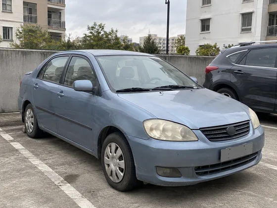
</td><td valign="top"><a href="https://dearsketch.com/ru/intent/i232-change-the-viewing-angle-of-a-portrait-product-or-scene.html?utm_source=github&amp;utm_medium=gallery&amp;utm_campaign=dearsketch-public-cases&amp;utm_content=i232_image">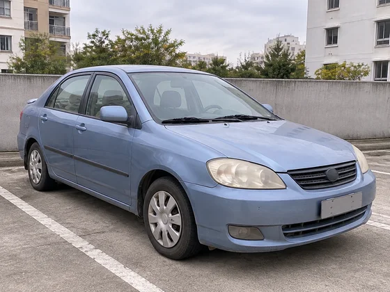</a></td></tr></tbody>
</table>

- **Тип входных данных:** включает предварительный просмотр справочного материала и пример результата.
- **Требования к материалу:** Требуемый одноракурсный портрет, изображение товара или сцены (1 изображение) + требуемый угол наблюдения за целью (1 изображение)
- **Описание:** Одновременно создается только одно изображение.

[ Проверьте конкретные требования в dearsketch и создайте ](https://dearsketch.com/ru/intent/i232-change-the-viewing-angle-of-a-portrait-product-or-scene.html?utm_source=github&utm_medium=gallery&utm_campaign=dearsketch-public-cases&utm_content=i232_cta).

---

## I233 · Размытие фона, чтобы выделить людей или продукты.

<table>
<thead><tr><th width="50%">Справочный материал</th><th width="50%">Пример результатов</th></tr></thead>
<tbody><tr><td valign="top">
<strong>Портреты или фотографии продуктов, которые можно добавить с глубиной резкости.</strong> 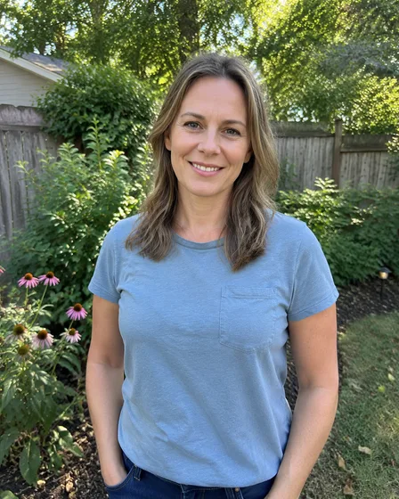
</td><td valign="top"><a href="https://dearsketch.com/ru/intent/i233-blur-the-background-to-highlight-a-person-or-product.html?utm_source=github&amp;utm_medium=gallery&amp;utm_campaign=dearsketch-public-cases&amp;utm_content=i233_image">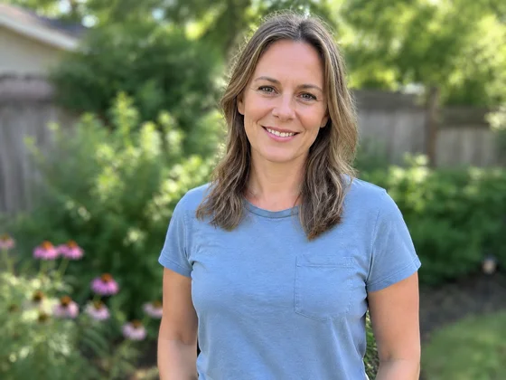</a></td></tr></tbody>
</table>

- **Тип входных данных:** включает предварительный просмотр справочного материала и пример результата.
- **Требования к материалам:** Необходимо добавить портреты или фотографии товаров с глубиной резкости (1 фото) + объекты, которые необходимо сохранить четкими (1 группа).
- **Описание:** Одновременно создается только одно изображение.

[ Проверьте конкретные требования в dearsketch и создайте ](https://dearsketch.com/ru/intent/i233-blur-the-background-to-highlight-a-person-or-product.html?utm_source=github&utm_medium=gallery&utm_campaign=dearsketch-public-cases&utm_content=i233_cta).

---

## I234 · Изменение цвета отдельных предметов, одежды или логотипов на картинке

<table>
<thead><tr><th width="50%">Справочный материал</th><th width="50%">Пример результатов</th></tr></thead>
<tbody><tr><td valign="top">
<strong>Исходное изображение будет частично перекрашено</strong> 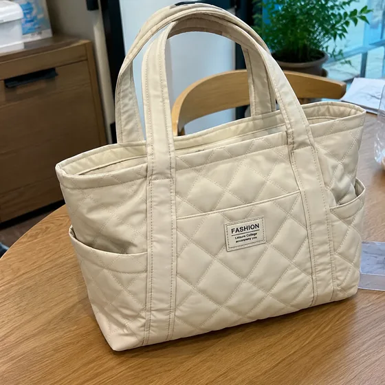
</td><td valign="top"><a href="https://dearsketch.com/ru/intent/i234-change-the-color-of-an-object-garment-or-logo-in-an-image.html?utm_source=github&amp;utm_medium=gallery&amp;utm_campaign=dearsketch-public-cases&amp;utm_content=i234_image">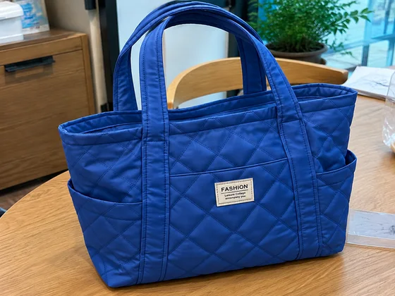</a></td></tr></tbody>
</table>

- **Тип входных данных:** включает предварительный просмотр справочного материала и пример результата.
- **Требования к материалу:** Исходное изображение, которое необходимо частично изменить (1 картинка) + необходимый объект изменения цвета и целевой цвет (1 комплект)
- **Описание:** Одновременно создается только одно изображение.

[ Проверьте конкретные требования в dearsketch и создайте ](https://dearsketch.com/ru/intent/i234-change-the-color-of-an-object-garment-or-logo-in-an-image.html?utm_source=github&utm_medium=gallery&utm_campaign=dearsketch-public-cases&utm_content=i234_cta).

---

## I236 · Исправление закрытых глаз, красных глаз и неестественных выражений лиц на отдельных фотографиях.

<table>
<thead><tr><th width="50%">Справочный материал</th><th width="50%">Пример результатов</th></tr></thead>
<tbody><tr><td valign="top">
<strong>Отдельные фотографии глаз или выражений лица, которые нужно исправить.</strong> 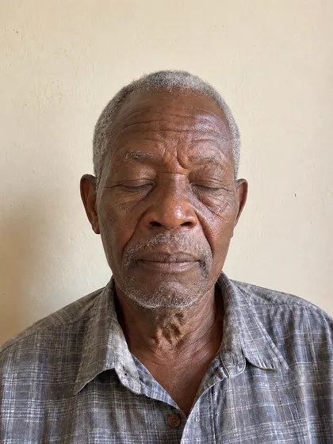
</td><td valign="top"><a href="https://dearsketch.com/ru/intent/i236-fix-closed-eyes-red-eye-or-an-unnatural-expression-in-a-portrait.html?utm_source=github&amp;utm_medium=gallery&amp;utm_campaign=dearsketch-public-cases&amp;utm_content=i236_image">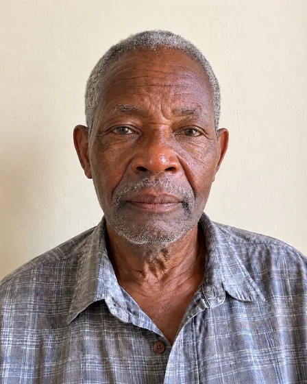</a></td></tr></tbody>
</table>

- **Тип входных данных:** включает предварительный просмотр справочного материала и пример результата.
- **Требования к материалам:** Одна фотография человека, чьи глаза или выражение лица необходимо восстановить (1 фото).
- **Описание:** Одновременно создается только одно изображение.

[ Проверьте конкретные требования в dearsketch и создайте ](https://dearsketch.com/ru/intent/i236-fix-closed-eyes-red-eye-or-an-unnatural-expression-in-a-portrait.html?utm_source=github&utm_medium=gallery&utm_campaign=dearsketch-public-cases&utm_content=i236_cta).

---

## I238 · Превращайте людей, домашних животных или предметы в прозрачные наклейки.

<table>
<thead><tr><th width="50%">Справочный материал</th><th width="50%">Пример результатов</th></tr></thead>
<tbody><tr><td valign="top">
<strong>Фотографии людей, домашних животных или предметов, которые можно превратить в наклейки.</strong> 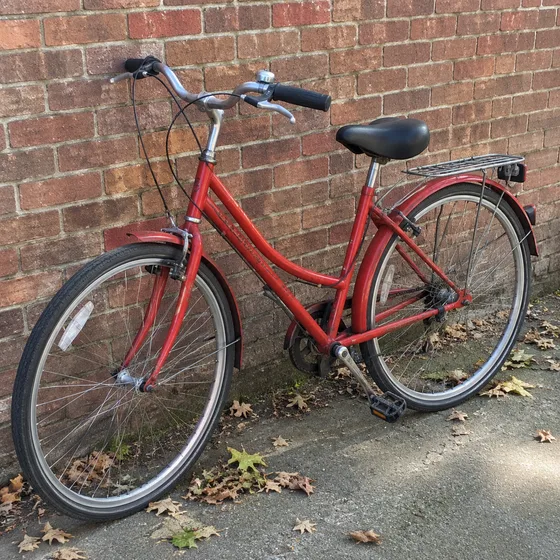
</td><td valign="top"><a href="https://dearsketch.com/ru/intent/i238-turn-a-person-pet-or-object-into-a-transparent-sticker.html?utm_source=github&amp;utm_medium=gallery&amp;utm_campaign=dearsketch-public-cases&amp;utm_content=i238_image">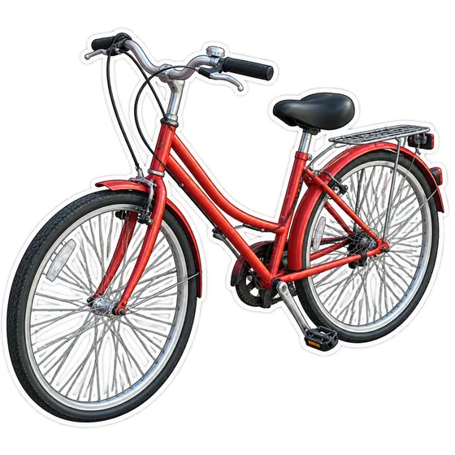</a></td></tr></tbody>
</table>

- **Тип входных данных:** включает предварительный просмотр справочного материала и пример результата.
- **Требования к материалам:** Обязательное фото человека, домашнего животного или объекта для изготовления наклейки (1 фото) + условный корпус наклейки (1 фото)
- **Описание:** Одновременно создается только одно изображение.

[ Проверьте конкретные требования в dearsketch и создайте ](https://dearsketch.com/ru/intent/i238-turn-a-person-pet-or-object-into-a-transparent-sticker.html?utm_source=github&utm_medium=gallery&utm_campaign=dearsketch-public-cases&utm_content=i238_cta).

---

## I239 · Преобразование фотографий в картины маслом, акварелью или рисунки.

<table>
<thead><tr><th width="50%">Справочный материал</th><th width="50%">Пример результатов</th></tr></thead>
<tbody><tr><td valign="top">
<strong>Фотографии людей, домашних животных или сцен, которые можно художественно преобразовать.</strong> 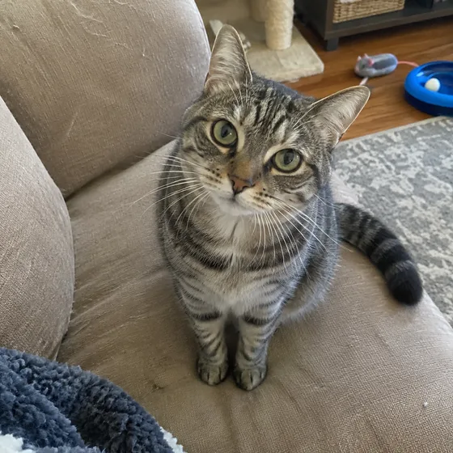
</td><td valign="top"><a href="https://dearsketch.com/ru/intent/i239-turn-a-photo-into-an-oil-painting-watercolor-or-sketch.html?utm_source=github&amp;utm_medium=gallery&amp;utm_campaign=dearsketch-public-cases&amp;utm_content=i239_image">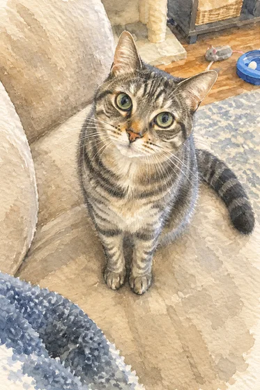</a></td></tr></tbody>
</table>

- **Тип входных данных:** включает предварительный просмотр справочного материала и пример результата.
- **Требования к материалам:** Необходимые фотографии людей, домашних животных или сцен, которые необходимо художественно преобразовать (1 фотография) + дополнительные материалы для рисования (0 или 1 фотография)
- **Описание:** Одновременно создается только одно изображение.

[ Проверьте конкретные требования в dearsketch и создайте ](https://dearsketch.com/ru/intent/i239-turn-a-photo-into-an-oil-painting-watercolor-or-sketch.html?utm_source=github&utm_medium=gallery&utm_campaign=dearsketch-public-cases&utm_content=i239_cta).

---

## I274 · Коррекция недодержки и передержки, восстановление светлых участков и теней.

<table>
<thead><tr><th width="50%">Справочный материал</th><th width="50%">Пример результатов</th></tr></thead>
<tbody><tr><td valign="top">
<strong>Исходное фото, требующее коррекции экспозиции.</strong> 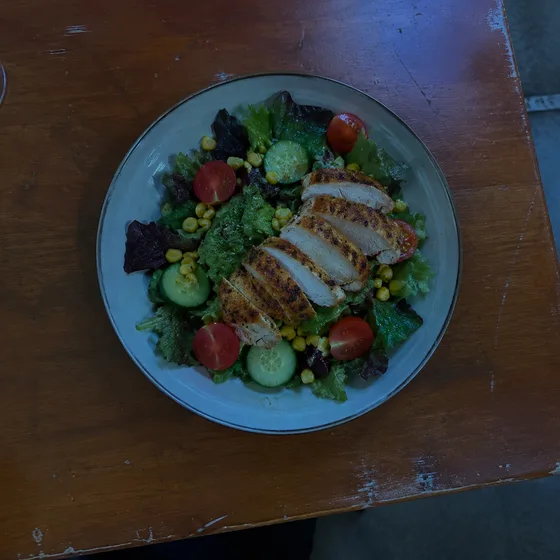
</td><td valign="top"><a href="https://dearsketch.com/ru/intent/i274-correct-exposure-and-recover-highlights-and-shadows.html?utm_source=github&amp;utm_medium=gallery&amp;utm_campaign=dearsketch-public-cases&amp;utm_content=i274_image">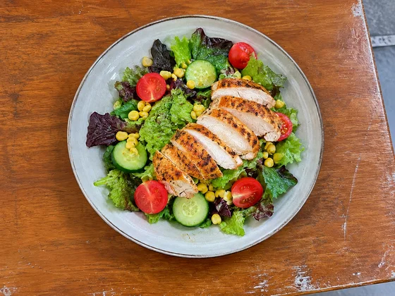</a></td></tr></tbody>
</table>

- **Тип входных данных:** включает предварительный просмотр справочного материала и пример результата.
- **Требования к материалам:** Требуется оригинал фотографии для экспонирования и коррекции (1 фотография).
- **Описание:** Одновременно создается только одно изображение.

[ Проверьте конкретные требования в dearsketch и создайте ](https://dearsketch.com/ru/intent/i274-correct-exposure-and-recover-highlights-and-shadows.html?utm_source=github&utm_medium=gallery&utm_campaign=dearsketch-public-cases&utm_content=i274_cta).

---

## I275 · Правильный баланс белого и цветовой оттенок

<table>
<thead><tr><th width="50%">Справочный материал</th><th width="50%">Пример результатов</th></tr></thead>
<tbody><tr><td valign="top">
<strong>Цветные фотографии, ожидающие коррекции баланса белого</strong> 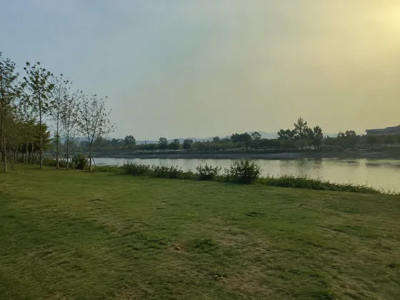
</td><td valign="top"><a href="https://dearsketch.com/ru/intent/i275-correct-white-balance-and-color-casts.html?utm_source=github&amp;utm_medium=gallery&amp;utm_campaign=dearsketch-public-cases&amp;utm_content=i275_image">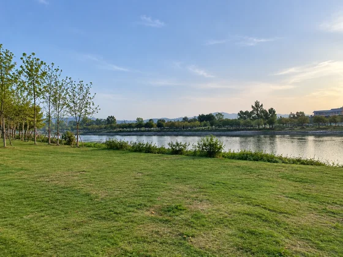</a></td></tr></tbody>
</table>

- **Тип входных данных:** включает предварительный просмотр справочного материала и пример результата.
- **Требования к материалам:** Цветные фотографии (1 фото), требующие коррекции баланса белого.
- **Описание:** Одновременно создается только одно изображение.

[ Проверьте конкретные требования в dearsketch и создайте ](https://dearsketch.com/ru/intent/i275-correct-white-balance-and-color-casts.html?utm_source=github&utm_medium=gallery&utm_campaign=dearsketch-public-cases&utm_content=i275_cta).

---

## I278 · Удаление отметок даты и текста камеры со своих фотографий.

<table>
<thead><tr><th width="50%">Справочный материал</th><th width="50%">Пример результатов</th></tr></thead>
<tbody><tr><td valign="top">
<strong>Ваши собственные фотографии с отметкой даты или наложением камеры.</strong> 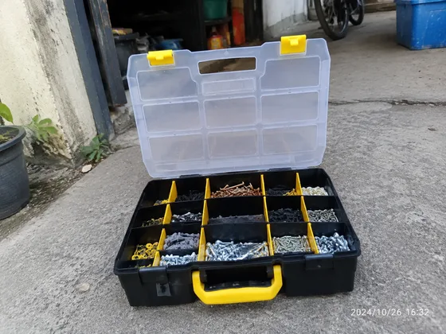
</td><td valign="top"><a href="https://dearsketch.com/ru/intent/i278-remove-a-date-stamp-or-camera-text-from-your-own-photo.html?utm_source=github&amp;utm_medium=gallery&amp;utm_campaign=dearsketch-public-cases&amp;utm_content=i278_image">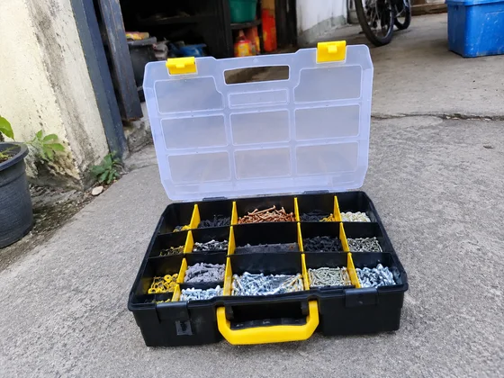</a></td></tr></tbody>
</table>

- **Тип входных данных:** включает предварительный просмотр справочного материала и пример результата.
- **Требования к материалам:** Необходимо иметь собственную фотографию с отметкой даты или наложением камеры (1 фотография).
- **Описание:** Одновременно создается только одно изображение.

[ Проверьте конкретные требования в dearsketch и создайте ](https://dearsketch.com/ru/intent/i278-remove-a-date-stamp-or-camera-text-from-your-own-photo.html?utm_source=github&utm_medium=gallery&utm_campaign=dearsketch-public-cases&utm_content=i278_cta).
